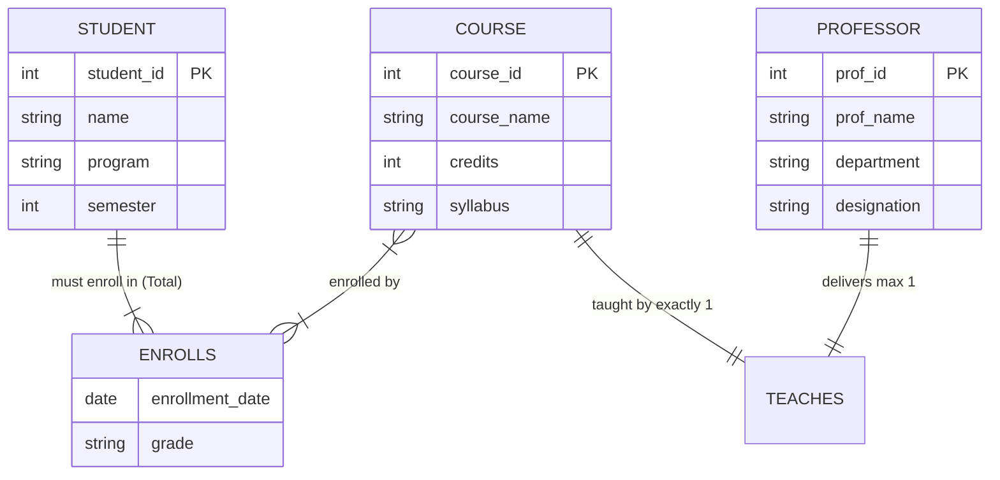
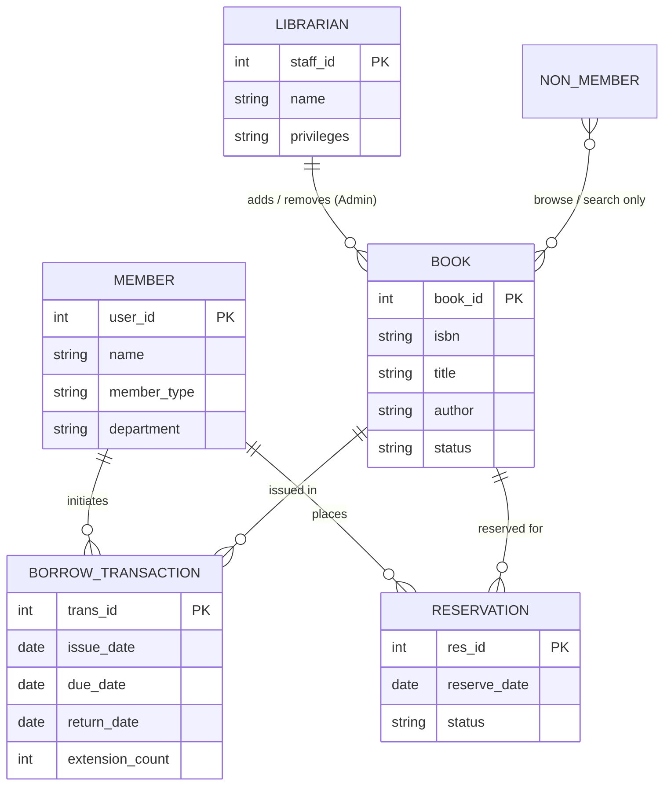
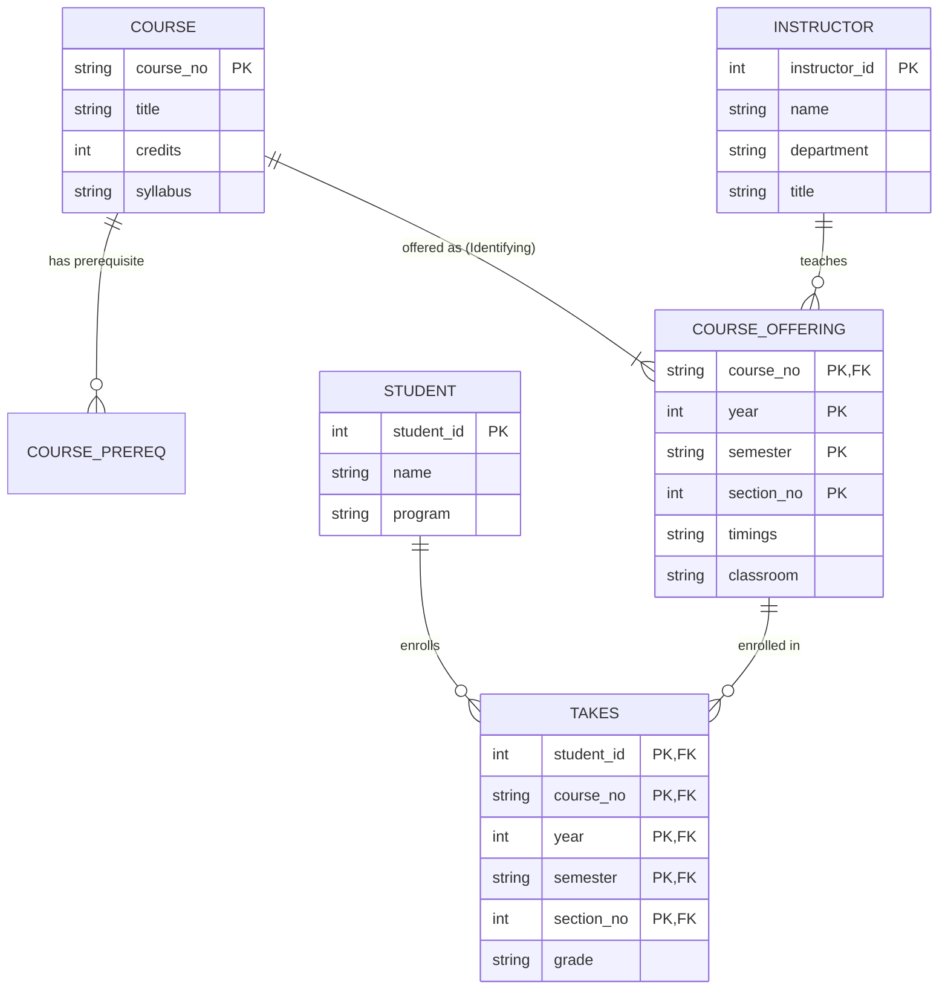
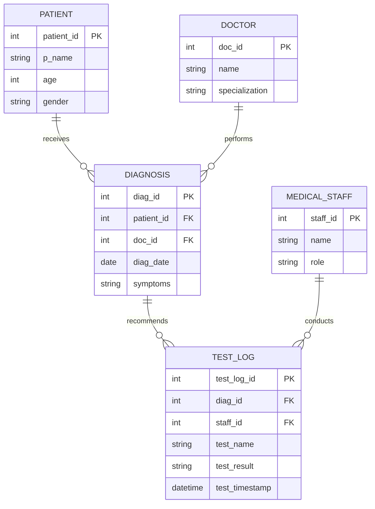

# DBMS Lab Assignments Notes & Complete Solutions
**Course**: CSN15401 - Database Management Systems Lab  
**Department**: Computer Science and Engineering, MNNIT Allahabad  
**Coverage**: Assignments 1 through 10 (Complete Laboratory Curriculum)

---

## Assignment 1: Conceptual ER Modeling

### Question 1: University Scenario
**Problem Statement**:  
In a university, a Student enrolls in Courses. A student must be assigned to at least one or more Courses. Each course is taught by a single Professor. To maintain instruction quality, a Professor can deliver only one course.  
Identify proper entities, attributes, relationships, and cardinalities to draw a suitable ER-diagram.

#### 1. Entity & Attribute Identification
* **Student**:
  * `student_id` (Primary Key / Unique Identifier)
  * `name`, `program`, `semester`
* **Course**:
  * `course_id` (Primary Key / Unique Identifier)
  * `course_name`, `credits`, `syllabus`
* **Professor**:
  * `prof_id` (Primary Key / Unique Identifier)
  * `prof_name`, `department`, `designation`

#### 2. Relationship & Cardinality Analysis
* **Enrolls** (`Student` $\longleftrightarrow$ `Course`):
  * **Cardinality**: Many-to-Many ($M:N$). A student enrolls in 1 or more courses; a course can have many students.
  * **Participation**: Total for `Student` (a student must enroll in at least one course); Partial for `Course`.
  * **Attributes**: `enrollment_date`, `grade`.
* **Teaches / Delivers** (`Professor` $\longleftrightarrow$ `Course`):
  * **Cardinality**: One-to-One ($1:1$). Each course is taught by exactly one professor; each professor delivers at most one course.
  * **Participation**: Total for `Course` (each course must have a professor); Partial/Total for `Professor`.

#### 3. ER Diagram (Mermaid)


---

### Question 2: Library Information System (LIS)
**Problem Statement**:  
An institute has setup a research facility with students (research scholars), professors, and project employees. Develop a Library Information System (LIS) where:
- Members borrow/return books with ease.
- Members can extend borrowing date if no other booking/reservation for that book exists.
- Library staff handle day-to-day transactions.
- Librarian has administrative privileges to add new purchase records or remove condemned books.
- Non-members can browse/search books online, but cannot issue/return books.

#### 1. Entity & Attribute Identification
* **User / Member (Specialization/Generalization)**:
  * Superclass: `User` (`user_id` [PK], `name`, `email`, `role`, `is_member`)
  * Subclasses: `Student_Member`, `Professor_Member`, `Employee_Member`
* **Librarian / Staff**:
  * `staff_id` [PK], `name`, `designation`, `admin_privilege_level`
* **Book**:
  * `book_id` [PK], `isbn`, `title`, `author`, `publisher`, `edition`, `status` ('Available', 'Issued', 'Reserved', 'Condemned')
* **Borrow_Transaction**:
  * `trans_id` [PK], `issue_date`, `due_date`, `return_date`, `extension_count`
* **Reservation / Booking**:
  * `res_id` [PK], `reservation_date`, `priority_status`

#### 2. Relationship & Cardinality Analysis
* **Borrow / Return**: `Member` $\longleftrightarrow$ `Book` through `Borrow_Transaction` ($1:N$). A member can borrow multiple books; a book copy can be borrowed across time.
* **Reserves / Bookings**: `Member` $\longleftrightarrow$ `Book` ($1:N$). A member can reserve books currently on issue.
* **Manages / Catalogues**: `Librarian` $\longleftrightarrow$ `Book` ($1:N$). Librarian inserts new purchases and removes old stock.
* **Online Search**: `User` (including non-members) can query `Book` records ($M:N$ read-only).

#### 3. ER Diagram (Mermaid)


---

## Assignment 2: SQL Commands, DDL, DML & Schema Design

### Question 1: Practicing SQL Commands
#### (a) DDL Commands
```sql
-- (i) Creating a table
CREATE TABLE Sample_Dept (
    dept_id INT PRIMARY KEY,
    dept_name VARCHAR(50) NOT NULL
);

-- (ii) Altering a table (Add column, Modify datatype)
ALTER TABLE Sample_Dept ADD location VARCHAR(100);
ALTER TABLE Sample_Dept MODIFY COLUMN location VARCHAR(150);

-- (iii) Rename a table
RENAME TABLE Sample_Dept TO Department_Records;

-- (iv) Truncating a table (Deletes all rows, resets auto-increment, preserves structure)
TRUNCATE TABLE Department_Records;

-- (v) Drop a table (Deletes entire table definition and data)
DROP TABLE IF EXISTS Department_Records;
```

#### (b) DML Commands & Constraints
```sql
CREATE TABLE Demo_Emp (
    emp_id INT PRIMARY KEY,
    emp_name VARCHAR(50) NOT NULL,
    salary DECIMAL(10,2) CHECK (salary >= 10000),
    status VARCHAR(20) DEFAULT 'Active'
);

-- (i) Inserting Rows
INSERT INTO Demo_Emp (emp_id, emp_name, salary) VALUES (1, 'Rahul', 25000);
INSERT INTO Demo_Emp (emp_id, emp_name, salary, status) VALUES (2, 'Priya', 32000, 'On Leave');

-- (ii) Updating data
UPDATE Demo_Emp SET salary = salary + 3000 WHERE emp_id = 1;

-- (iii) Deleting Rows
DELETE FROM Demo_Emp WHERE emp_id = 2;

-- (iv) Defining constraints (NOT NULL, UNIQUE, CHECK, DEFAULT, FOREIGN KEY)
ALTER TABLE Demo_Emp ADD email VARCHAR(100) UNIQUE;
```

---

### Question 2: Student Records
**Attributes**: `(Roll No, Full name, CGPA, Age, Gender)`

#### (a) Create Table
```sql
CREATE TABLE Student (
    Roll_No INT PRIMARY KEY,
    Full_name VARCHAR(100) NOT NULL,
    CGPA DECIMAL(3,2) CHECK (CGPA BETWEEN 0.0 AND 10.0),
    Age INT CHECK (Age > 0),
    Gender CHAR(1) CHECK (Gender IN ('M', 'F', 'O'))
);

INSERT INTO Student VALUES 
(101, 'Aarav Sharma', 8.45, 20, 'M'),
(102, 'Ananya Sen', 9.12, 19, 'F'),
(103, 'Rohan Verma', 6.20, 21, 'M'),
(104, 'Diya Patel', 7.85, 20, 'F'),
(105, 'Kabir Mehta', 9.50, 22, 'M');
```

#### (b) SQL Queries
```sql
-- (i) List the names of all female students
SELECT Full_name FROM Student WHERE Gender = 'F';

-- (ii) Age of the youngest male student
SELECT MIN(Age) AS Youngest_Male_Age FROM Student WHERE Gender = 'M';

-- (iii) Name and CGPA of students with CGPA > 6.5 ordered by CGPA then name
SELECT Full_name, CGPA FROM Student 
WHERE CGPA > 6.5 
ORDER BY CGPA DESC, Full_name ASC;

-- (iv) What is the Topper name?
SELECT Full_name FROM Student 
WHERE CGPA = (SELECT MAX(CGPA) FROM Student);
```

#### (c) Problem with Age Attribute & Implementation
**Problem**: Age changes every year. Storing it as a static column requires annual updates to all records.  
**Solution**: Store static `DOB` (Date of Birth) instead and calculate age dynamically using `TIMESTAMPDIFF()`.
```sql
-- Alter table schema
ALTER TABLE Student ADD DOB DATE;
ALTER TABLE Student DROP COLUMN Age;

-- Update sample DOBs
UPDATE Student SET DOB = '2004-05-15' WHERE Roll_No = 101;
UPDATE Student SET DOB = '2005-02-10' WHERE Roll_No = 102;

-- Query age dynamically
SELECT Roll_No, Full_name, DOB,
       TIMESTAMPDIFF(YEAR, DOB, CURDATE()) AS Age
FROM Student;
```

---

### Question 3: Supermarket Store Records
**Attributes**: `(item_id, item_name, item_price, expiration_date, quantity_in_hand)`

#### (a) Create Table
```sql
CREATE TABLE Supermarket (
    item_id INT PRIMARY KEY,
    item_name VARCHAR(100) NOT NULL,
    item_price DECIMAL(10,2) NOT NULL,
    expiration_date DATE NOT NULL,
    quantity_in_hand INT DEFAULT 0
);

INSERT INTO Supermarket VALUES
(1, 'Full Cream Milk 1L', 66.00, '2026-03-01', 35),
(2, 'Brown Bread', 45.00, '2026-02-15', 12),
(3, 'Greek Yogurt', 90.00, '2026-04-10', 25),
(4, 'Olive Oil 1L', 850.00, '2027-01-01', 15),
(5, 'Organic Honey 500g', 320.00, '2027-06-30', 8);
```

#### (b) SQL Queries
```sql
-- (i) Names and prices for items with quantity in hand > 20
SELECT item_name, item_price FROM Supermarket 
WHERE quantity_in_hand > 20;

-- (ii) Names of expired items
SELECT item_name FROM Supermarket 
WHERE expiration_date < CURDATE();

-- (iii) Name of the second most expensive item
SELECT item_name FROM Supermarket 
ORDER BY item_price DESC 
LIMIT 1 OFFSET 1;
-- Alternative using subquery:
-- SELECT item_name FROM Supermarket WHERE item_price = (
--     SELECT MAX(item_price) FROM Supermarket WHERE item_price < (SELECT MAX(item_price) FROM Supermarket)
-- );
```

#### (c) Alter Table to Prevent Negative Price
```sql
ALTER TABLE Supermarket ADD CONSTRAINT chk_item_price CHECK (item_price >= 0);
```

---

## Assignment 3: ER-to-Relational Mapping & Schema Modification

### Question 1: University Registrar's Office

#### (a) ER Diagram (Mermaid)


#### (b) Relational Schema
* `Course(course_no [PK], title, credits, syllabus)`
* `Course_Prereq(course_no [FK], prereq_no [FK], PRIMARY KEY(course_no, prereq_no))`
* `Instructor(instructor_id [PK], name, department, title)`
* `Course_Offering(course_no [FK], year, semester, section_no, timings, classroom, instructor_id [FK], PRIMARY KEY(course_no, year, semester, section_no))`
* `Student(student_id [PK], name, program)`
* `Takes(student_id [FK], course_no, year, semester, section_no, grade, PRIMARY KEY(student_id, course_no, year, semester, section_no))`

#### (c) SQL DDL
```sql
CREATE TABLE Course (
    course_no VARCHAR(10) PRIMARY KEY,
    title VARCHAR(100) NOT NULL,
    credits INT CHECK (credits > 0),
    syllabus TEXT
);

CREATE TABLE Course_Prereq (
    course_no VARCHAR(10),
    prereq_no VARCHAR(10),
    PRIMARY KEY (course_no, prereq_no),
    FOREIGN KEY (course_no) REFERENCES Course(course_no) ON DELETE CASCADE,
    FOREIGN KEY (prereq_no) REFERENCES Course(course_no) ON DELETE CASCADE
);

CREATE TABLE Instructor (
    instructor_id INT PRIMARY KEY,
    name VARCHAR(100) NOT NULL,
    department VARCHAR(50) NOT NULL,
    title VARCHAR(50)
);

CREATE TABLE Course_Offering (
    course_no VARCHAR(10),
    year INT,
    semester VARCHAR(10),
    section_no INT,
    timings VARCHAR(50),
    classroom VARCHAR(50),
    instructor_id INT,
    PRIMARY KEY (course_no, year, semester, section_no),
    FOREIGN KEY (course_no) REFERENCES Course(course_no) ON DELETE CASCADE,
    FOREIGN KEY (instructor_id) REFERENCES Instructor(instructor_id) ON DELETE SET NULL
);

CREATE TABLE Student (
    student_id INT PRIMARY KEY,
    name VARCHAR(100) NOT NULL,
    program VARCHAR(50) NOT NULL
);

CREATE TABLE Takes (
    student_id INT,
    course_no VARCHAR(10),
    year INT,
    semester VARCHAR(10),
    section_no INT,
    grade VARCHAR(2),
    PRIMARY KEY (student_id, course_no, year, semester, section_no),
    FOREIGN KEY (student_id) REFERENCES Student(student_id) ON DELETE CASCADE,
    FOREIGN KEY (course_no, year, semester, section_no) 
        REFERENCES Course_Offering(course_no, year, semester, section_no) ON DELETE CASCADE
);
```

---

### Question 2: Hospital OPD Ward

#### (a) ER Diagram (Mermaid)


#### (b) Relational Schema
* `Patient(patient_id [PK], p_name, age, gender)`
* `Doctor(doc_id [PK], name, specialization)`
* `Medical_Staff(staff_id [PK], name, role)`
* `Diagnosis(diag_id [PK], patient_id [FK], doc_id [FK], diag_date, symptoms)`
* `Test_Log(test_log_id [PK], diag_id [FK], staff_id [FK], test_name, test_result, test_timestamp)`

#### (c) SQL DDL
```sql
CREATE TABLE Patient (
    patient_id INT PRIMARY KEY,
    p_name VARCHAR(100) NOT NULL,
    age INT CHECK (age >= 0),
    gender CHAR(1) CHECK (gender IN ('M', 'F', 'O'))
);

CREATE TABLE Doctor (
    doc_id INT PRIMARY KEY,
    name VARCHAR(100) NOT NULL,
    specialization VARCHAR(100) NOT NULL
);

CREATE TABLE Medical_Staff (
    staff_id INT PRIMARY KEY,
    name VARCHAR(100) NOT NULL,
    role VARCHAR(50) NOT NULL
);

CREATE TABLE Diagnosis (
    diag_id INT PRIMARY KEY,
    patient_id INT NOT NULL,
    doc_id INT NOT NULL,
    diag_date DATE NOT NULL,
    symptoms TEXT,
    FOREIGN KEY (patient_id) REFERENCES Patient(patient_id) ON DELETE CASCADE,
    FOREIGN KEY (doc_id) REFERENCES Doctor(doc_id) ON DELETE CASCADE
);

CREATE TABLE Test_Log (
    test_log_id INT PRIMARY KEY,
    diag_id INT NOT NULL,
    staff_id INT NOT NULL,
    test_name VARCHAR(100) NOT NULL,
    test_result VARCHAR(255),
    test_timestamp DATETIME DEFAULT CURRENT_TIMESTAMP,
    FOREIGN KEY (diag_id) REFERENCES Diagnosis(diag_id) ON DELETE CASCADE,
    FOREIGN KEY (staff_id) REFERENCES Medical_Staff(staff_id) ON DELETE RESTRICT
);
```

---

### Question 3: Vehicle Schema Evolution
Given schema: `Vehicle (VehicleID INT PRIMARY KEY, Model VARCHAR(50), Manufacturer VARCHAR(50), Year INT, Price DECIMAL(10,2))`

```sql
-- Initial creation
CREATE TABLE Vehicle (
    VehicleID INT PRIMARY KEY,
    Model VARCHAR(50),
    Manufacturer VARCHAR(50),
    Year INT,
    Price DECIMAL(10,2)
);

-- a. Add a new column Color of type VARCHAR(20)
ALTER TABLE Vehicle ADD Color VARCHAR(20);

-- b. Modify the data type of the column Price to FLOAT
ALTER TABLE Vehicle MODIFY COLUMN Price FLOAT;

-- c. Change the column Year to ManufactureYear
ALTER TABLE Vehicle RENAME COLUMN Year TO ManufactureYear;

-- d. Remove the column Color from the Vehicle table
ALTER TABLE Vehicle DROP COLUMN Color;

-- e. Rename the Vehicle table to VehicleArchive
RENAME TABLE Vehicle TO VehicleArchive;

-- f. Add a column Status to mark if the vehicle is "Available" or "Sold"
ALTER TABLE VehicleArchive ADD Status VARCHAR(10) CHECK (Status IN ('Available', 'Sold'));

-- g. Remove all records from the VehicleArchive table without deleting the table structure
TRUNCATE TABLE VehicleArchive;

-- h. Remove the VehicleArchive table completely from the database
DROP TABLE IF EXISTS VehicleArchive;
```

---

## Assignment 4: Basic DML, Record Management & Simple Filtering

### Benchmark Data Setup Script
```sql
-- 1. Sales Information System Tables
CREATE TABLE Product (
    p_id INT PRIMARY KEY,
    p_name VARCHAR(50),
    mfg_name VARCHAR(50),
    p_rate DECIMAL(10,2),
    sell_price DECIMAL(10,2),
    p_description VARCHAR(100)
);

CREATE TABLE Client (
    c_id INT PRIMARY KEY,
    c_name VARCHAR(50),
    address VARCHAR(100),
    city VARCHAR(50),
    pin INT,
    state VARCHAR(50),
    balance_due DECIMAL(10,2)
);

CREATE TABLE Salesman (
    s_id INT PRIMARY KEY,
    s_name VARCHAR(50),
    address VARCHAR(100),
    city VARCHAR(50),
    pin INT,
    state VARCHAR(50),
    salary DECIMAL(10,2)
);

CREATE TABLE Sales_order_details (
    so_no INT PRIMARY KEY,
    so_date DATE,
    c_id INT,
    s_id INT,
    p_id INT,
    bill_paid VARCHAR(3),
    delivery_date DATE,
    p_rate DECIMAL(10,2),
    quantity INT,
    cancel_date DATE
);

INSERT INTO Product VALUES 
(101, 'Laptop', 'Dell', 45000, 50000, 'Dell Inspiron 15'),
(102, 'Mobile', 'Samsung', 15000, 18000, 'Galaxy M13'),
(103, 'Printer', 'HP', 8000, 9500, 'LaserJet Pro'),
(104, 'Tablet', 'Apple', 30000, 35000, 'iPad 9th Gen');

INSERT INTO Client VALUES 
(201, 'Rahul Sharma', 'Sector 12, Noida', 'Noida', 201301, 'UP', 10000),
(202, 'Priya Singh', 'Park Street', 'Kolkata', 700016, 'WB', 5000),
(203, 'Amit Verma', 'Civil Lines', 'Prayagraj', 211002, 'UP', 7000),
(204, 'Riya Mehta', 'MG Road', 'Bengaluru', 560001, 'Karnataka', 2000);

INSERT INTO Salesman VALUES 
(301, 'Suresh Kumar', 'Sec 10', 'Noida', 201301, 'UP', 35000),
(302, 'Anil Gupta', 'Salt Lake', 'Kolkata', 700091, 'WB', 40000),
(303, 'Neha Jain', 'Indiranagar', 'Bengaluru', 560038, 'Karnataka', 30000);

INSERT INTO Sales_order_details VALUES 
(401, '2025-01-15', 201, 301, 101, 'YES', '2025-01-20', 50000, 2, NULL),
(402, '2025-01-18', 202, 302, 102, 'NO', '2025-01-25', 18000, 3, NULL),
(403, '2025-02-01', 203, 301, 103, 'YES', '2025-02-05', 9500, 1, NULL),
(404, '2025-02-10', 204, 303, 104, 'YES', '2025-02-15', 35000, 2, NULL);

-- 2. Company Office System Tables
CREATE TABLE Employee (
    E_id INT PRIMARY KEY,
    First_Name VARCHAR(50),
    Last_Name VARCHAR(50),
    Salary DECIMAL(10,2),
    Joining_Date DATE,
    Department VARCHAR(50)
);

CREATE TABLE Bonus (
    E_Ref_Id INT,
    Bonus_Date DATE,
    Bonus_Amount DECIMAL(10,2)
);

CREATE TABLE Job_Title (
    E_Ref_Id INT,
    E_Title VARCHAR(50),
    Affected_From DATE
);

INSERT INTO Employee VALUES 
(101, 'Amit', 'Sharma', 50000, '2019-06-15', 'IT'),
(102, 'Neha', 'Verma', 60000, '2020-01-20', 'HR'),
(103, 'Rajesh', 'Gupta', 75000, '2018-09-10', 'Finance'),
(104, 'Priya', 'Mehta', 50000, '2021-03-05', 'Marketing'),
(105, 'Anil', 'Yadav', 45000, '2022-07-12', 'Sales');

INSERT INTO Bonus VALUES 
(101, '2022-12-25', 5000),
(102, '2021-11-15', 7000),
(103, '2022-03-10', 10000),
(104, '2023-01-05', 4000),
(105, '2022-08-20', 3000);

INSERT INTO Job_Title VALUES 
(101, 'Software Engineer', '2019-06-15'),
(102, 'HR Executive', '2020-01-20'),
(103, 'Finance Manager', '2018-09-10'),
(104, 'Marketing Officer', '2021-03-05'),
(105, 'Sales Associate', '2022-07-12');
```

---

### Question 1: Sales Info System Queries
```sql
-- (a) Tables created and data inserted above.
-- (b) Delete all records having delivery date before 30th January, 2025
DELETE FROM Sales_order_details WHERE delivery_date < '2025-01-30';

-- (c) Delete a client who has no pending balance
DELETE FROM Client WHERE balance_due = 0;

-- (d) Delete a canceled order (if any) in table ‘Sales_order_details’
DELETE FROM Sales_order_details WHERE cancel_date IS NOT NULL;

-- (e) Add a new column New_sell_price into the product table
ALTER TABLE Product ADD New_sell_price DECIMAL(10,2);

-- (f) Update the balance of client 202 after payment of 2000
UPDATE Client SET balance_due = balance_due - 2000 WHERE c_id = 202;

-- (g) Change the delivery date of order number 403 to 2025-03-10
UPDATE Sales_order_details SET delivery_date = '2025-03-10' WHERE so_no = 403;

-- (h) Change the bal_due of client_no 201 to 12000
UPDATE Client SET balance_due = 12000 WHERE c_id = 201;

-- (i) Update salary of salesman with ID ‘302’ by increasing it by Rs. 5000
UPDATE Salesman SET salary = salary + 5000 WHERE s_id = 302;

-- (j) List the various products available
SELECT DISTINCT p_name FROM Product;

-- (k) List all clients who are in ‘Prayagraj’
SELECT * FROM Client WHERE city = 'Prayagraj';

-- (l) Products whose selling price is > 10000 and <= 40000
SELECT * FROM Product WHERE sell_price > 10000 AND sell_price <= 40000;

-- (m) Display all clients with balance due > 5000
SELECT * FROM Client WHERE balance_due > 5000;

-- (n) Show products with selling price > 20000
SELECT * FROM Product WHERE sell_price > 20000;

-- (o) List the products in sorted order of their description
SELECT * FROM Product ORDER BY p_description ASC;

-- (p) Display order number and date on which clients placed order
SELECT so_no, so_date, c_id FROM Sales_order_details;

-- (q) Find product with description as ‘Dell Inspiron 15’ and ‘LaserJet Pro’
SELECT * FROM Product WHERE p_description IN ('Dell Inspiron 15', 'LaserJet Pro');

-- (r) List names, city, and state of clients not in the state of ‘UP’
SELECT c_name, city, state FROM Client WHERE state <> 'UP';

-- (s) Retrieve the list of names and the cities of all clients
SELECT c_name, city FROM Client;
```

---

### Question 2: Company Office System Queries
```sql
-- a) Tables created and data inserted above.
-- b) Insert new record in ‘Job_Title’ with E_Ref_Id='106', E_Title='Senior Software Engineer', Affected_From='2022-10-01'
INSERT INTO Job_Title VALUES (106, 'Senior Software Engineer', '2022-10-01');

-- c) Employee with E_Id 104 has resigned. Delete record from employee table
DELETE FROM Employee WHERE E_id = 104;

-- d) Delete job title of employee with ref_id ‘104’
DELETE FROM Job_Title WHERE E_Ref_Id = 104;

-- e) Update salary of employee E_Id ‘101’ by increasing it by Rs 6000
UPDATE Employee SET Salary = Salary + 6000 WHERE E_id = 101;

-- f) Update bonus amount for E_Id ‘103’ to 12000
UPDATE Bonus SET Bonus_Amount = 12000 WHERE E_Ref_Id = 103;

-- g) Update job title of ref_id ‘102’ to ‘HR Manager’
UPDATE Job_Title SET E_Title = 'HR Manager' WHERE E_Ref_Id = 102;

-- h) List last name of employees in upper case
SELECT UPPER(Last_Name) AS Last_Name_Upper FROM Employee;

-- i) Retrieve first three characters of employees from their first name
SELECT SUBSTRING(First_Name, 1, 3) AS Short_First_Name FROM Employee;

-- j) Details of employee whose first name ends with ‘a’ and contains 4 alphabets
SELECT * FROM Employee WHERE First_Name LIKE '___a';

-- k) Details of employees who joined in March 2021
SELECT * FROM Employee WHERE YEAR(Joining_Date) = 2021 AND MONTH(Joining_Date) = 3;

-- l) Fetch employee names with salaries >= 40000 and <= 75000
SELECT First_Name, Last_Name, Salary FROM Employee 
WHERE Salary BETWEEN 40000 AND 75000;

-- m) Print details of employees who are ‘HR Executive’
SELECT e.* FROM Employee e 
JOIN Job_Title j ON e.E_id = j.E_Ref_Id 
WHERE j.E_Title = 'HR Executive';

-- n) List details of employees with the same salary
SELECT * FROM Employee 
WHERE Salary IN (SELECT Salary FROM Employee GROUP BY Salary HAVING COUNT(*) > 1);

-- o) Display all employees who joined after 2020
SELECT * FROM Employee WHERE Joining_Date > '2020-12-31';

-- p) Show all employees working in ‘IT’ department
SELECT * FROM Employee WHERE Department = 'IT';

-- q) List employees with salary greater than 55,000
SELECT * FROM Employee WHERE Salary > 55000;

-- r) Retrieve employees who received a bonus greater than 5000
SELECT e.*, b.Bonus_Amount FROM Employee e 
JOIN Bonus b ON e.E_id = b.E_Ref_Id 
WHERE b.Bonus_Amount > 5000;
```

---

## Assignment 5: Integrity Constraints Enforcement & Verification Testing

### Question 1: Sales Info System Constraints & Verification
```sql
-- (a) Creation and seed insertion completed in Assignment 4.
-- (b) Modify ‘Product’ table: product’s name and manufacturer’s name are not NULL
ALTER TABLE Product MODIFY p_name VARCHAR(50) NOT NULL, MODIFY mfg_name VARCHAR(50) NOT NULL;

-- (c) Modify ‘Client’ table: client’s name is not NULL
ALTER TABLE Client MODIFY c_name VARCHAR(50) NOT NULL;

-- (d) Modify ‘Salesman’ table: salesman’s name is not NULL
ALTER TABLE Salesman MODIFY s_name VARCHAR(50) NOT NULL;

-- (e) Modify ‘Sales_order_details’ table: sales order date is not NULL
ALTER TABLE Sales_order_details MODIFY so_date DATE NOT NULL;

-- (f) Modify ‘Product’ table: product’s rate > 0 and sell_price >= product’s rate
ALTER TABLE Product ADD CONSTRAINT chk_product_rates CHECK (p_rate > 0 AND sell_price >= p_rate);

-- (g) Modify ‘Client’ table: default due balance is 0, and value must be >= 0
ALTER TABLE Client ALTER COLUMN balance_due SET DEFAULT 0;
ALTER TABLE Client ADD CONSTRAINT chk_client_bal CHECK (balance_due >= 0);

-- (h) Modify ‘Salesman’ table: salary > 20000
ALTER TABLE Salesman ADD CONSTRAINT chk_salesman_sal CHECK (salary > 20000);

-- (i) Modify ‘Sales_order_details’ table: bill paid must be ('YES' or 'NO')
ALTER TABLE Sales_order_details ADD CONSTRAINT chk_bill_val CHECK (bill_paid IN ('YES', 'NO'));

-- (j) Modify ‘Sales_order_details’: quantity > 0 and define FKs for c_id, s_id, p_id
ALTER TABLE Sales_order_details ADD CONSTRAINT chk_qty CHECK (quantity > 0);
ALTER TABLE Sales_order_details ADD CONSTRAINT fk_sod_client FOREIGN KEY (c_id) REFERENCES Client(c_id);
ALTER TABLE Sales_order_details ADD CONSTRAINT fk_sod_salesman FOREIGN KEY (s_id) REFERENCES Salesman(s_id);
ALTER TABLE Sales_order_details ADD CONSTRAINT fk_sod_product FOREIGN KEY (p_id) REFERENCES Product(p_id);

-- Constraint Verification Tests:
-- (k) Insert a product without a product name to verify NOT NULL constraint
-- Expected Error: Column 'p_name' cannot be null
INSERT INTO Product (p_id, p_name, mfg_name, p_rate, sell_price) VALUES (105, NULL, 'Asus', 30000, 35000);

-- (l) Insert another client with the same ID = 201 to verify PRIMARY KEY constraint
-- Expected Error: Duplicate entry '201' for key 'PRIMARY'
INSERT INTO Client VALUES (201, 'Same ID Test', 'Street 1', 'Noida', 201301, 'UP', 5000);

-- (m) Insert a salesman with salary Rs 15000 to verify CHECK constraint
-- Expected Error: Check constraint 'chk_salesman_sal' is violated
INSERT INTO Salesman VALUES (305, 'Low Pay', 'Street 2', 'Noida', 201301, 'UP', 15000);

-- (n) Insert a client without specifying due balance amount to verify DEFAULT constraint
INSERT INTO Client (c_id, c_name, address, city, pin, state) VALUES (205, 'Default Tester', 'Aliganj', 'Lucknow', 226024, 'UP');
SELECT c_id, c_name, balance_due FROM Client WHERE c_id = 205; -- Outputs 0.00

-- (o) Insert an order with client_id = ‘210’ to verify FOREIGN KEY constraint
-- Expected Error: Cannot add or update a child row: a foreign key constraint fails
INSERT INTO Sales_order_details (so_no, so_date, c_id, s_id, p_id, bill_paid, delivery_date, p_rate, quantity)
VALUES (405, '2025-02-12', 210, 301, 101, 'YES', '2025-02-18', 50000, 1);

-- Queries:
-- (p) Find name of client, city, state for clients belonging to state ‘UP’ or ‘WB’
SELECT c_name, city, state FROM Client WHERE state IN ('UP', 'WB');

-- (q) Find products priced between 10,000 and 40,000
SELECT * FROM Product WHERE sell_price BETWEEN 10000 AND 40000;

-- (r) Find salesman whose name starts with 'S'
SELECT * FROM Salesman WHERE s_name LIKE 'S%';

-- (s) Find clients whose name contains 'a' alphabet
SELECT * FROM Client WHERE LOWER(c_name) LIKE '%a%';

-- (t) Find clients with due balance amount greater than Rs 5000
SELECT * FROM Client WHERE balance_due > 5000;

-- (u) Find sales orders with ‘total value’ (p_rate * quantity)
SELECT so_no, (p_rate * quantity) AS total_value FROM Sales_order_details;

-- (v) Find all orders placed in February 2025
SELECT * FROM Sales_order_details WHERE YEAR(so_date) = 2025 AND MONTH(so_date) = 2;

-- (w) Increase the salary of the salesmen belonging to ‘WB’ by 10%
UPDATE Salesman SET salary = salary * 1.10 WHERE state = 'WB';
```

---

### Question 2: Company Office System Constraints & Verification
```sql
-- a) Tables and data already present.
-- b) Modify ‘Employee’ table: First_Name, Last_Name, Joining_Date NOT NULL; (First_Name, Last_Name) UNIQUE
ALTER TABLE Employee 
    MODIFY First_Name VARCHAR(50) NOT NULL,
    MODIFY Last_Name VARCHAR(50) NOT NULL,
    MODIFY Joining_Date DATE NOT NULL,
    ADD CONSTRAINT uq_emp_name UNIQUE (First_Name, Last_Name);

-- c) Modify ‘Bonus’ table: date of bonus is NOT NULL
ALTER TABLE Bonus MODIFY Bonus_Date DATE NOT NULL;

-- d) Modify ‘Job_Title’: title and affected_from NOT NULL; E_Ref_Id references Employee(E_id)
ALTER TABLE Job_Title 
    MODIFY E_Title VARCHAR(50) NOT NULL,
    MODIFY Affected_From DATE NOT NULL,
    ADD CONSTRAINT fk_jt_emp FOREIGN KEY (E_Ref_Id) REFERENCES Employee(E_id);

-- e) Modify ‘Employee’: salary >= 20000; department default 'General'
ALTER TABLE Employee ADD CONSTRAINT chk_emp_sal CHECK (Salary >= 20000);
ALTER TABLE Employee ALTER COLUMN Department SET DEFAULT 'General';

-- f) Modify ‘Bonus’: bonus amount >= 500; E_Ref_Id references Employee(E_id)
ALTER TABLE Bonus ADD CONSTRAINT chk_min_bonus CHECK (Bonus_Amount >= 500);
ALTER TABLE Bonus ADD CONSTRAINT fk_bonus_emp FOREIGN KEY (E_Ref_Id) REFERENCES Employee(E_id);

-- Verification Tests:
-- g) Insert name of employee without first name to verify NOT NULL constraint
-- Expected Error: Column 'First_Name' cannot be null
INSERT INTO Employee (E_id, First_Name, Last_Name, Salary, Joining_Date) VALUES (107, NULL, 'Kumar', 30000, '2023-01-01');

-- h) Insert duplicate employee name to verify UNIQUE constraint
-- Expected Error: Duplicate entry 'Amit-Sharma' for key 'uq_emp_name'
INSERT INTO Employee VALUES (108, 'Amit', 'Sharma', 40000, '2023-02-01', 'IT');

-- i) Insert salary below Rs 20000 to verify CHECK constraint
-- Expected Error: Check constraint 'chk_emp_sal' is violated
INSERT INTO Employee VALUES (109, 'Vikas', 'Singh', 18000, '2023-03-01', 'Finance');

-- j) Insert employee without department name to verify DEFAULT constraint
INSERT INTO Employee (E_id, First_Name, Last_Name, Salary, Joining_Date) VALUES (110, 'Sunil', 'Rawat', 25000, '2023-04-01');
SELECT E_id, Department FROM Employee WHERE E_id = 110; -- Outputs 'General'

-- k) Insert bonus with employee not in Employee to verify FOREIGN KEY constraint
-- Expected Error: Cannot add or update a child row: a foreign key constraint fails
INSERT INTO Bonus VALUES (999, '2023-05-01', 5000);

-- Queries:
-- l) Find first name and salary of all employees working in either ‘Finance’ or ‘IT’ department
SELECT First_Name, Salary FROM Employee WHERE Department IN ('Finance', 'IT');

-- m) Find employees who joined the organization between year 2020 and 2022
SELECT * FROM Employee WHERE YEAR(Joining_Date) BETWEEN 2020 AND 2022;

-- n) Find all employees whose first name starts with 'R'
SELECT * FROM Employee WHERE First_Name LIKE 'R%';

-- o) Find all employees whose last name ends with 'a' alphabet
SELECT * FROM Employee WHERE Last_Name LIKE '%a';

-- p) Find all employees whose first name contains 'i' alphabet
SELECT * FROM Employee WHERE LOWER(First_Name) LIKE '%i%';

-- q) Update salary of all employees working in ‘IT’ department by 10%
UPDATE Employee SET Salary = Salary * 1.10 WHERE Department = 'IT';
```

---

## Assignment 6: Aggregate Functions & Group-by Processing

### Question 1: Sales Info System Queries
```sql
-- (a) Count total number of products listed
SELECT COUNT(*) AS total_products FROM Product;

-- (b) Find the average selling price of all products
SELECT AVG(sell_price) AS avg_selling_price FROM Product;

-- (c) Find total balance due from all clients
SELECT SUM(balance_due) AS total_balance_due FROM Client;

-- (d) Find the maximum salary among salesmen
SELECT MAX(salary) AS max_salesman_salary FROM Salesman;

-- (e) Get total sales amount per order (product rate * quantity)
SELECT so_no, (p_rate * quantity) AS total_sales_amount FROM Sales_order_details;

-- (f) Find all orders delivered in February 2025
SELECT * FROM Sales_order_details 
WHERE YEAR(delivery_date) = 2025 AND MONTH(delivery_date) = 2;

-- (g) Find the earliest order date placed by any client
SELECT MIN(so_date) AS earliest_order_date FROM Sales_order_details;

-- (h) Find orders where bill was not paid by party
SELECT * FROM Sales_order_details WHERE bill_paid = 'NO';

-- (i) Find clients whose orders were delivered within 5 days of order date
SELECT DISTINCT c_id, so_no FROM Sales_order_details 
WHERE DATEDIFF(delivery_date, so_date) <= 5;

-- (j) List total orders placed by each client
SELECT c_id, COUNT(so_no) AS total_orders FROM Sales_order_details GROUP BY c_id;

-- (k) Calculate total sales done by each salesman
SELECT s_id, SUM(p_rate * quantity) AS total_sales_done FROM Sales_order_details GROUP BY s_id;

-- (l) Find the number of clients from each city
SELECT city, COUNT(c_id) AS client_count FROM Client GROUP BY city;

-- (m) Find the average product rate sold by each salesman
SELECT s_id, AVG(p_rate) AS avg_product_rate FROM Sales_order_details GROUP BY s_id;

-- (n) List clients with due balance greater than average due balance
SELECT * FROM Client 
WHERE balance_due > (SELECT AVG(balance_due) FROM Client);

-- (o) Find total quantity of products ordered by each client
SELECT c_id, SUM(quantity) AS total_quantity FROM Sales_order_details GROUP BY c_id;

-- (p) Get the product(s) with the highest selling price
SELECT * FROM Product 
WHERE sell_price = (SELECT MAX(sell_price) FROM Product);

-- (q) Show salesmen earning more than average salary
SELECT * FROM Salesman 
WHERE salary > (SELECT AVG(salary) FROM Salesman);

-- (r) Find number of orders handled by each salesman (using HAVING for filtering)
SELECT s_id, COUNT(so_no) AS order_count 
FROM Sales_order_details 
GROUP BY s_id 
HAVING COUNT(so_no) >= 1;

-- (s) Display all orders sorted by total bill in descending order
SELECT so_no, (p_rate * quantity) AS total_bill 
FROM Sales_order_details 
ORDER BY total_bill DESC;
```

---

### Question 2: Company Office System Queries
```sql
-- a) Find the total number of employees in the company
SELECT COUNT(*) AS total_employees FROM Employee;

-- b) Find the total salary paid to all employees
SELECT SUM(Salary) AS total_salary_payroll FROM Employee;

-- c) Find the average salary of employees in the ‘Finance’ department
SELECT AVG(Salary) AS avg_finance_salary FROM Employee WHERE Department = 'Finance';

-- d) Display the highest and lowest salary among employees
SELECT MAX(Salary) AS Highest_Salary, MIN(Salary) AS Lowest_Salary FROM Employee;

-- e) Find the employees who joined in the year ‘2020’
SELECT * FROM Employee WHERE YEAR(Joining_Date) = 2020;

-- f) Find the total bonus amount paid by the company
SELECT SUM(Bonus_Amount) AS total_bonus_paid FROM Bonus;

-- g) Show the total number of distinct job titles present
SELECT COUNT(DISTINCT E_Title) AS distinct_job_titles FROM Job_Title;

-- h) Show the difference between highest and lowest salary of an employee
SELECT (MAX(Salary) - MIN(Salary)) AS Salary_Difference FROM Employee;

-- i) Find the month in which each employee joined (using date function)
SELECT E_id, First_Name, MONTHNAME(Joining_Date) AS Joining_Month FROM Employee;

-- j) Display employees who have worked for more than 3 years
SELECT * FROM Employee 
WHERE TIMESTAMPDIFF(YEAR, Joining_Date, CURDATE()) > 3;

-- k) Display all employee details ordered by their salary in descending order
SELECT * FROM Employee ORDER BY Salary DESC;

-- l) Count how many employees work in each department
SELECT Department, COUNT(E_id) AS Employee_Count FROM Employee GROUP BY Department;

-- m) Find departments that have more than ‘1’ employee
SELECT Department, COUNT(E_id) AS Employee_Count 
FROM Employee 
GROUP BY Department 
HAVING COUNT(E_id) > 1;

-- n) Show total salary paid department-wise
SELECT Department, SUM(Salary) AS Total_Department_Salary FROM Employee GROUP BY Department;

-- o) Find employees whose salary is above the company’s average salary
SELECT * FROM Employee 
WHERE Salary > (SELECT AVG(Salary) FROM Employee);

-- p) Display all employees who have received any bonus
SELECT DISTINCT e.* FROM Employee e 
JOIN Bonus b ON e.E_id = b.E_Ref_Id 
WHERE b.Bonus_Amount > 0;

-- q) Find the employee(s) who got the maximum bonus amount
SELECT e.*, b.Bonus_Amount FROM Employee e 
JOIN Bonus b ON e.E_id = b.E_Ref_Id 
WHERE b.Bonus_Amount = (SELECT MAX(Bonus_Amount) FROM Bonus);
```

---

## Assignment 7: Relational Joins & Multi-Table Complex Queries

### Question 1: Sales Info System Joins
```sql
-- (a) List all sales orders with client details
SELECT sod.*, c.c_name, c.address, c.city, c.state, c.balance_due 
FROM Sales_order_details sod 
JOIN Client c ON sod.c_id = c.c_id;

-- (b) List sales orders with salesman details
SELECT sod.*, s.s_name, s.city AS salesman_city, s.salary 
FROM Sales_order_details sod 
JOIN Salesman s ON sod.s_id = s.s_id;

-- (c) Find all salesmen who handled orders in ‘Prayagraj’
SELECT DISTINCT s.* 
FROM Salesman s 
JOIN Sales_order_details sod ON s.s_id = sod.s_id 
JOIN Client c ON sod.c_id = c.c_id 
WHERE c.city = 'Prayagraj';

-- (d) Find total sales amount handled by each salesman
SELECT s.s_id, s.s_name, SUM(sod.p_rate * sod.quantity) AS Total_Sales_Handled 
FROM Salesman s 
JOIN Sales_order_details sod ON s.s_id = sod.s_id 
GROUP BY s.s_id, s.s_name;

-- (e) Count number of orders placed by each client
SELECT c.c_id, c.c_name, COUNT(sod.so_no) AS Order_Count 
FROM Client c 
LEFT JOIN Sales_order_details sod ON c.c_id = sod.c_id 
GROUP BY c.c_id, c.c_name;

-- (f) Find average product rate ordered by each client
SELECT c.c_id, c.c_name, AVG(sod.p_rate) AS Avg_Product_Rate 
FROM Client c 
JOIN Sales_order_details sod ON c.c_id = sod.c_id 
GROUP BY c.c_id, c.c_name;

-- (g) Show clients with total purchases above ‘5000’
SELECT c.c_id, c.c_name, SUM(sod.p_rate * sod.quantity) AS Total_Purchases 
FROM Client c 
JOIN Sales_order_details sod ON c.c_id = sod.c_id 
GROUP BY c.c_id, c.c_name 
HAVING Total_Purchases > 5000;

-- (h) Show highest and lowest salary of salesmen who handled orders
SELECT MAX(s.salary) AS Max_Salary, MIN(s.salary) AS Min_Salary 
FROM Salesman s 
WHERE s.s_id IN (SELECT DISTINCT s_id FROM Sales_order_details);

-- (i) Find total sales done per city
SELECT c.city, SUM(sod.p_rate * sod.quantity) AS Total_Sales_In_City 
FROM Client c 
JOIN Sales_order_details sod ON c.c_id = sod.c_id 
GROUP BY c.city;

-- (j) Show clients who still have pending balance
SELECT * FROM Client WHERE balance_due > 0;

-- (k) Show yearly total sales
SELECT YEAR(so_date) AS Order_Year, SUM(p_rate * quantity) AS Yearly_Sales 
FROM Sales_order_details 
GROUP BY YEAR(so_date);

-- (l) Find total monthly sales along with product name and id
SELECT p.p_id, p.p_name, MONTH(sod.so_date) AS Order_Month, 
       SUM(sod.p_rate * sod.quantity) AS Monthly_Sales 
FROM Sales_order_details sod 
JOIN Product p ON sod.p_id = p.p_id 
GROUP BY p.p_id, p.p_name, MONTH(sod.so_date);

-- (m) Show salesmen who handled orders but live in a different city than client
SELECT DISTINCT s.s_id, s.s_name, s.city AS Salesman_City, 
       c.c_id, c.c_name, c.city AS Client_City 
FROM Sales_order_details sod 
JOIN Salesman s ON sod.s_id = s.s_id 
JOIN Client c ON sod.c_id = c.c_id 
WHERE s.city <> c.city;

-- (n) Find top 3 clients with maximum purchase amounts
SELECT c.c_id, c.c_name, SUM(sod.p_rate * sod.quantity) AS Total_Purchase 
FROM Client c 
JOIN Sales_order_details sod ON c.c_id = sod.c_id 
GROUP BY c.c_id, c.c_name 
ORDER BY Total_Purchase DESC 
LIMIT 3;

-- (o) Find cancelled orders with client details
SELECT sod.*, c.c_name, c.city 
FROM Sales_order_details sod 
JOIN Client c ON sod.c_id = c.c_id 
WHERE sod.cancel_date IS NOT NULL;

-- (p) Find average salary of salesmen handling more than 2 orders
SELECT AVG(salary) AS Avg_Salary 
FROM Salesman 
WHERE s_id IN (
    SELECT s_id FROM Sales_order_details GROUP BY s_id HAVING COUNT(so_no) > 2
);

-- (q) Show all orders along with salesman salaries sorted by salary
SELECT sod.so_no, sod.so_date, s.s_name, s.salary 
FROM Sales_order_details sod 
JOIN Salesman s ON sod.s_id = s.s_id 
ORDER BY s.salary ASC;

-- (r) Find number of orders handled by each salesman per year
SELECT s_id, YEAR(so_date) AS Sales_Year, COUNT(so_no) AS Orders_Count 
FROM Sales_order_details 
GROUP BY s_id, YEAR(so_date);
```

---

### Question 2: Company Office System Joins
```sql
-- (a) List all employee details along with their bonus details
SELECT e.*, b.Bonus_Date, b.Bonus_Amount 
FROM Employee e 
LEFT JOIN Bonus b ON e.E_id = b.E_Ref_Id;

-- (b) Find all employees who got a bonus above ‘5000’
SELECT e.*, b.Bonus_Amount 
FROM Employee e 
JOIN Bonus b ON e.E_id = b.E_Ref_Id 
WHERE b.Bonus_Amount > 5000;

-- (c) Find total bonus paid by the company department-wise
SELECT e.Department, SUM(b.Bonus_Amount) AS Total_Dept_Bonus 
FROM Employee e 
JOIN Bonus b ON e.E_id = b.E_Ref_Id 
GROUP BY e.Department;

-- (d) Find employee with minimum bonus
SELECT e.*, b.Bonus_Amount 
FROM Employee e 
JOIN Bonus b ON e.E_id = b.E_Ref_Id 
WHERE b.Bonus_Amount = (SELECT MIN(Bonus_Amount) FROM Bonus);

-- (e) Find employees whose bonus amount is not NULL
SELECT e.*, b.Bonus_Amount 
FROM Employee e 
JOIN Bonus b ON e.E_id = b.E_Ref_Id 
WHERE b.Bonus_Amount IS NOT NULL;

-- (f) Employees who have bonus > 5000 and salary > average salary
SELECT e.*, b.Bonus_Amount 
FROM Employee e 
JOIN Bonus b ON e.E_id = b.E_Ref_Id 
WHERE b.Bonus_Amount > 5000 
  AND e.Salary > (SELECT AVG(Salary) FROM Employee);

-- (g) Find total salary expense department-wise
SELECT Department, SUM(Salary) AS Total_Salary_Expense 
FROM Employee 
GROUP BY Department;

-- (h) List employees with bonus and calculate total compensation (salary + bonus)
SELECT e.E_id, e.First_Name, e.Salary, b.Bonus_Amount, 
       (e.Salary + b.Bonus_Amount) AS Total_Compensation 
FROM Employee e 
JOIN Bonus b ON e.E_id = b.E_Ref_Id;

-- (i) Find employees who did not receive any bonus
SELECT e.* 
FROM Employee e 
LEFT JOIN Bonus b ON e.E_id = b.E_Ref_Id 
WHERE b.Bonus_Amount IS NULL;

-- (j) Count number of employees with each designation
SELECT E_Title, COUNT(E_Ref_Id) AS Designation_Count 
FROM Job_Title 
GROUP BY E_Title;

-- (k) Find employees with bonuses more than the average bonus
SELECT e.*, b.Bonus_Amount 
FROM Employee e 
JOIN Bonus b ON e.E_id = b.E_Ref_Id 
WHERE b.Bonus_Amount > (SELECT AVG(Bonus_Amount) FROM Bonus);

-- (l) Show employees who joined in the same year they received a bonus
SELECT e.E_id, e.First_Name, e.Joining_Date, b.Bonus_Date 
FROM Employee e 
JOIN Bonus b ON e.E_id = b.E_Ref_Id 
WHERE YEAR(e.Joining_Date) = YEAR(b.Bonus_Date);

-- (m) Find the difference in years between joining date and bonus date
SELECT e.First_Name, 
       TIMESTAMPDIFF(YEAR, e.Joining_Date, b.Bonus_Date) AS Gap_In_Years 
FROM Employee e 
JOIN Bonus b ON e.E_id = b.E_Ref_Id;

-- (n) Find department with total bonuses greater than Rs 10,000
SELECT e.Department, SUM(b.Bonus_Amount) AS Total_Bonus 
FROM Employee e 
JOIN Bonus b ON e.E_id = b.E_Ref_Id 
GROUP BY e.Department 
HAVING SUM(b.Bonus_Amount) > 10000;

-- (o) Find all employees who received bonus in the month of ‘December’
SELECT e.*, b.Bonus_Date 
FROM Employee e 
JOIN Bonus b ON e.E_id = b.E_Ref_Id 
WHERE MONTHNAME(b.Bonus_Date) = 'December';

-- (p) Find all employees whose bonus is more than 10% of their salary
SELECT e.*, b.Bonus_Amount 
FROM Employee e 
JOIN Bonus b ON e.E_id = b.E_Ref_Id 
WHERE b.Bonus_Amount > (0.10 * e.Salary);
```

---

## Assignment 8: Subqueries, Nested Queries & Views

### Question 1: Sales Info System Queries
```sql
-- (a) Find clients whose balance is above average balance
SELECT * FROM Client WHERE balance_due > (SELECT AVG(balance_due) FROM Client);

-- (b) Find salesman with highest salary
SELECT * FROM Salesman WHERE salary = (SELECT MAX(salary) FROM Salesman);

-- (c) List all products with price greater than average product price
SELECT * FROM Product WHERE sell_price > (SELECT AVG(sell_price) FROM Product);

-- (d) Show clients who have placed any order(s)
SELECT * FROM Client WHERE c_id IN (SELECT DISTINCT c_id FROM Sales_order_details);

-- (e) Show salesmen who have not handled any orders
SELECT * FROM Salesman WHERE s_id NOT IN (SELECT DISTINCT s_id FROM Sales_order_details);

-- (f) Find the latest order placed by each client
SELECT sod.* FROM Sales_order_details sod 
WHERE sod.so_date = (
    SELECT MAX(sub.so_date) FROM Sales_order_details sub WHERE sub.c_id = sod.c_id
);

-- (g) Find client name and total quantity they ordered
SELECT c.c_name, 
       (SELECT SUM(quantity) FROM Sales_order_details WHERE c_id = c.c_id) AS total_qty 
FROM Client c;

-- (h) Find product(s) with highest rate
SELECT * FROM Product WHERE p_rate = (SELECT MAX(p_rate) FROM Product);

-- (i) Find salesman who handled orders with total sales above 5000
SELECT * FROM Salesman 
WHERE s_id IN (
    SELECT s_id FROM Sales_order_details GROUP BY s_id HAVING SUM(p_rate * quantity) > 5000
);

-- (j) List all orders whose client is from the same city as their salesman
SELECT * FROM Sales_order_details sod 
WHERE (SELECT city FROM Client WHERE c_id = sod.c_id) = 
      (SELECT city FROM Salesman WHERE s_id = sod.s_id);

-- (k) Insert new client with balance equal to max existing balance (Hint: INSERT + subquery)
INSERT INTO Client (c_id, c_name, address, city, pin, state, balance_due)
SELECT 205, 'Rohit Kumar', 'ABC Street', 'Delhi', 110001, 'Delhi', MAX(balance_due) 
FROM Client;

-- (l) Insert new product with rate equal to average product rate
INSERT INTO Product (p_id, p_name, mfg_name, p_rate, sell_price, p_description)
SELECT 501, 'Desktop computer', 'HCL', AVG(p_rate), 35000, 'HCL Desktop' 
FROM Product;

-- (m) Update all salesman salaries to 10% more than avg salary (Hint: UPDATE + subquery)
UPDATE Salesman 
SET salary = (SELECT 1.10 * AVG(salary) FROM (SELECT salary FROM Salesman) AS temp);

-- (n) Update all clients’ balance to max balance if they are from 'Mumbai'
UPDATE Client 
SET balance_due = (SELECT MAX(balance_due) FROM (SELECT balance_due FROM Client) AS temp) 
WHERE city = 'Mumbai';

-- (o) Delete all orders whose client balance is zero (Hint: DELETE + subquery)
DELETE FROM Sales_order_details 
WHERE c_id IN (SELECT c_id FROM Client WHERE balance_due = 0);

-- (p) Create a view to see client name, city, and total purchase
CREATE OR REPLACE VIEW View_Client_Purchases AS
SELECT c.c_name, c.city, COALESCE(SUM(sod.p_rate * sod.quantity), 0) AS Total_Purchase 
FROM Client c 
LEFT JOIN Sales_order_details sod ON c.c_id = sod.c_id 
GROUP BY c.c_name, c.city;

-- (q) Create a view for a salesman’s performance measured by total sales order placed
CREATE OR REPLACE VIEW View_Salesman_Performance AS
SELECT s.s_id, s.s_name, COUNT(sod.so_no) AS Total_Orders_Placed 
FROM Salesman s 
LEFT JOIN Sales_order_details sod ON s.s_id = sod.s_id 
GROUP BY s.s_id, s.s_name;
```

---

### Question 2: Company Office System Queries
```sql
-- (a) Find names of employees earning more than average salary
SELECT First_Name, Last_Name FROM Employee 
WHERE Salary > (SELECT AVG(Salary) FROM Employee);

-- (b) Find employees who got a bonus greater than 5000
SELECT * FROM Employee 
WHERE E_id IN (SELECT E_Ref_Id FROM Bonus WHERE Bonus_Amount > 5000);

-- (c) Display employee names and their bonus amount if they got any
SELECT First_Name, 
       (SELECT Bonus_Amount FROM Bonus WHERE E_Ref_Id = Employee.E_id) AS Bonus 
FROM Employee;

-- (d) Get details of employees who have not received any bonus
SELECT * FROM Employee 
WHERE E_id NOT IN (SELECT E_Ref_Id FROM Bonus);

-- (e) Find employees who joined before the earliest joining date in Sales department
SELECT * FROM Employee 
WHERE Joining_Date < (SELECT MIN(Joining_Date) FROM Employee WHERE Department = 'Sales');

-- (f) Show employees having job title 'Manager' using subquery
SELECT * FROM Employee 
WHERE E_id IN (SELECT E_Ref_Id FROM Job_Title WHERE E_Title LIKE '%Manager%');

-- (g) Find the highest salary employee and their job title
SELECT e.First_Name, e.Salary, 
       (SELECT E_Title FROM Job_Title WHERE E_Ref_Id = e.E_id) AS Title 
FROM Employee e 
WHERE e.Salary = (SELECT MAX(Salary) FROM Employee);

-- (h) Count employees who got bonus after “2022-01-01”
SELECT COUNT(DISTINCT E_Ref_Id) AS Count_Employees 
FROM Bonus 
WHERE Bonus_Date > '2022-01-01';

-- (i) Insert a new bonus for employee with highest salary (Bonus_Date=’2023-12-31’, Bonus_Amount=8000)
INSERT INTO Bonus (E_Ref_Id, Bonus_Date, Bonus_Amount)
SELECT E_id, '2023-12-31', 8000 
FROM Employee 
WHERE Salary = (SELECT MAX(Salary) FROM (SELECT Salary FROM Employee) AS temp);

-- (j) Insert new employee with salary 10% higher than average (E_id=106, Ravi Patel, 2023-09-01, IT)
INSERT INTO Employee (E_id, First_Name, Last_Name, Salary, Joining_Date, Department)
SELECT 106, 'Ravi', 'Patel', 1.10 * AVG(Salary), '2023-09-01', 'IT' 
FROM Employee;

-- (k) Increase salary by 5% for employees who got bonus less than ‘5000’
UPDATE Employee 
SET Salary = Salary * 1.05 
WHERE E_id IN (SELECT E_Ref_Id FROM Bonus WHERE Bonus_Amount < 5000);

-- (l) Update department to 'Admin' for the employee with the lowest salary
UPDATE Employee 
SET Department = 'Admin' 
WHERE Salary = (SELECT MIN(Salary) FROM (SELECT Salary FROM Employee) AS temp);

-- (m) Delete all bonus records of employees from ‘HR’ department
DELETE FROM Bonus 
WHERE E_Ref_Id IN (SELECT E_id FROM Employee WHERE Department = 'HR');

-- (n) Delete all employees who have never received any bonus
DELETE FROM Employee 
WHERE E_id NOT IN (SELECT E_Ref_Id FROM Bonus);

-- (o) Create a view showing employee name, salary, and bonus amount
CREATE OR REPLACE VIEW View_Emp_Bonus_Summary AS
SELECT e.First_Name, e.Last_Name, e.Salary, b.Bonus_Amount 
FROM Employee e 
LEFT JOIN Bonus b ON e.E_id = b.E_Ref_Id;

-- (p) Create a view showing only ‘IT’ department employees
CREATE OR REPLACE VIEW View_IT_Employees AS
SELECT * FROM Employee WHERE Department = 'IT';
```

---

## Assignment 9: Database Triggers & Automated Business Logic

### Audit & Counter Tables Setup
```sql
CREATE TABLE Client_Audit_Log (
    log_id INT AUTO_INCREMENT PRIMARY KEY,
    client_id INT,
    action_type VARCHAR(50),
    log_timestamp DATETIME DEFAULT CURRENT_TIMESTAMP
);

CREATE TABLE Salesman_Salary_Log (
    log_id INT AUTO_INCREMENT PRIMARY KEY,
    salesman_id INT,
    old_salary DECIMAL(10,2),
    new_salary DECIMAL(10,2),
    log_timestamp DATETIME DEFAULT CURRENT_TIMESTAMP
);

CREATE TABLE Product_Counters (
    counter_name VARCHAR(50) PRIMARY KEY,
    total_count INT DEFAULT 0
);
INSERT INTO Product_Counters VALUES ('products_added', 0), ('products_deleted', 0);

CREATE TABLE Employee_Salary_Log (
    log_id INT AUTO_INCREMENT PRIMARY KEY,
    emp_id INT,
    old_salary DECIMAL(10,2),
    new_salary DECIMAL(10,2),
    log_timestamp DATETIME DEFAULT CURRENT_TIMESTAMP
);
```

---

### Question 1: Sales Info System Triggers
```sql
DELIMITER //

-- (a) Set default product description as ‘No description available’ if not specified
CREATE TRIGGER trg_a_product_default_desc
BEFORE INSERT ON Product
FOR EACH ROW
BEGIN
    IF NEW.p_description IS NULL OR TRIM(NEW.p_description) = '' THEN
        SET NEW.p_description = 'No description available';
    END IF;
END //

-- (b) Automatically set delivery date = order_date + 5 days
CREATE TRIGGER trg_b_auto_delivery_date
BEFORE INSERT ON Sales_order_details
FOR EACH ROW
BEGIN
    IF NEW.delivery_date IS NULL THEN
        SET NEW.delivery_date = DATE_ADD(NEW.so_date, INTERVAL 5 DAY);
    END IF;
END //

-- (c) Log/record for every new client added (client_id, action: 'client added', datetime)
CREATE TRIGGER trg_c_log_client_added
AFTER INSERT ON Client
FOR EACH ROW
BEGIN
    INSERT INTO Client_Audit_Log (client_id, action_type, log_timestamp)
    VALUES (NEW.c_id, 'client added', NOW());
END //

-- (d) Prevent inserting product details with negative price
CREATE TRIGGER trg_d_prevent_negative_price
BEFORE INSERT ON Product
FOR EACH ROW
BEGIN
    IF NEW.sell_price < 0 OR NEW.p_rate < 0 THEN
        SIGNAL SQLSTATE '45000'
        SET MESSAGE_TEXT = 'Error: Product rates and selling prices cannot be negative!';
    END IF;
END //

-- (e) Update client’s balance after new order is placed for that client
CREATE TRIGGER trg_e_update_client_bal_insert
AFTER INSERT ON Sales_order_details
FOR EACH ROW
BEGIN
    UPDATE Client 
    SET balance_due = balance_due + (NEW.p_rate * NEW.quantity)
    WHERE c_id = NEW.c_id;
END //

-- (f) Reduce client’s balance when an order is deleted for that client
CREATE TRIGGER trg_f_reduce_client_bal_delete
AFTER DELETE ON Sales_order_details
FOR EACH ROW
BEGIN
    UPDATE Client 
    SET balance_due = balance_due - (OLD.p_rate * OLD.quantity)
    WHERE c_id = OLD.c_id;
END //

-- (g) Update product rate in sales order details table if product rate changes in product table
CREATE TRIGGER trg_g_cascade_product_rate_update
AFTER UPDATE ON Product
FOR EACH ROW
BEGIN
    IF OLD.p_rate <> NEW.p_rate THEN
        UPDATE Sales_order_details 
        SET p_rate = NEW.p_rate 
        WHERE p_id = NEW.p_id;
    END IF;
END //

-- (h) Check salesman salary cannot drop below 10000
CREATE TRIGGER trg_h_check_min_salesman_salary
BEFORE UPDATE ON Salesman
FOR EACH ROW
BEGIN
    IF NEW.salary < 10000 THEN
        SIGNAL SQLSTATE '45000'
        SET MESSAGE_TEXT = 'Error: Salesman salary cannot drop below Rs 10000!';
    END IF;
END //

-- (i) Log/record for deleted clients showing client_id and datetime of deletion
CREATE TRIGGER trg_i_log_client_deleted
AFTER DELETE ON Client
FOR EACH ROW
BEGIN
    INSERT INTO Client_Audit_Log (client_id, action_type, log_timestamp)
    VALUES (OLD.c_id, 'client deleted', NOW());
END //

-- (j) Automatically capitalize product name before insertion
CREATE TRIGGER trg_j_capitalize_product_name
BEFORE INSERT ON Product
FOR EACH ROW
BEGIN
    SET NEW.p_name = UPPER(NEW.p_name);
END //

-- (k) Block order if client has unpaid balance > 10000
CREATE TRIGGER trg_k_block_unpaid_client_order
BEFORE INSERT ON Sales_order_details
FOR EACH ROW
BEGIN
    DECLARE v_bal DECIMAL(10,2);
    SELECT balance_due INTO v_bal FROM Client WHERE c_id = NEW.c_id;
    IF v_bal > 10000 THEN
        SIGNAL SQLSTATE '45000'
        SET MESSAGE_TEXT = 'Error: Order blocked! Client has unpaid balance exceeding 10000.';
    END IF;
END //

-- (l) Count total number of products added
CREATE TRIGGER trg_l_count_products_added
AFTER INSERT ON Product
FOR EACH ROW
BEGIN
    UPDATE Product_Counters 
    SET total_count = total_count + 1 
    WHERE counter_name = 'products_added';
END //

-- (m) Count total deleted products
CREATE TRIGGER trg_m_count_products_deleted
AFTER DELETE ON Product
FOR EACH ROW
BEGIN
    UPDATE Product_Counters 
    SET total_count = total_count + 1 
    WHERE counter_name = 'products_deleted';
END //

-- (n) Log/record salary changes of salesmen showing s_id, old_salary, new_salary, and datetime
CREATE TRIGGER trg_n_log_salesman_salary_change
AFTER UPDATE ON Salesman
FOR EACH ROW
BEGIN
    IF OLD.salary <> NEW.salary THEN
        INSERT INTO Salesman_Salary_Log (salesman_id, old_salary, new_salary, log_timestamp)
        VALUES (NEW.s_id, OLD.salary, NEW.salary, NOW());
    END IF;
END //

-- (o) Prevent deleting a salesman with any pending orders
CREATE TRIGGER trg_o_prevent_deleting_salesman_with_orders
BEFORE DELETE ON Salesman
FOR EACH ROW
BEGIN
    IF EXISTS (SELECT 1 FROM Sales_order_details WHERE s_id = OLD.s_id) THEN
        SIGNAL SQLSTATE '45000'
        SET MESSAGE_TEXT = 'Error: Cannot delete salesman who has active/pending orders!';
    END IF;
END //

DELIMITER ;
```

---

### Question 2: Company Office System Triggers
```sql
DELIMITER //

-- (a) Automatically insert default job title of “Trainee” when a new employee joins
CREATE TRIGGER trg_2a_default_job_title
AFTER INSERT ON Employee
FOR EACH ROW
BEGIN
    INSERT INTO Job_Title (E_Ref_Id, E_Title, Affected_From)
    VALUES (NEW.E_id, 'Trainee', NEW.Joining_Date);
END //

-- (b) Prevent insertion of data if salary of an employee is below 15000
CREATE TRIGGER trg_2b_prevent_low_salary
BEFORE INSERT ON Employee
FOR EACH ROW
BEGIN
    IF NEW.Salary < 15000 THEN
        SIGNAL SQLSTATE '45000'
        SET MESSAGE_TEXT = 'Error: Employee salary cannot be less than 15000!';
    END IF;
END //

-- (c) Set ‘Bonus_Date’ to current date if not provided by the user
CREATE TRIGGER trg_2c_default_bonus_date
BEFORE INSERT ON Bonus
FOR EACH ROW
BEGIN
    IF NEW.Bonus_Date IS NULL THEN
        SET NEW.Bonus_Date = CURDATE();
    END IF;
END //

-- (d) Give a joining bonus of 5000 automatically on employee insertion
CREATE TRIGGER trg_2d_auto_joining_bonus
AFTER INSERT ON Employee
FOR EACH ROW
BEGIN
    INSERT INTO Bonus (E_Ref_Id, Bonus_Date, Bonus_Amount)
    VALUES (NEW.E_id, NEW.Joining_Date, 5000);
END //

-- (e) Log/record old and new salary whenever salary of an employee is updated
CREATE TRIGGER trg_2e_log_emp_salary_update
AFTER UPDATE ON Employee
FOR EACH ROW
BEGIN
    IF OLD.Salary <> NEW.Salary THEN
        INSERT INTO Employee_Salary_Log (emp_id, old_salary, new_salary, log_timestamp)
        VALUES (NEW.E_id, OLD.Salary, NEW.Salary, NOW());
    END IF;
END //

-- (f) Prevent salary update if an employee’s salary is reduced
CREATE TRIGGER trg_2f_prevent_salary_reduction
BEFORE UPDATE ON Employee
FOR EACH ROW
BEGIN
    IF NEW.Salary < OLD.Salary THEN
        SIGNAL SQLSTATE '45000'
        SET MESSAGE_TEXT = 'Violation: Employee salary cannot be decreased!';
    END IF;
END //

-- (g) Auto-update employee title in ‘Job_Title’ as ('Moved to ' <dept> ' Dept') when dept changes
CREATE TRIGGER trg_2g_autoupdate_dept_title
AFTER UPDATE ON Employee
FOR EACH ROW
BEGIN
    IF OLD.Department <> NEW.Department THEN
        UPDATE Job_Title 
        SET E_Title = CONCAT('Moved to ', NEW.Department, ' Dept'),
            Affected_From = CURDATE()
        WHERE E_Ref_Id = NEW.E_id;
    END IF;
END //

-- (h) Automatically increase bonus by 10% when job title is updated to “Manager”
CREATE TRIGGER trg_2h_increase_bonus_on_manager
AFTER UPDATE ON Job_Title
FOR EACH ROW
BEGIN
    IF NEW.E_Title LIKE '%Manager%' AND OLD.E_Title NOT LIKE '%Manager%' THEN
        UPDATE Bonus 
        SET Bonus_Amount = Bonus_Amount * 1.10 
        WHERE E_Ref_Id = NEW.E_Ref_Id;
    END IF;
END //

-- (i) Automatically convert department name to uppercase when updated
CREATE TRIGGER trg_2i_uppercase_department
BEFORE UPDATE ON Employee
FOR EACH ROW
BEGIN
    SET NEW.Department = UPPER(NEW.Department);
END //

-- (j) Delete all bonuses linked to deleted employee
CREATE TRIGGER trg_2j_cascade_delete_bonus
AFTER DELETE ON Employee
FOR EACH ROW
BEGIN
    DELETE FROM Bonus WHERE E_Ref_Id = OLD.E_id;
END //

-- (k) Block deletion if employee belongs to “HR” department
CREATE TRIGGER trg_2k_block_delete_hr_employee
BEFORE DELETE ON Employee
FOR EACH ROW
BEGIN
    IF OLD.Department = 'HR' THEN
        SIGNAL SQLSTATE '45000'
        SET MESSAGE_TEXT = 'Error: Deletion of HR department employees is strictly prohibited!';
    END IF;
END //

-- (l) Increase salary if bonus exceeds 15000
CREATE TRIGGER trg_2l_increase_salary_on_high_bonus
AFTER INSERT ON Bonus
FOR EACH ROW
BEGIN
    IF NEW.Bonus_Amount > 15000 THEN
        UPDATE Employee 
        SET Salary = Salary + 2000 
        WHERE E_id = NEW.E_Ref_Id;
    END IF;
END //

DELIMITER ;
```


---

## Assignment 10: PL/SQL Programming, Stored Procedures & Control Structures

### Laboratory Objectives & Procedural Concepts
- **Stored Procedures & Procedural Logic**: Encapsulating reusable computational, analytical, and administrative database routines.
- **Variable Declarations & Assignment**: Declaring strongly typed local variables (`DECLARE`), capturing scalar query results (`SELECT ... INTO ...`), and modifying state (`SET`).
- **Conditional Branching**: Structured decision-making logic using `IF ... THEN ... ELSEIF ... ELSE ... END IF;`.
- **Iterative Control & Explicit Cursors**:
  - `WHILE` loops with condition-based termination.
  - Multi-row row-by-row processing via Explicit Cursors (`DECLARE ... CURSOR FOR ...`, `OPEN`, `FETCH`, `CLOSE`, `CONTINUE HANDLER FOR NOT FOUND`).
  - PL/SQL `FOR` loops for seamless cursor iteration.
- **DML Operations in Routines**: Executing data updates (`UPDATE`), deletions (`DELETE`), and tracking impacted records via `ROW_COUNT()`.
- **Built-in SQL Functions in Procedural Blocks**: `ROUND()`, `DATE()`, `YEAR()`, `DATEDIFF()`, `COUNT()`, and `COALESCE()`.

---

### Question 1: Sales Information System Procedures

#### Schema Architecture
* **Product** (`p_id` [PK], `p_name`, `mfg_name`, `p_rate`, `sell_price`, `p_description`)
* **Client** (`c_id` [PK], `c_name`, `address`, `city`, `pin`, `state`, `balance_due`)
* **Salesman** (`s_id` [PK], `s_name`, `address`, `city`, `pin`, `state`, `salary`)
* **Sales_order_details** (`so_no` [PK], `so_date`, `c_id` [FK], `s_id` [FK], `p_id` [FK], `bill_paid`, `delivery_date`, `p_rate`, `quantity`, `cancel_date`)

#### MySQL Stored Procedures Implementation
```sql
DELIMITER //

-- (a) PL/SQL procedure to check whether the product’s selling price is greater than '1000'
CREATE PROCEDURE sp_check_product_price(IN in_pid INT)
BEGIN
    DECLARE v_price DECIMAL(10,2);
    DECLARE v_name VARCHAR(50);

    SELECT p_name, sell_price INTO v_name, v_price
    FROM Product
    WHERE p_id = in_pid;

    IF v_price > 1000 THEN
        SELECT in_pid AS p_id, v_name AS product_name, v_price AS selling_price,
               'Selling price is greater than 1000' AS price_status;
    ELSE
        SELECT in_pid AS p_id, v_name AS product_name, v_price AS selling_price,
               'Selling price is NOT greater than 1000' AS price_status;
    END IF;
END //

-- (b) Procedure to classify client balance using IF–ELSEIF:
--     balance > 10000          -> 'High balance'
--     5000 <= balance <= 10000 -> 'Medium balance'
--     balance < 5000           -> 'Low balance'
CREATE PROCEDURE sp_classify_client_balance(IN in_cid INT)
BEGIN
    DECLARE v_cname VARCHAR(50);
    DECLARE v_bal DECIMAL(10,2);
    DECLARE v_category VARCHAR(30);

    SELECT c_name, balance_due INTO v_cname, v_bal
    FROM Client
    WHERE c_id = in_cid;

    IF v_bal > 10000 THEN
        SET v_category = 'High balance';
    ELSEIF v_bal >= 5000 AND v_bal <= 10000 THEN
        SET v_category = 'Medium balance';
    ELSE
        SET v_category = 'Low balance';
    END IF;

    SELECT in_cid AS client_id, v_cname AS client_name, v_bal AS balance_due, 
           v_category AS balance_classification;
END //

-- (b.1) Batch classification for ALL clients using an Explicit Cursor
CREATE PROCEDURE sp_classify_all_clients()
BEGIN
    DECLARE done INT DEFAULT FALSE;
    DECLARE v_cid INT;
    DECLARE v_name VARCHAR(50);
    DECLARE v_bal DECIMAL(10,2);
    DECLARE v_cat VARCHAR(30);

    DECLARE cur_client CURSOR FOR SELECT c_id, c_name, balance_due FROM Client;
    DECLARE CONTINUE HANDLER FOR NOT FOUND SET done = TRUE;

    DROP TEMPORARY TABLE IF EXISTS Temp_Client_Classification;
    CREATE TEMPORARY TABLE Temp_Client_Classification (
        client_id INT,
        client_name VARCHAR(50),
        balance_due DECIMAL(10,2),
        classification VARCHAR(30)
    );

    OPEN cur_client;
    client_loop: LOOP
        FETCH cur_client INTO v_cid, v_name, v_bal;
        IF done THEN
            LEAVE client_loop;
        END IF;

        IF v_bal > 10000 THEN
            SET v_cat = 'High balance';
        ELSEIF v_bal >= 5000 AND v_bal <= 10000 THEN
            SET v_cat = 'Medium balance';
        ELSE
            SET v_cat = 'Low balance';
        END IF;

        INSERT INTO Temp_Client_Classification VALUES (v_cid, v_name, v_bal, v_cat);
    END LOOP;
    CLOSE cur_client;

    SELECT * FROM Temp_Client_Classification;
END //

-- (c) Procedure that applies a 10% discount to products priced above 2000
CREATE PROCEDURE sp_apply_discount_above_2000()
BEGIN
    UPDATE Product
    SET sell_price = sell_price * 0.90
    WHERE sell_price > 2000;

    SELECT CONCAT(ROW_COUNT(), ' product(s) successfully updated with a 10% discount.') AS update_summary;
    SELECT p_id, p_name, mfg_name, sell_price FROM Product;
END //

-- (d) Procedure that counts the total number of clients using COUNT()
CREATE PROCEDURE sp_count_total_clients(OUT total_count INT)
BEGIN
    SELECT COUNT(*) INTO total_count FROM Client;
    SELECT total_count AS Total_Number_Of_Clients;
END //

-- (e) Procedure using IF–THEN to check if any client has zero balance and delete them
CREATE PROCEDURE sp_delete_zero_balance_clients()
BEGIN
    DECLARE v_zero_count INT;

    SELECT COUNT(*) INTO v_zero_count 
    FROM Client 
    WHERE balance_due = 0;

    IF v_zero_count > 0 THEN
        DELETE FROM Client WHERE balance_due = 0;
        SELECT CONCAT(v_zero_count, ' client(s) with zero balance were deleted.') AS result_message;
    ELSE
        SELECT 'No client with zero balance found. Deletion skipped.' AS result_message;
    END IF;
END //

-- (f) Procedure that calculates total sales for each salesman
CREATE PROCEDURE sp_total_sales_per_salesman()
BEGIN
    SELECT s.s_id, 
           s.s_name, 
           s.city, 
           COALESCE(SUM(sod.p_rate * sod.quantity), 0) AS total_sales_amount
    FROM Salesman s
    LEFT JOIN Sales_order_details sod ON s.s_id = sod.s_id
    GROUP BY s.s_id, s.s_name, s.city
    ORDER BY total_sales_amount DESC;
END //

-- (g) Procedure to display all deliveries that are delayed by more than 7 days
CREATE PROCEDURE sp_display_delayed_deliveries()
BEGIN
    SELECT sod.so_no, 
           sod.so_date, 
           sod.delivery_date, 
           c.c_name AS client_name, 
           s.s_name AS salesman_name, 
           p.p_name AS product_name,
           DATEDIFF(sod.delivery_date, sod.so_date) AS days_taken
    FROM Sales_order_details sod
    JOIN Client c ON sod.c_id = c.c_id
    JOIN Salesman s ON sod.s_id = s.s_id
    JOIN Product p ON sod.p_id = p.p_id
    WHERE DATEDIFF(sod.delivery_date, sod.so_date) > 7;
END //

-- (h) Procedure using numeric function ROUND() to round product rates
CREATE PROCEDURE sp_round_product_rates()
BEGIN
    SELECT p_id, 
           p_name, 
           p_rate AS original_rate,
           ROUND(p_rate, 0) AS rounded_rate_int,
           ROUND(p_rate, -2) AS rounded_nearest_hundred,
           ROUND(p_rate, -3) AS rounded_nearest_thousand
    FROM Product;
END //

-- (i) Procedure to count total orders placed in the year '2025' using DATE() and IF condition
CREATE PROCEDURE sp_count_orders_2025()
BEGIN
    DECLARE done INT DEFAULT FALSE;
    DECLARE v_order_date DATE;
    DECLARE v_count_2025 INT DEFAULT 0;

    DECLARE cur_orders CURSOR FOR SELECT DATE(so_date) FROM Sales_order_details;
    DECLARE CONTINUE HANDLER FOR NOT FOUND SET done = TRUE;

    OPEN cur_orders;
    order_loop: LOOP
        FETCH cur_orders INTO v_order_date;
        IF done THEN
            LEAVE order_loop;
        END IF;

        IF YEAR(v_order_date) = 2025 THEN
            SET v_count_2025 = v_count_2025 + 1;
        END IF;
    END LOOP;
    CLOSE cur_orders;

    SELECT v_count_2025 AS Total_Orders_Placed_In_2025;
END //

DELIMITER ;
```

---

### Question 2: Company Office System Procedures & PL/SQL Blocks

#### Schema Architecture
* **Employee** (`E_id` [PK], `First_Name`, `Last_Name`, `Salary`, `Joining_Date`, `Department`)
* **Bonus** (`E_Ref_Id` [FK], `Bonus_Date`, `Bonus_Amount`)
* **Job_Title** (`E_Ref_Id` [FK], `E_Title`, `Affected_From`)

#### MySQL Stored Procedures Implementation
```sql
DELIMITER //

-- (a) PL/SQL procedure to calculate and display annual salary of an employee with employee id as '101'
CREATE PROCEDURE sp_annual_salary_emp101()
BEGIN
    DECLARE v_emp_id INT DEFAULT 101;
    DECLARE v_name VARCHAR(100);
    DECLARE v_monthly_sal DECIMAL(10,2);
    DECLARE v_annual_sal DECIMAL(12,2);

    SELECT CONCAT(First_Name, ' ', Last_Name), Salary 
    INTO v_name, v_monthly_sal
    FROM Employee
    WHERE E_id = v_emp_id;

    SET v_annual_sal = v_monthly_sal * 12;

    SELECT v_emp_id AS Employee_Id, 
           v_name AS Employee_Name, 
           v_monthly_sal AS Monthly_Salary, 
           v_annual_sal AS Annual_Salary;
END //

-- (b) PL/SQL procedure to give 10% salary hike to employees in the 'Sales' department
CREATE PROCEDURE sp_sales_dept_salary_hike()
BEGIN
    UPDATE Employee
    SET Salary = Salary * 1.10
    WHERE Department = 'Sales';

    SELECT CONCAT(ROW_COUNT(), ' employee(s) in Sales department awarded a 10% salary hike.') AS summary;
    SELECT * FROM Employee WHERE Department = 'Sales';
END //

-- (c) PL/SQL block using IF condition to check whether a particular employee’s salary is greater than 50,000
CREATE PROCEDURE sp_check_employee_salary(IN in_eid INT)
BEGIN
    DECLARE v_name VARCHAR(100);
    DECLARE v_salary DECIMAL(10,2);
    DECLARE v_status VARCHAR(50);

    SELECT CONCAT(First_Name, ' ', Last_Name), Salary
    INTO v_name, v_salary
    FROM Employee
    WHERE E_id = in_eid;

    IF v_salary > 50000 THEN
        SET v_status = 'Salary is GREATER than 50,000';
    ELSE
        SET v_status = 'Salary is NOT greater than 50,000';
    END IF;

    SELECT in_eid AS E_id, v_name AS Employee_Name, v_salary AS Current_Salary, v_status AS Salary_Status;
END //

-- (d) PL/SQL block to display the bonus category of a particular employee:
--     High   : Bonus_Amount > 10,000
--     Medium : 5,000 <= Bonus_Amount <= 10,000
--     Low    : Bonus_Amount < 5,000
CREATE PROCEDURE sp_employee_bonus_category(IN in_eid INT)
BEGIN
    DECLARE v_name VARCHAR(100);
    DECLARE v_bonus DECIMAL(10,2);
    DECLARE v_category VARCHAR(20);

    SELECT CONCAT(e.First_Name, ' ', e.Last_Name), b.Bonus_Amount
    INTO v_name, v_bonus
    FROM Employee e
    JOIN Bonus b ON e.E_id = b.E_Ref_Id
    WHERE e.E_id = in_eid;

    IF v_bonus > 10000 THEN
        SET v_category = 'High';
    ELSEIF v_bonus >= 5000 AND v_bonus <= 10000 THEN
        SET v_category = 'Medium';
    ELSE
        SET v_category = 'Low';
    END IF;

    SELECT in_eid AS E_id, v_name AS Employee_Name, v_bonus AS Bonus_Amount, v_category AS Bonus_Category;
END //

-- (e) PL/SQL program to find total bonus amount for all employees
CREATE PROCEDURE sp_total_bonus_all_employees()
BEGIN
    DECLARE v_total_bonus DECIMAL(14,2);

    SELECT SUM(Bonus_Amount) INTO v_total_bonus FROM Bonus;

    SELECT v_total_bonus AS Total_Bonus_Amount_Distributed;
END //

-- (f) PL/SQL program using WHILE loop to display first 5 employees
CREATE PROCEDURE sp_display_first_5_employees_while()
BEGIN
    DECLARE i INT DEFAULT 0;

    DROP TEMPORARY TABLE IF EXISTS Temp_First5_Employees;
    CREATE TEMPORARY TABLE Temp_First5_Employees (
        row_num INT,
        emp_id INT,
        emp_name VARCHAR(100),
        department VARCHAR(50),
        salary DECIMAL(10,2)
    );

    WHILE i < 5 DO
        INSERT INTO Temp_First5_Employees
        SELECT i + 1, E_id, CONCAT(First_Name, ' ', Last_Name), Department, Salary
        FROM Employee
        ORDER BY E_id ASC
        LIMIT 1 OFFSET i;

        SET i = i + 1;
    END WHILE;

    SELECT * FROM Temp_First5_Employees;
END //

-- (g) PL/SQL program using loop/cursor to print all distinct departments
CREATE PROCEDURE sp_print_all_departments_loop()
BEGIN
    DECLARE done INT DEFAULT FALSE;
    DECLARE v_dept VARCHAR(50);

    DECLARE cur_dept CURSOR FOR SELECT DISTINCT Department FROM Employee ORDER BY Department;
    DECLARE CONTINUE HANDLER FOR NOT FOUND SET done = TRUE;

    DROP TEMPORARY TABLE IF EXISTS Temp_All_Departments;
    CREATE TEMPORARY TABLE Temp_All_Departments (department_name VARCHAR(50));

    OPEN cur_dept;
    dept_loop: LOOP
        FETCH cur_dept INTO v_dept;
        IF done THEN
            LEAVE dept_loop;
        END IF;

        INSERT INTO Temp_All_Departments VALUES (v_dept);
    END LOOP;
    CLOSE cur_dept;

    SELECT department_name AS Department_Name FROM Temp_All_Departments;
END //

-- (h) PL/SQL program to count the number of employees in each department
CREATE PROCEDURE sp_count_employees_per_department()
BEGIN
    SELECT Department, COUNT(*) AS Total_Employees
    FROM Employee
    GROUP BY Department
    ORDER BY Total_Employees DESC;
END //

-- (i) PL/SQL program to delete employees earning less than 20,000
CREATE PROCEDURE sp_delete_employees_less_than_20000()
BEGIN
    DECLARE v_del_count INT;

    SELECT COUNT(*) INTO v_del_count FROM Employee WHERE Salary < 20000;

    IF v_del_count > 0 THEN
        DELETE FROM Employee WHERE Salary < 20000;
        SELECT CONCAT(v_del_count, ' employee(s) earning less than 20,000 were deleted.') AS message;
    ELSE
        SELECT 'No employee earns less than 20,000. 0 records deleted.' AS message;
    END IF;
END //

-- (j) PL/SQL block to find the highest bonus awarded
CREATE PROCEDURE sp_highest_bonus_awarded()
BEGIN
    DECLARE v_max_bonus DECIMAL(10,2);
    DECLARE v_eid INT;
    DECLARE v_name VARCHAR(100);

    SELECT e.E_id, CONCAT(e.First_Name, ' ', e.Last_Name), b.Bonus_Amount
    INTO v_eid, v_name, v_max_bonus
    FROM Bonus b
    JOIN Employee e ON b.E_Ref_Id = e.E_id
    WHERE b.Bonus_Amount = (SELECT MAX(Bonus_Amount) FROM Bonus)
    LIMIT 1;

    SELECT v_eid AS Employee_Id, v_name AS Employee_Name, v_max_bonus AS Highest_Bonus_Awarded;
END //

-- (k) PL/SQL block to display total number of employees who joined in the year '2021'
CREATE PROCEDURE sp_count_employees_joined_2021()
BEGIN
    DECLARE v_count_2021 INT;

    SELECT COUNT(*) INTO v_count_2021
    FROM Employee
    WHERE YEAR(Joining_Date) = 2021;

    SELECT v_count_2021 AS Total_Employees_Joined_In_2021;
END //

-- (l) PL/SQL block to display all employees with salary > average salary
CREATE PROCEDURE sp_employees_above_average_salary()
BEGIN
    DECLARE v_avg_sal DECIMAL(10,2);

    SELECT AVG(Salary) INTO v_avg_sal FROM Employee;

    SELECT E_id, 
           CONCAT(First_Name, ' ', Last_Name) AS Employee_Name, 
           Department, 
           Salary, 
           ROUND(v_avg_sal, 2) AS Company_Average_Salary,
           ROUND(Salary - v_avg_sal, 2) AS Margin_Above_Average
    FROM Employee
    WHERE Salary > v_avg_sal
    ORDER BY Salary DESC;
END //

DELIMITER ;
```

---

### Alternative: Oracle PL/SQL Anonymous Blocks
When running on Oracle Database environments (`SQL*Plus` / Oracle SQL Developer), the questions can be executed as standalone procedural anonymous blocks with `DBMS_OUTPUT`:

```sql
SET SERVEROUTPUT ON SIZE 1000000;

-- (a) Annual salary of employee 101
DECLARE
    v_name VARCHAR2(100);
    v_sal Employee.Salary%TYPE;
    v_annual NUMBER(12,2);
BEGIN
    SELECT First_Name || ' ' || Last_Name, Salary 
    INTO v_name, v_sal 
    FROM Employee 
    WHERE E_id = 101;

    v_annual := v_sal * 12;
    DBMS_OUTPUT.PUT_LINE('Employee: ' || v_name || ' | Annual Salary: Rs. ' || v_annual);
END;
/

-- (b) 10% salary hike for Sales department
BEGIN
    UPDATE Employee 
    SET Salary = Salary * 1.10 
    WHERE Department = 'Sales';

    DBMS_OUTPUT.PUT_LINE('Salary hiked by 10% for ' || SQL%ROWCOUNT || ' employees in Sales.');
    COMMIT;
END;
/

-- (c) IF condition to check whether salary is greater than 50,000 (e.g., E_id = 101)
DECLARE
    v_eid Employee.E_id%TYPE := 101;
    v_name VARCHAR2(100);
    v_sal Employee.Salary%TYPE;
BEGIN
    SELECT First_Name || ' ' || Last_Name, Salary 
    INTO v_name, v_sal 
    FROM Employee 
    WHERE E_id = v_eid;

    IF v_sal > 50000 THEN
        DBMS_OUTPUT.PUT_LINE(v_name || ' (ID: ' || v_eid || ') earns Rs. ' || v_sal || ' which is > 50,000');
    ELSE
        DBMS_OUTPUT.PUT_LINE(v_name || ' (ID: ' || v_eid || ') earns Rs. ' || v_sal || ' which is <= 50,000');
    END IF;
END;
/

-- (d) Bonus category classification for a given employee (e.g., E_id = 103)
DECLARE
    v_eid Bonus.E_Ref_Id%TYPE := 103;
    v_bonus Bonus.Bonus_Amount%TYPE;
    v_cat VARCHAR2(20);
BEGIN
    SELECT Bonus_Amount INTO v_bonus 
    FROM Bonus 
    WHERE E_Ref_Id = v_eid;

    IF v_bonus > 10000 THEN
        v_cat := 'High';
    ELSIF v_bonus >= 5000 AND v_bonus <= 10000 THEN
        v_cat := 'Medium';
    ELSE
        v_cat := 'Low';
    END IF;

    DBMS_OUTPUT.PUT_LINE('Employee ID: ' || v_eid || ' | Bonus: ' || v_bonus || ' | Classification: ' || v_cat);
END;
/

-- (e) Total bonus amount for all employees
DECLARE
    v_total NUMBER(14,2);
BEGIN
    SELECT SUM(Bonus_Amount) INTO v_total FROM Bonus;
    DBMS_OUTPUT.PUT_LINE('Total Bonus Awarded across all employees: Rs. ' || v_total);
END;
/

-- (f) WHILE loop to display first 5 employees
DECLARE
    i NUMBER := 1;
    CURSOR c_emp IS SELECT * FROM Employee ORDER BY E_id ASC;
    r_emp Employee%ROWTYPE;
BEGIN
    OPEN c_emp;
    WHILE i <= 5 LOOP
        FETCH c_emp INTO r_emp;
        EXIT WHEN c_emp%NOTFOUND;
        DBMS_OUTPUT.PUT_LINE(i || '. ID: ' || r_emp.E_id || ' | ' || RPAD(r_emp.First_Name || ' ' || r_emp.Last_Name, 18) || ' | Dept: ' || RPAD(r_emp.Department, 12) || ' | Salary: ' || r_emp.Salary);
        i := i + 1;
    END LOOP;
    CLOSE c_emp;
END;
/

-- (g) FOR loop to print all unique departments
BEGIN
    FOR r IN (SELECT DISTINCT Department FROM Employee ORDER BY Department) LOOP
        DBMS_OUTPUT.PUT_LINE('Department: ' || r.Department);
    END LOOP;
END;
/

-- (h) Count number of employees in each department
BEGIN
    FOR r IN (SELECT Department, COUNT(*) AS emp_cnt FROM Employee GROUP BY Department ORDER BY emp_cnt DESC) LOOP
        DBMS_OUTPUT.PUT_LINE('Dept: ' || RPAD(r.Department, 15) || ' -> ' || r.emp_cnt || ' employee(s)');
    END LOOP;
END;
/

-- (i) Delete employees earning less than 20,000
BEGIN
    DELETE FROM Employee WHERE Salary < 20000;
    DBMS_OUTPUT.PUT_LINE('Deleted ' || SQL%ROWCOUNT || ' employee(s) with salary < 20,000.');
    COMMIT;
END;
/

-- (j) Find the highest bonus awarded
DECLARE
    v_max Bonus.Bonus_Amount%TYPE;
    v_eid Bonus.E_Ref_Id%TYPE;
BEGIN
    SELECT E_Ref_Id, Bonus_Amount INTO v_eid, v_max 
    FROM Bonus 
    WHERE Bonus_Amount = (SELECT MAX(Bonus_Amount) FROM Bonus)
    FETCH FIRST 1 ROW ONLY;

    DBMS_OUTPUT.PUT_LINE('Highest Bonus Awarded: Rs. ' || v_max || ' (Employee ID: ' || v_eid || ')');
END;
/

-- (k) Display total number of employees who joined in 2021
DECLARE
    v_cnt NUMBER;
BEGIN
    SELECT COUNT(*) INTO v_cnt 
    FROM Employee 
    WHERE EXTRACT(YEAR FROM Joining_Date) = 2021;

    DBMS_OUTPUT.PUT_LINE('Total employees who joined in 2021: ' || v_cnt);
END;
/

-- (l) Display all employees with salary > average salary
DECLARE
    v_avg NUMBER(10,2);
BEGIN
    SELECT AVG(Salary) INTO v_avg FROM Employee;
    DBMS_OUTPUT.PUT_LINE('Company Average Salary: Rs. ' || ROUND(v_avg, 2));
    DBMS_OUTPUT.PUT_LINE('----------------------------------------------------');
    FOR r IN (SELECT E_id, First_Name, Last_Name, Department, Salary FROM Employee WHERE Salary > v_avg ORDER BY Salary DESC) LOOP
        DBMS_OUTPUT.PUT_LINE('ID: ' || r.E_id || ' | ' || RPAD(r.First_Name || ' ' || r.Last_Name, 18) || ' | ' || RPAD(r.Department, 12) || ' | Salary: ' || r.Salary);
    END LOOP;
END;
/
```
