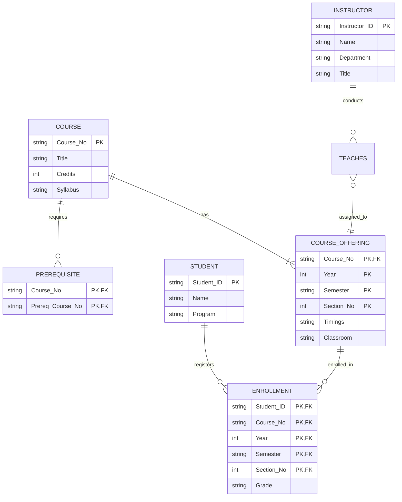
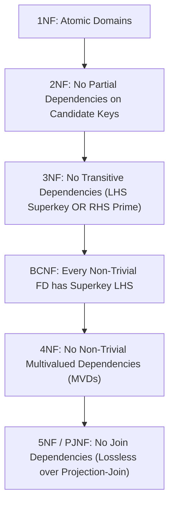
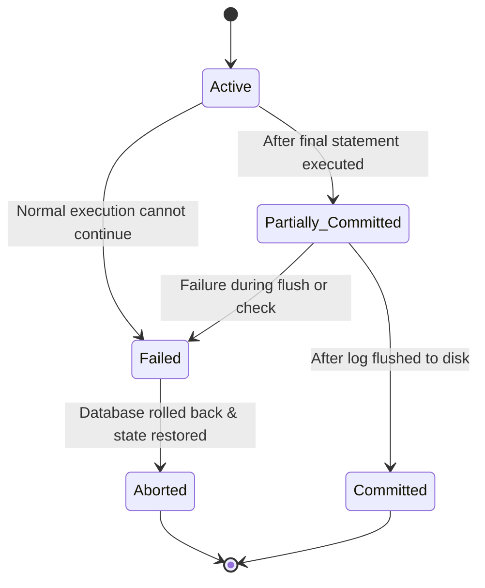
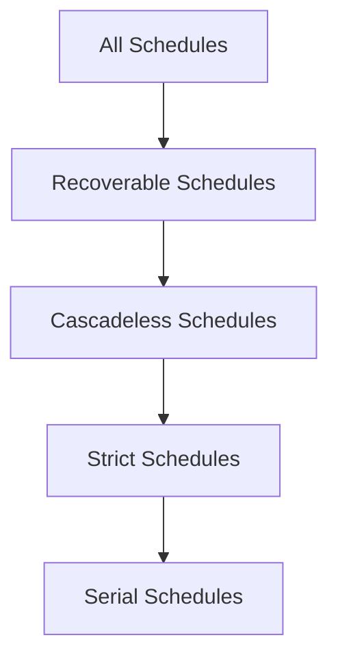

# Complete Master Study Guide: Database Management Systems (CSN15401)
> **Authoritative Comprehensive Exam & Reference Notes**  
> **Course:** CSN15401 — Database Management Systems (B.Tech CSE Semester V, MNNIT Allahabad)  
> **Coverage:** Full Syllabus from Prescribed PPTs (Ch 8–12: Normalization, Transactions, Concurrency Control, Indexing, Query Optimization), Post-Midsem Class Notes (Sections A & B), and Previous Year End-Semester & Mid-Semester Exam Papers.

---

## Table of Contents
1. [Exam Blueprint & Quick Reference Map](#exam-blueprint--quick-reference-map)
2. [Module 1: Relational Data Model, ER Modeling, Relational Algebra & SQL](#module-1-relational-data-model-er-modeling-relational-algebra--sql)
   - 1.1 ER Modeling Concepts & Structural Constraints
   - 1.2 ER-to-Relational Schema Mapping Rules
   - 1.3 Relational Algebra: Core, Extended & Advanced Operators
   - 1.4 SQL DDL, DML & Pattern Matching Operators
   - 1.5 Solved Exam Problem: University Registrar System (Screenshot Q1)
   - 1.6 Additional High-Yield Practice Problems & Solutions
3. [Module 2: Functional Dependencies, Closures, Candidate Keys & Canonical Cover](#module-2-functional-dependencies-closures-candidate-keys--canonical-cover)
   - 2.1 Schema Design Pitfalls & Anomalies
   - 2.2 Functional Dependencies & Armstrong's Axioms
   - 2.3 Attribute Closure ($X^+$) Algorithm
   - 2.4 Systematic Candidate Key Discovery (Attribute Classification Framework)
   - 2.5 Canonical Cover / Minimal Cover ($F_c$) Algorithm
   - 2.6 Solved Exam Problems (Endsem Q3, Screenshot Q2 Canonical Cover)
   - 2.7 Additional Practice Problems on Keys and Canonical Covers
4. [Module 3: Normalization & Relational Decomposition (1NF to 5NF)](#module-3-normalization--relational-decomposition-1nf-to-5nf)
   - 3.1 Normal Forms Hierarchy (1NF, 2NF, 3NF, BCNF, 4NF, 5NF)
   - 3.2 Formal Definitions & Violation Criteria
   - 3.3 Lossless-Join Decomposition (Binary Test & Chase Matrix Test)
   - 3.4 Dependency Preservation Property & Local Testing Algorithm
   - 3.5 BCNF Decomposition Algorithm vs 3NF Synthesis Algorithm
   - 3.6 Solved Exam Problems (Screenshot Q2 Highest Normal Form, Endsem Q2 Dependency Preservation)
   - 3.7 Comprehensive Normalization Decision Tree & Practice Questions
5. [Module 4: Transactions, Serializability & Recoverability](#module-4-transactions-serializability--recoverability)
   - 4.1 Transaction Concepts & Deep Dive into ACID Properties
   - 4.2 Transaction State Transition Diagram
   - 4.3 Concurrent Execution Anomalies (Dirty Read, Lost Update, Fuzzy Read, Phantom Read)
   - 4.4 Conflict Serializability & Precedence Graphs
   - 4.5 View Serializability & Blind Writes
   - 4.6 Recoverability, Cascadelessness, and Strict Schedules
   - 4.7 Solved Exam Problem (Endsem Q4(a))
   - 4.8 Practice Questions on Serializability & Recoverability
6. [Module 5: Concurrency Control Protocols, Deadlocks & InnoDB Architecture](#module-5-concurrency-control-protocols-deadlocks--innodb-architecture)
   - 5.1 Lock-Based Protocols & Two-Phase Locking (Basic, Strict, Rigorous, Conservative 2PL)
   - 5.2 Multiple Granularity Locking (MGL) & Intention Locks (IS, IX, SIX)
   - 5.3 Modern Storage Engine Locking: MySQL InnoDB Deep Dive (Row, Gap, Next-Key, Predicate Locks)
   - 5.4 Deadlock Prevention (Wait-Die vs Wound-Wait) & Deadlock Detection (Wait-For Graph)
   - 5.5 Timestamp-Based Ordering Protocol (TSO) & Thomas Write Rule
   - 5.6 Validation-Based / Optimistic Concurrency Control (OCC)
   - 5.7 Multi-Version Concurrency Control (MVCC) & SQL Isolation Levels
   - 5.8 Solved Exam Problems (Endsem Q1 Groups C/D, Q4(b), Q5)
   - 5.9 Practice Problems on 2PL and Timestamp Ordering
7. [Module 6: Storage, Indexing & B+ Trees](#module-6-storage-indexing--b-trees)
   - 6.1 Physical Storage & File Organization
   - 6.2 Ordered Indices: Primary, Secondary, Clustering, Dense vs Sparse
   - 6.3 B+ Tree Architecture: Internal Nodes, Leaf Nodes, Fanout
   - 6.4 Mathematical Formulas & Quantitative Sizing of B+ Trees
   - 6.5 Hashing (Static & Dynamic/Extendible) & Bitmap Indices
   - 6.6 Solved Exam Problems (Endsem Q1 Groups A/B, Q6(e))
   - 6.7 Quantitative Practice Problems on B+ Tree Sizing
8. [Module 7: Query Processing & Optimization](#module-7-query-processing--optimization)
   - 7.1 Query Processing Pipeline & Execution Plans
   - 7.2 Relational Algebra Equivalence Rules
   - 7.3 Heuristic Optimization: Pushing Selections & Projections
   - 7.4 Cost-Based Estimation & Join Algorithms
   - 7.5 Solved Query Tree Transformation Examples
9. [Module 8: Master Consolidated Solutions to All Exam Questions & Quick Revision Sheet](#module-8-master-consolidated-solutions-to-all-exam-questions--quick-revision-sheet)

---

# Exam Blueprint & Quick Reference Map

| Topic Area | Typical Weightage | Core Question Types | Key Success Formulas / Rules |
| :--- | :--- | :--- | :--- |
| **B+ Tree Sizing** | 10 Marks (Q1) | Internal node order, leaf entries, tree height, block counts | Order $p$: $p \cdot P_{block} + (p-1) \cdot K \le B$; Leaf $p_{leaf}$: $p_{leaf}(K + P_{rec}) + P_{block} \le B$ |
| **Deadlock Prevention** | 10 Marks (Q1) | Wait-Die vs Wound-Wait step-by-step lock traces | Wait-Die: Old waits, Young dies (non-preemptive). Wound-Wait: Old wounds/preempts, Young waits (preemptive) |
| **Dependency Preservation**| 5 Marks (Q2) | Check if $(R_1, R_2, \dots)$ preserves $F$ | For each $X \to Y \in F$, check if $Y \subseteq \text{result}$ using iterative projection closures |
| **Candidate Keys** | 5 Marks (Q3) | Find all candidate keys of a relation | Classify: Left-only (essential), Right-only (never in key), Both (exploratory), Neither (essential) |
| **2PL & Serializability** | 5 Marks (Q4) | Precedence graph cycles, adding $L_i(A)/U_i(A)$ locks | Conflict: Same data, different transactions, at least one write. 2PL: All locks before any unlock |
| **Timestamp Ordering** | 5 Marks (Q5) | Determine valid writes and rollbacks under TSO | Read: $TS(T) < W\text{-TS}(Q) \implies$ Abort. Write: $TS(T) < R\text{-TS}(Q)$ or $TS(T) < W\text{-TS}(Q) \implies$ Abort |
| **Theory & Definitions** | 10 Marks (Q6)| Relational algebra, SQL DDL/operators, Normal forms, Indices | Precise definitions, clean diagrams, and illustrative minimal counter-examples |
| **ER & Schema Design** | 14 Marks (Midsem)| ER diagram, Schema mapping, SQL & RA queries | Entity types, Weak entity identification, Cardinality ratios, Join conditions |
| **Highest Normal Form** | 6 Marks (Midsem)| 1NF vs 2NF vs 3NF vs BCNF + Canonical Cover | 2NF: No partial FDs. 3NF: LHS superkey OR RHS prime. BCNF: LHS superkey. Extraneous test for $F_c$ |

---

# Module 1: Relational Data Model, ER Modeling, Relational Algebra & SQL

## 1.1 ER Modeling Concepts & Structural Constraints

An **Entity-Relationship (ER) model** provides an abstract, conceptual representation of real-world data and relationships.

```
+-----------------------------------------------------------------------------------+
|                                  ER MODEL NOTATION                                |
+-----------------------------------------------------------------------------------+
|  [ Entity Set ]         : Rectangle                                               |
|  [[ Weak Entity Set ]]  : Double Rectangle                                        |
|  ( Attribute )          : Ellipse (Underlined = Primary Key / Partial Key dashed) |
|  (( Multivalued ))      : Double Ellipse                                          |
|  ( Composite )          : Ellipse branching into sub-ellipses                     |
|  ( Derived )            : Dashed Ellipse                                          |
|  < Relationship Set >   : Diamond                                                 |
|  << Identifying Rel >>  : Double Diamond (links weak entity to owner entity)      |
|  Total Participation    : Double Line connecting entity set to relationship set   |
|  Partial Participation  : Single Line connecting entity set to relationship set   |
+-----------------------------------------------------------------------------------+
```

### Core Components
1. **Entity Set**: A collection of similar real-world objects (e.g., `STUDENT`, `INSTRUCTOR`).
2. **Weak Entity Set**: An entity set that does not possess sufficient attributes to form a primary key on its own.
   - It depends existentially on an **identifying (owner) entity set**.
   - It is identified using its **partial key (discriminator)** concatenated with the primary key of the owner entity set.
   - It always exhibits **total participation** in its identifying relationship set.
3. **Attributes**:
   - **Simple / Atomic**: Indivisible values (e.g., `Credits`, `Salary`).
   - **Composite**: Can be divided into smaller sub-parts (e.g., `Name` $\to$ `First_Name`, `Middle_Name`, `Last_Name`).
   - **Multivalued**: Can have multiple values for a single entity instance (e.g., `Phone_Numbers`, `Prerequisites`).
   - **Derived**: Calculated dynamically from other attributes (e.g., `Age` from `Date_Of_Birth`).
4. **Mapping Cardinalities (Cardinality Ratios)**:
   - **One-to-One (1:1)**: An entity in A is associated with at most one entity in B, and vice-versa.
   - **One-to-Many (1:N)**: An entity in A can associate with multiple entities in B, but an entity in B associates with at most one entity in A.
   - **Many-to-Many (M:N)**: Entities in both sets can associate with multiple entities in the other set.
5. **Participation Constraints**:
   - **Total Participation (Existence Dependency)**: Every entity in the entity set must participate in at least one relationship instance in the relationship set (represented by a double line).
   - **Partial Participation**: Some entities in the entity set may not participate in the relationship set (single line).

---

## 1.2 ER-to-Relational Schema Mapping Rules

Transforming an ER diagram into a relational schema follows rigorous, unambiguous algorithmic rules:

| ER Construct | Relational Schema Mapping Rule | Primary Key (PK) & Foreign Key (FK) |
| :--- | :--- | :--- |
| **Strong Entity Set $E$** | Create relation $R(E)$. Include all atomic attributes and atomic sub-components of composite attributes. | PK = Primary key of $E$. |
| **Weak Entity Set $W$ owned by $E$ via identifying rel $ID$** | Create relation $R(W)$. Include all simple attributes of $W$ plus the primary key $K(E)$ of owner entity. | PK = $K(E) \cup \{\text{Discriminator of } W\}$. $K(E)$ is FK referencing $R(E)$. |
| **1:1 Relationship $R$ between $A$ and $B$** | **Foreign Key approach**: Include PK of one relation (preferably total participation side) as FK in the other relation, along with any relationship attributes. | PK = PK of the relation containing the foreign key. |
| **1:N Relationship $R$ from $A$ (1-side) to $B$ (N-side)** | Include PK of $A$ as Foreign Key in relation $B$, along with any attributes of $R$. | PK = PK of $B$. FK = PK of $A$ referencing $R(A)$. |
| **M:N Relationship $R$ between $A$ and $B$** | Create a distinct relation $R(A, B)$. Include PK of $A$, PK of $B$, and all relationship attributes of $R$. | PK = $\{PK(A) \cup PK(B)\}$. Both are individual FKs referencing $A$ and $B$. |
| **Multivalued Attribute $M$ of entity $E$** | Create a separate relation $R_M(PK(E), M)$. Each value of $M$ becomes a separate tuple. | PK = $\{PK(E), M\}$. FK = $PK(E)$ referencing $R(E)$. |
| **Recursive / Self-Referencing Relationship** | Treat as unary relationship. If 1:N, include PK as FK with alias column (e.g., `Manager_ID` referencing `Emp_ID`). If M:N, create separate bridge table. | Aliased FK referencing same relation. |

---

## 1.3 Relational Algebra: Core, Extended & Advanced Operators

Relational algebra is a procedural query language. Expressions take relations as input and return relations as output.

### 1. Fundamental Operators
1. **Selection ($\sigma$)**: Filters rows satisfying predicate $p$.
   $$\sigma_p(R) = \{ t \mid t \in R \text{ and } p(t) \text{ is true} \}$$
2. **Projection ($\pi$)**: Filters specific columns $A_1, A_2, \dots, A_k$ and eliminates duplicate tuples.
   $$\pi_{A_1, \dots, A_k}(R)$$
3. **Set Union ($\cup$)**: Combines tuples from two union-compatible relations ($R$ and $S$ must have same arity and compatible attribute domains).
   $$R \cup S = \{ t \mid t \in R \lor t \in S \}$$
4. **Set Difference ($-$)**: Tuples in $R$ but not in $S$. Union-compatibility required.
   $$R - S = \{ t \mid t \in R \land t \notin S \}$$
5. **Cartesian Product ($\times$)**: Pairs every tuple of $R$ with every tuple of $S$.
   $$R \times S = \{ t \cdot s \mid t \in R \land s \in S \}$$
6. **Rename ($\rho$)**: Renames relation or attributes.
   $$\rho_{S(B_1, \dots, B_n)}(R)$$

### 2. Derived & Extended Operators
1. **Theta Join ($\bowtie_\theta$)**: Cross product followed by selection.
   $$R \bowtie_\theta S = \sigma_\theta(R \times S)$$
2. **Natural Join ($\bowtie$)**: Equijoin on all common attribute names, projecting out duplicate column names.
3. **Division Operator ($\div$)**: Used for "for all" / "universal" queries (e.g., "find students who have taken all courses offered by CSE").
   $$R(A, B) \div S(B) = \pi_A(R) - \pi_A((\pi_A(R) \times S) - R)$$
4. **Aggregation Operator ($\mathcal{G}$)**:
   $$_{G_1, G_2, \dots, G_k}\mathcal{G}_{F_1(A_1), \dots, F_m(A_m)}(R)$$
   Groups tuples by $G_1, \dots, G_k$ and evaluates aggregate functions (SUM, AVG, MIN, MAX, COUNT).

---

## 1.4 SQL DDL, DML & Pattern Matching Operators

### 1. SQL DDL (Data Definition Language)
- `CREATE TABLE`: Defines table schema, attribute data types, and integrity constraints (`PRIMARY KEY`, `FOREIGN KEY ... REFERENCES`, `NOT NULL`, `UNIQUE`, `CHECK`).
- `ALTER TABLE`: Modifies table schema dynamically (`ADD`, `DROP COLUMN`, `MODIFY`).
- `DROP TABLE`: Permanently deletes table structure and all stored rows.
- `TRUNCATE TABLE`: Fast DDL operation removing all rows while preserving schema structure.

### 2. SQL LIKE & IN Operators
- **`LIKE` Operator**: Pattern matching on string columns.
  - `%`: Matches zero or more characters.
  - `_`: Matches exactly one character.
  - `LIKE 'A%'`: Strings starting with 'A'.
  - `LIKE '%computer%'`: Strings containing 'computer'.
  - `LIKE '___'`: Exactly three characters long.
  - `LIKE '_a%'`: Second character is 'a'.
- **`IN` Operator**: Membership test against an explicit list or subquery.
  - `WHERE Dept IN ('CSE', 'ECE', 'IT')`
  - Equivalent to: `WHERE Dept = 'CSE' OR Dept = 'ECE' OR Dept = 'IT'`
- **`BETWEEN` Operator**: Inclusive range filter: `WHERE Salary BETWEEN 40000 AND 80000`.

---

## 1.5 Solved Exam Problem: University Registrar System (Screenshot Q1)

### Problem Statement
A university registrar's office maintains data about the following entities:
1. **Courses**: Course number, title, credits, syllabus, and prerequisites.
2. **Course Offerings**: Course number, year, semester, section number, instructor(s), timings, and classroom.
3. **Students**: Student-id, name, and program.
4. **Instructors**: Identification number, name, department, and title.

Further, the enrollment of students in courses and grades awarded to students in each course they are enrolled for must be appropriately modeled.

- **(a)** Construct an E-R diagram for the registrar's office. State all assumptions about mapping constraints. [6 Marks]
- **(b)** Construct relational database schema for the E-R diagram constructed in part (a). [2 Marks]
- **(c)** Write queries in SQL and Relational Algebra: [6 Marks]
  - *(i)* Find the names of students enrolled in course number "CSN15401".
  - *(ii)* Find the names of instructors who taught a course in the year 2024.
  - *(iii)* List all students enrolled in the course "DBMS".

---

### Detailed Solution

#### (a) Assumptions & Mapping Constraints
1. **Course**: Identified by `Course_No` (Primary Key). Has `Title`, `Credits`, `Syllabus`.
2. **Prerequisites**: A course can have zero, one, or more prerequisite courses, and a course can be a prerequisite for multiple other courses. This is an **M:N recursive relationship** `PREREQ(Course_No, Prereq_Course_No)` on `COURSE`.
3. **Course Offering**: A course is offered across different semesters/years in sections. A Course Offering cannot exist without its base Course. Thus, `COURSE_OFFERING` can be modeled as a **Weak Entity Set** identified by discriminator `(Year, Semester, Section_No)` combined with owner `Course_No`. Alternatively, it is a strong entity with composite key `(Course_No, Year, Semester, Section_No)`.
4. **Instructors**: Identified by `Instructor_ID` (Primary Key), with `Name`, `Department`, `Title`. An instructor teaches zero, one, or more course offerings. A course offering is taught by one or more instructors (**M:N** or **1:N**; we assume an offering is taught by one primary instructor, or M:N if team-taught. Let us model `TEACHES` as M:N).
5. **Students**: Identified by `Student_ID` (Primary Key), with `Name`, `Program`.
6. **Enrollment**: A student enrolls in multiple course offerings, and each course offering contains multiple students (**M:N Relationship** `ENROLLS_IN`). The attribute `Grade` is a descriptive attribute placed directly on the `ENROLLS_IN` relationship.



---

#### (b) Relational Database Schema
Underlined attributes indicate **Primary Keys**; bold/foreign keys are explicitly noted.

1. **`Course`** ($\underline{\text{Course\_No}}$, $\text{Title}$, $\text{Credits}$, $\text{Syllabus}$)
2. **`Course_Prereq`** ($\underline{\text{Course\_No}, \text{Prereq\_Course\_No}}$)
   - Foreign Key `Course_No` references `Course(Course_No)` ON DELETE CASCADE
   - Foreign Key `Prereq_Course_No` references `Course(Course_No)`
3. **`Course_Offering`** ($\underline{\text{Course\_No}, \text{Year}, \text{Semester}, \text{Section\_No}}$, $\text{Timings}$, $\text{Classroom}$)
   - Foreign Key `Course_No` references `Course(Course_No)` ON DELETE CASCADE
4. **`Instructor`** ($\underline{\text{Instructor\_ID}}$, $\text{Name}$, $\text{Department}$, $\text{Title}$)
5. **`Teaches`** ($\underline{\text{Instructor\_ID}, \text{Course\_No}, \text{Year}, \text{Semester}, \text{Section\_No}}$)
   - Foreign Key `Instructor_ID` references `Instructor(Instructor_ID)`
   - Foreign Key `(Course_No, Year, Semester, Section_No)` references `Course_Offering`
6. **`Student`** ($\underline{\text{Student\_ID}}$, $\text{Name}$, $\text{Program}$)
7. **`Enrollment`** ($\underline{\text{Student\_ID}, \text{Course\_No}, \text{Year}, \text{Semester}, \text{Section\_No}}$, $\text{Grade}$)
   - Foreign Key `Student_ID` references `Student(Student_ID)`
   - Foreign Key `(Course_No, Year, Semester, Section_No)` references `Course_Offering`

---

#### (c) SQL and Relational Algebra Queries

##### (i) Find the names of students enrolled in course number "CSN15401"
- **SQL Query**:
```sql
SELECT DISTINCT S.Name
FROM Student S
JOIN Enrollment E ON S.Student_ID = E.Student_ID
WHERE E.Course_No = 'CSN15401';
```
- **Relational Algebra**:
$$\pi_{\text{Name}}\Big(\text{Student} \bowtie \sigma_{\text{Course\_No} = \text{'CSN15401'}}(\text{Enrollment})\Big)$$

---

##### (ii) Find the names of instructors who taught a course in the year 2024
- **SQL Query**:
```sql
SELECT DISTINCT I.Name
FROM Instructor I
JOIN Teaches T ON I.Instructor_ID = T.Instructor_ID
WHERE T.Year = 2024;
```
- **Relational Algebra**:
$$\pi_{\text{Name}}\Big(\text{Instructor} \bowtie \sigma_{\text{Year} = 2024}(\text{Teaches})\Big)$$

---

##### (iii) List all students enrolled in the course "DBMS"
- **SQL Query**:
```sql
SELECT DISTINCT S.Student_ID, S.Name, S.Program
FROM Student S
JOIN Enrollment E ON S.Student_ID = E.Student_ID
JOIN Course C ON E.Course_No = C.Course_No
WHERE C.Title = 'DBMS';
```
- **Relational Algebra**:
$$\pi_{\text{Student\_ID}, \text{Name}, \text{Program}}\Big(\text{Student} \bowtie \text{Enrollment} \bowtie \sigma_{\text{Title} = \text{'DBMS'}}(\text{Course})\Big)$$

---

## 1.6 Additional High-Yield Practice Problems & Solutions

### Practice Problem 1.1: Division in Relational Algebra
**Question**: Using the schema above, write a Relational Algebra query to find the `Student_ID` of students who have enrolled in **all** courses offered in the year 2024.
**Solution**:
1. Target Courses in 2024:
   $$C_{2024} = \pi_{\text{Course\_No}}(\sigma_{\text{Year} = 2024}(\text{Course\_Offering}))$$
2. Student enrollments in those offerings:
   $$SE = \pi_{\text{Student\_ID}, \text{Course\_No}}(\text{Enrollment} \bowtie \sigma_{\text{Year} = 2024}(\text{Course\_Offering}))$$
3. Applying Division operator ($\div$):
   $$\text{Result} = SE \div C_{2024}$$
   Using fundamental operators:
   $$\text{All\_Students} = \pi_{\text{Student\_ID}}(SE)$$
   $$\text{Disqualified} = \pi_{\text{Student\_ID}}\Big( (\text{All\_Students} \times C_{2024}) - SE \Big)$$
   $$\text{Result} = \text{All\_Students} - \text{Disqualified}$$

---

# Module 2: Functional Dependencies, Closures, Candidate Keys & Canonical Cover

## 2.1 Schema Design Pitfalls & Anomalies

A poorly designed relational schema exhibits three critical anomalies caused by data redundancy:
1. **Redundancy (Repetition of Information)**: The same fact is stored repeatedly in multiple tuples (e.g., repeating department budget for every instructor).
2. **Update Anomaly**: If a department's budget changes, every tuple corresponding to that department must be updated. If one tuple is missed, the database enters an inconsistent state.
3. **Insertion Anomaly**: If a new department is created but currently has no instructors, we cannot insert it without placing `NULL` values in the instructor primary key columns (which violates Entity Integrity).
4. **Deletion Anomaly**: If the last instructor of a department leaves and their record is deleted, all information about that department is inadvertently erased.

Normalization provides a mathematically sound methodology to decompose relations into normal forms that guarantee no loss of information while eliminating anomalies.

---

## 2.2 Functional Dependencies & Armstrong's Axioms

### Formal Definition
Let $R$ be a relation schema, and let $\alpha \subseteq R$ and $\beta \subseteq R$.  
A **Functional Dependency (FD)** $\alpha \to \beta$ states that for any valid legal relation instance $r(R)$, if two tuples $t_1$ and $t_2$ agree on all attributes in $\alpha$, they must also agree on all attributes in $\beta$:
$$t_1[\alpha] = t_2[\alpha] \implies t_1[\beta] = t_2[\beta]$$

- **Trivial FD**: $\alpha \to \beta$ is trivial if $\beta \subseteq \alpha$ (e.g., $AB \to A$).
- **Non-Trivial FD**: $\alpha \to \beta$ is non-trivial if $\beta \nsubseteq \alpha$.
- **Completely Non-Trivial**: $\alpha \to \beta$ is completely non-trivial if $\alpha \cap \beta = \emptyset$.

### Armstrong's Axioms (Sound and Complete)
1. **Reflexivity Rule**: If $\beta \subseteq \alpha$, then $\alpha \to \beta$.
2. **Augmentation Rule**: If $\alpha \to \beta$, then $\gamma\alpha \to \gamma\beta$ for any attribute set $\gamma$.
3. **Transitivity Rule**: If $\alpha \to \beta$ and $\beta \to \gamma$, then $\alpha \to \gamma$.

### Derived Secondary Rules
1. **Union Rule**: If $\alpha \to \beta$ and $\alpha \to \gamma$, then $\alpha \to \beta\gamma$.
2. **Decomposition Rule**: If $\alpha \to \beta\gamma$, then $\alpha \to \beta$ and $\alpha \to \gamma$.
3. **Pseudotransitivity Rule**: If $\alpha \to \beta$ and $\gamma\beta \to \delta$, then $\alpha\gamma \to \delta$.

---

## 2.3 Attribute Closure ($X^+$) Algorithm

The **attribute closure** of an attribute set $X$ with respect to a set of functional dependencies $F$, denoted $X^+$, is the set of all attributes functionally determined by $X$ under $F$.

### Algorithm: Computing $X^+$
```
Input: Set of attributes X, set of FDs F
Output: Attribute closure X+

result := X;
repeat
    for each functional dependency (alpha -> beta) in F do
        if alpha is a subset of result then
            result := result union beta;
until (result does not change);
return result;
```

---

## 2.4 Systematic Candidate Key Discovery (Attribute Classification Framework)

A **Superkey** of relation $R$ is a set of attributes $K$ such that $K^+ = R$.  
A **Candidate Key** is a **minimal superkey** (i.e., no proper subset of $K$ is a superkey).  
- **Prime Attribute**: Any attribute that is part of *at least one* candidate key.
- **Non-Prime Attribute**: An attribute that does not belong to *any* candidate key.

### Fast Attribute Classification Method
Partition all attributes of relation $R$ into four mutually disjoint categories based on their appearances in the FD set $F$:
1. **$L$ (Left-only)**: Attributes appearing **only on the LHS** of FDs.
   - *Rule*: Must be present in **every** candidate key because no other attribute can determine them.
2. **$R$ (Right-only)**: Attributes appearing **only on the RHS** of FDs.
   - *Rule*: Can **never** be part of any candidate key (unless essential left attributes don't exist).
3. **$B$ (Both sides)**: Attributes appearing on **both LHS and RHS**.
   - *Rule*: May or may not be part of candidate keys; tested systematically.
4. **$N$ (Neither side)**: Attributes that appear on **neither LHS nor RHS** in any FD.
   - *Rule*: Must be present in **every** candidate key, because no FD can ever determine them.

### Step-by-Step Procedure
1. Identify Essential Core Attributes: $Core = L \cup N$.
2. Compute $(Core)^+$:
   - If $(Core)^+ = R$, then $Core$ is the **unique candidate key**! (Process terminates).
   - If $(Core)^+ \subset R$, combine $Core$ with one attribute from $B$, test closures. If needed, combine with pairs from $B$, and so forth, stopping when minimal superkeys are found.

---

## 2.5 Canonical Cover / Minimal Cover ($F_c$) Algorithm

A **Canonical Cover** $F_c$ for a set of functional dependencies $F$ is a simplified minimal set of FDs that is logically equivalent to $F$ ($F_c \equiv F$) and has no redundancies.

### Formal Properties of $F_c$
1. $F_c$ logically implies all dependencies in $F$, and $F$ implies all dependencies in $F_c$ ($F_c^+ = F^+$).
2. Every dependency in $F_c$ is of the form $\alpha \to \beta$ where $\beta$ is a single attribute (or merged using union rule).
3. No functional dependency in $F_c$ contains an **extraneous attribute** (neither on LHS nor on RHS).
4. Each left side of a functional dependency in $F_c$ is unique.

### Definition: Extraneous Attribute
An attribute $A$ is extraneous in a dependency $\alpha \to \beta \in F$ if:
- **Extraneous on LHS**: If $A \in \alpha$, attribute $A$ is extraneous on the LHS if:
  $$(\alpha - \{A\})^+ \text{ under } F \text{ contains } \beta$$
  *(Intuition: $\alpha - \{A\}$ alone can already determine $\beta$, so $A$ is unnecessary baggage on the left!)*
- **Extraneous on RHS**: If $B \in \beta$, attribute $B$ is extraneous on the RHS if:
  $$\alpha^+ \text{ under } (F - \{\alpha \to \beta\} \cup \{\alpha \to (\beta - \{B\})\}) \text{ contains } B$$
  *(Intuition: $\alpha$ can still derive $B$ through other paths even if $B$ is removed from this RHS!)*

### Step-by-Step Algorithm for Computing $F_c$
1. **Decompose RHS**: Write every FD with a single attribute on the RHS (Decomposition Rule).
2. **Remove Extraneous LHS Attributes**: For each FD $XY \to Z$, check if $X \to Z$ holds under $F$ (by checking if $Z \in X^+$). If yes, replace $XY \to Z$ with $X \to Z$.
3. **Remove Redundant FDs**: For each FD $f: X \to Y$, check if $Y \in X^+$ under $F - \{f\}$. If yes, delete $f$.
4. **Merge LHS (Union Rule)**: Combine dependencies with identical left-hand sides (e.g., $X \to Y$ and $X \to Z$ become $X \to YZ$).

---

## 2.6 Solved Exam Problems (Endsem Q3 & Screenshot Q2)

### Exam Problem 1: Candidate Keys (Endsem Q3)
**Question**:  
Given a Relation $R(\text{Transaction\_ID}, \text{Name}, \text{Payment\_ID}, \text{Product})$ for a particular application. The functional dependencies for this relation are:
1. $\text{Transaction\_ID} \to \text{Name}$
2. $\text{Name} \to \text{Payment\_ID}$
3. $\text{Payment\_ID} \to \text{Transaction\_ID}$

Find all the candidate keys for the relation $R$. [5 Marks]

---

#### Step-by-Step Solution:
Let us abbreviate attributes:
$T = \text{Transaction\_ID}$, $N = \text{Name}$, $P = \text{Payment\_ID}$, $D = \text{Product}$.  
Relation schema: $R(T, N, P, D)$.  
FD set $F$:
1. $T \to N$
2. $N \to P$
3. $P \to T$

**Step 1: Attribute Classification**
- Appears on LHS: $T, N, P$
- Appears on RHS: $N, P, T$
- Appears on Both Sides ($B$): $\{T, N, P\}$
- Appears on Neither Side ($N$): $\{D\}$ (Product does not appear in any FD!)

**Step 2: Core Analysis**
Since $D$ (Product) is in $N$, it is never determined by any other attribute.  
**Crucial Rule:** Attribute $D$ must be present in EVERY candidate key of $R$.

**Step 3: Test Candidate Key Combinations with $D$**
1. Test $(TD)$:
   $$(TD)^+ = \{T, D\} \cup \{N\} \cup \{P\} = \{T, N, P, D\} = R$$
   Check proper subsets of $TD$:
   - $T^+ = \{T, N, P\} \ne R$
   - $D^+ = \{D\} \ne R$
   Since no proper subset is a superkey, **$\{\text{Transaction\_ID}, \text{Product}\}$ is a Candidate Key**.

2. Test $(ND)$:
   $$(ND)^+ = \{N, D\} \cup \{P\} \cup \{T\} = \{T, N, P, D\} = R$$
   Check proper subsets:
   - $N^+ = \{N, P, T\} \ne R$
   - $D^+ = \{D\} \ne R$
   Thus, **$\{\text{Name}, \text{Product}\}$ is a Candidate Key**.

3. Test $(PD)$:
   $$(PD)^+ = \{P, D\} \cup \{T\} \cup \{N\} = \{T, N, P, D\} = R$$
   Check proper subsets:
   - $P^+ = \{P, T, N\} \ne R$
   - $D^+ = \{D\} \ne R$
   Thus, **$\{\text{Payment\_ID}, \text{Product}\}$ is a Candidate Key**.

**Final Answer**:  
There are exactly **3 candidate keys** for relation $R$:
1. **$\{\text{Transaction\_ID}, \text{Product}\}$**
2. **$\{\text{Name}, \text{Product}\}$**
3. **$\{\text{Payment\_ID}, \text{Product}\}$**

---

### Exam Problem 2: Canonical Cover (Screenshot Q2)
**Question**:  
Given relation $R(A, B, C, D)$ with functional dependency set:
$$F = \{ AB \to C, AB \to D, C \to A, B \to D \}$$
Compute the canonical cover for $F$. [2 Marks]

---

#### Step-by-Step Solution:
Given $F = \{ AB \to C, AB \to D, C \to A, B \to D \}$.

**Step 1: Write with singleton RHS**
All FDs already have singleton right-hand sides:
1. $AB \to C$
2. $AB \to D$
3. $C \to A$
4. $B \to D$

**Step 2: Test for Extraneous Attributes on the LHS**
- Consider $AB \to D$:
  Can $A$ be eliminated?
  Check closure of remaining LHS attribute $\{B\}$ under $F$:
  $$B^+ = \{B, D\}$$
  Since $D \in B^+$, $B$ alone determines $D$!
  Therefore, attribute $A$ is **extraneous** in $AB \to D$.
  Replacing $AB \to D$ with $B \to D$, the FD set becomes:
  $$F' = \{ AB \to C, B \to D, C \to A, B \to D \}$$
  (The duplicate $B \to D$ merges).
  Current FDs: $\{ AB \to C, B \to D, C \to A \}$.

- Consider $AB \to C$:
  - Test if $A$ is extraneous:
    Closure of $(AB - \{A\}) = B^+$ under $F'$:
    $B^+ = \{B, D\}$.
    Does $B^+$ contain $C$? No ($C \notin \{B, D\}$). Thus $A$ is NOT extraneous.
  - Test if $B$ is extraneous:
    Closure of $(AB - \{B\}) = A^+$ under $F'$:
    $A^+ = \{A\}$.
    Does $A^+$ contain $C$? No ($C \notin \{A\}$). Thus $B$ is NOT extraneous.
  Therefore, neither $A$ nor $B$ is extraneous in $AB \to C$.

- Consider single-attribute LHS dependencies:
  $C \to A$ and $B \to D$ have only one attribute on the LHS, so neither can have extraneous LHS attributes.

**Step 3: Test for Redundant Functional Dependencies**
Current set: $F'' = \{ AB \to C, B \to D, C \to A \}$.
1. Test $AB \to C$:
   Compute $(AB)^+$ using $F'' - \{AB \to C\} = \{B \to D, C \to A\}$:
   $(AB)^+ = \{A, B, D\}$.
   Does $(AB)^+$ contain $C$? No. Hence, $AB \to C$ is **essential**.
2. Test $B \to D$:
   Compute $B^+$ using $F'' - \{B \to D\} = \{AB \to C, C \to A\}$:
   $B^+ = \{B\}$.
   Does $B^+$ contain $D$? No. Hence, $B \to D$ is **essential**.
3. Test $C \to A$:
   Compute $C^+$ using $F'' - \{C \to A\} = \{AB \to C, B \to D\}$:
   $C^+ = \{C\}$.
   Does $C^+$ contain $A$? No. Hence, $C \to A$ is **essential**.

**Step 4: Merge dependencies with identical LHS**
The LHS sets are $AB$, $B$, and $C$. All are distinct.

**Final Answer**:  
The canonical cover is:
$$\mathbf{F_c = \{ AB \to C, B \to D, C \to A \}}$$

---

## 2.7 Additional Practice Problems on Keys and Canonical Covers

### Practice Problem 2.1: Canonical Cover with Extraneous RHS Attribute
**Relation**: $R(A, B, C)$  
**FD Set**: $F = \{ A \to BC, B \to C, A \to B, AB \to C \}$  
**Find**: Canonical Cover $F_c$.

**Solution**:
1. Singleton RHS: $\{ A \to B, A \to C, B \to C, AB \to C \}$
2. Extraneous LHS in $AB \to C$:
   Check $A^+ = \{A, B, C\}$ (since $A \to B$ and $B \to C$). $C \in A^+$, so $B$ is extraneous! $AB \to C$ reduces to $A \to C$.
   FD set: $\{ A \to B, A \to C, B \to C \}$
3. Check Redundancy:
   - In $A \to C$: Under $F - \{A \to C\}$, $A^+ = \{A, B, C\}$ (via $A \to B$ and $B \to C$).
     Since $C \in A^+$, $A \to C$ is **redundant** and eliminated!
4. Remaining FDs: $\{ A \to B, B \to C \}$.
5. Canonical Cover:
   $$F_c = \{ A \to B, B \to C \}$$

# Module 3: Normalization & Relational Decomposition (1NF to 5NF)

## 3.1 Normal Forms Hierarchy & Formal Definitions

Normalization organizes relational schemas to eliminate redundancy and update/insert/delete anomalies while preserving functional dependencies and lossless joins.



### Definitions Summary Table
| Normal Form | Formal Condition for Every Non-Trivial Dependency $X \to Y$ | Practical Test / What it Eliminates |
| :--- | :--- | :--- |
| **1NF** | All attribute values are atomic; no multivalued or composite attributes. | Eliminates repeating groups and arrays within table cells. |
| **2NF** | In 1NF, and **no non-prime attribute is partially dependent** on any candidate key. | For every $X \to Y$ where $Y \notin \text{Prime}$, $X$ cannot be a proper subset of any candidate key. |
| **3NF** | In 2NF, and for every non-trivial $X \to Y$, either: <br>1. **$X$ is a Superkey**, OR <br>2. **$Y$ is a Prime Attribute** (belongs to some candidate key). | Eliminates transitive dependencies of non-prime attributes on candidate keys. |
| **BCNF** | In 1NF, and for every non-trivial $X \to Y$: <br> **$X$ must be a Superkey**. | Eliminates all redundancy based on functional dependencies. Strictly stronger than 3NF. |
| **4NF** | For every non-trivial Multivalued Dependency (MVD) $X \twoheadrightarrow Y$: <br> **$X$ must be a Superkey**. | Eliminates independent multivalued facts stored in the same relation. |
| **5NF (PJNF)** | Every join dependency $\bowtie(R_1, R_2, \dots, R_k)$ on $R$ is implied by candidate keys. | Eliminates cyclic dependencies where $R$ decomposes into 3+ relations losslessly. |

---

## 3.2 Key Concepts: Prime vs Non-Prime Attributes & Partial Dependencies

- **Prime Attribute**: An attribute that is a member of **at least one candidate key**.
- **Non-Prime Attribute**: An attribute that is **not a member of any candidate key**.
- **Partial Dependency**: A functional dependency $X \to Y$ where:
  1. $X$ is a **proper subset** of a candidate key.
  2. $Y$ is a **non-prime attribute**.
  *(Crucial Note: If $Y$ is a prime attribute, $X \to Y$ is NOT a violation of 2NF! 2NF only forbids partial dependencies where the dependent $Y$ is non-prime!)*
- **Transitive Dependency**: A functional dependency $X \to Z$ where $X \to Y$ and $Y \to Z$ hold, $Y \nto X$, and $Z$ is a non-prime attribute not belonging to any candidate key.

---

## 3.3 Lossless-Join Decomposition

When decomposing relation $R$ into $\{R_1, R_2, \dots, R_k\}$, we must ensure that joining the decomposed relations reproduces the exact original relation without creating **spurious (phantom) tuples**:
$$R = R_1 \bowtie R_2 \bowtie \dots \bowtie R_k$$

### 1. Binary Decomposition Theorem (Necessary & Sufficient Condition)
A decomposition of $R$ into two relations $R_1$ and $R_2$ is **lossless-join** with respect to functional dependency set $F$ if and only if the common attributes $(R_1 \cap R_2)$ form a superkey of at least one of the decomposed relations:
$$(R_1 \cap R_2) \to R_1 \in F^+ \quad \text{OR} \quad (R_1 \cap R_2) \to R_2 \in F^+$$

### 2. General Decomposition: The Chase Matrix Test
For decompositions into 3 or more relations ($R_1, R_2, \dots, R_k$):
1. Construct a table with $k$ rows (one per relation $R_i$) and $|R|$ columns (one per attribute $A_j$).
2. Fill cell $(i, j)$ with $a_j$ if $A_j \in R_i$; otherwise fill with symbol $b_{ij}$.
3. For each FD $X \to Y \in F$:
   - Find rows that agree on all $X$-columns.
   - Equate their $Y$-column values. If any row has $a_j$, change all matching rows in that column to $a_j$; otherwise equate them to the same $b$-symbol.
4. If any row becomes entirely composed of $a$-symbols ($a_1, a_2, \dots, a_n$), the decomposition is **Lossless**!

---

## 3.4 Dependency Preservation Property & Local Testing Algorithm

A decomposition $\{R_1, R_2, \dots, R_k\}$ is **dependency preserving** if the union of the functional dependencies that hold individually on the decomposed relations logically implies all dependencies in the original set $F$:
$$(F_1 \cup F_2 \cup \dots \cup F_k)^+ = F^+$$
Where $F_i = \pi_{R_i}(F) = \{ X \to Y \in F^+ \mid XY \subseteq R_i \}$.

### Practical Polynomial-Time Testing Algorithm
Computing all $F_i$ directly requires exponential time. Instead, test each dependency $X \to Y \in F$ individually using the following linear-time projection algorithm:

```
Algorithm: Test if X -> Y is preserved in decomposition (R_1, R_2, ..., R_k)
Input: X -> Y, Decomposition (R_1, ..., R_k), FD set F
Output: True (Preserved) or False (Not Preserved)

result := X;
repeat
    for each relation R_i in {R_1, R_2, ..., R_k} do
        t := (result intersect R_i)^+ under F;
        result := result union (t intersect R_i);
until (result does not change);

if Y is a subset of result then
    return True;   // Preserved!
else
    return False;  // Lost!
```

---

## 3.5 BCNF Decomposition Algorithm vs 3NF Synthesis Algorithm

### 1. BCNF Decomposition Algorithm (Guarantees Lossless; May Lose Dependencies)
```
Input: Relation R, FD set F
Output: Set of BCNF relations

Decomposition := { R };
while there is some relation R_i in Decomposition that is NOT in BCNF do
    Find an FD (alpha -> beta) that violates BCNF in R_i 
    (i.e., alpha -> beta holds in R_i, alpha intersect beta = empty, and alpha is NOT a superkey of R_i);
    Replace R_i in Decomposition with two relations:
        R_i1 := (alpha union beta)
        R_i2 := (R_i - (beta - alpha))
return Decomposition;
```
- **Guarantees**: Always Lossless-join.
- **Trade-off**: May NOT preserve all functional dependencies!

### 2. 3NF Synthesis Algorithm (Bernstein's Algorithm)
**Guarantees BOTH Lossless-Join AND Dependency Preservation!**
1. Find a **Canonical Cover** $F_c$ of $F$.
2. For each dependency $\alpha \to \beta \in F_c$, create a relation schema with attributes $\alpha \cup \beta$.
3. If none of the generated relation schemas contains a **candidate key of $R$**, create an additional relation containing any candidate key of $R$.
4. (Optional Optimization) If relation $R_j$ is a subset of another relation $R_k$, delete $R_j$.

---

## 3.6 Solved Exam Problems (Screenshot Q2 & Endsem Q2)

### Exam Problem 1: Highest Normal Form (Screenshot Q2)
**Question**:  
Find the highest normal form of a relation $R(A, B, C, D)$ with functional dependency set:
$$F = \{ AB \to C, AB \to D, C \to A, B \to D \}$$
[4 Marks]

---

#### Step-by-Step Solution:

**Step 1: Determine all Candidate Keys**
- Compute closures of attribute combinations:
  - $(AB)^+$:
    - Initially: $\{A, B\}$
    - From $AB \to C$: $\{A, B, C\}$
    - From $AB \to D$: $\{A, B, C, D\} = R$
    - Check subsets: $A^+ = \{A\}$, $B^+ = \{B, D\}$. Neither is a superkey.
    - Thus, **$AB$ is a Candidate Key**.
  - Since $C \to A$, we can replace $A$ with $C$ in key $AB$:
    - Check $(BC)^+$:
      - Initially: $\{B, C\}$
      - From $C \to A$: $\{A, B, C\}$
      - From $B \to D$: $\{A, B, C, D\} = R$
      - Check subsets: $C^+ = \{A, C\} \ne R$, $B^+ = \{B, D\} \ne R$.
      - Thus, **$BC$ is a Candidate Key**.
  - Can $D$ replace anything? $D$ only gives $D$, so no other candidate keys exist.

- **Candidate Keys of $R$**: $\{AB, BC\}$.
- **Prime Attributes**: Attributes belonging to at least one candidate key $= \{A, B, C\}$.
- **Non-Prime Attributes**: Attributes belonging to no candidate key $= \{D\}$.

---

**Step 2: Test for First Normal Form (1NF)**
All attributes have atomic values. Hence, $R$ is in **1NF**.

---

**Step 3: Test for Second Normal Form (2NF)**
- **2NF Rule**: A relation is in 2NF if and only if **no non-prime attribute is partially dependent on any candidate key**.
- Non-prime attribute: $D$.
- Examine the given dependency:
  $$\mathbf{B \to D}$$
  - The LHS is $\{B\}$, which is a **proper subset** of candidate key $AB$ (and also a proper subset of candidate key $BC$).
  - The RHS is $\{D\}$, which is a **non-prime attribute**.
  - Therefore, $B \to D$ is a **Partial Dependency**!
- Because a partial dependency exists, the relation violates 2NF!

---

**Final Conclusion**:  
Since $R$ fails the 2NF condition, the highest normal form of relation $R$ is **1NF**.

---

### Exam Problem 2: Dependency Preservation Test (Endsem Q2)
**Question**:  
Given a Relation $R(A, B, C, D)$ and set of FDs as:
$$F = \{ AB \to CD, D \to A \}$$
$R$ is decomposed into two relations:
$$R_1(A, D) \quad \text{and} \quad R_2(B, C, D)$$
Identify whether this decomposition is dependency preserving or not. [5 Marks]

---

#### Step-by-Step Solution:

Given:
- Schema: $R(A, B, C, D)$
- $F = \{ AB \to CD, D \to A \}$
- Decomposed into $R_1(A, D)$ and $R_2(B, C, D)$

To test if the decomposition is dependency preserving, we must verify whether every FD in $F$ can be derived from the dependencies holding on the individual decomposed relations.

**Test 1: Check dependency $D \to A$**
- Both attributes $\{D, A\} \subseteq R_1(A, D)$.
- Therefore, $D \to A$ holds directly and locally in $R_1$.
- **$D \to A$ is preserved.**

---

**Test 2: Check dependency $AB \to CD$**
Notice that neither $R_1(A, D)$ nor $R_2(B, C, D)$ contains both attributes $A$ and $B$.  
We must use the formal **iterative projection-closure algorithm** to determine if $AB \to CD$ is preserved:

We want to compute the closure of $X = \{A, B\}$ under the decomposition:
- Initialize:
  $$\text{result} = \{A, B\}$$

**Iteration 1**:
1. **Consider relation $R_1(A, D)$**:
   - Compute intersection with current result:
     $$t = \text{result} \cap R_1 = \{A, B\} \cap \{A, D\} = \{A\}$$
   - Compute closure of $t = \{A\}$ under original $F$:
     $$A^+ = \{A\}$$
   - Intersect with $R_1$:
     $$t^+ \cap R_1 = \{A\} \cap \{A, D\} = \{A\}$$
   - Update result:
     $$\text{result} = \text{result} \cup \{A\} = \{A, B\}$$

2. **Consider relation $R_2(B, C, D)$**:
   - Compute intersection with current result:
     $$t = \text{result} \cap R_2 = \{A, B\} \cap \{B, C, D\} = \{B\}$$
   - Compute closure of $t = \{B\}$ under original $F$:
     $$B^+ = \{B\}$$
   - Intersect with $R_2$:
     $$t^+ \cap R_2 = \{B\} \cap \{B, C, D\} = \{B\}$$
   - Update result:
     $$\text{result} = \text{result} \cup \{B\} = \{A, B\}$$

**Check Termination**:  
In Iteration 1, $\text{result}$ did not change ($\text{result} = \{A, B\}$).  
The algorithm terminates!

**Evaluate Result**:  
The final computed closure is:
$$\text{result} = \{A, B\}$$
Does $\text{result}$ contain $CD$?  
**No! Neither $C$ nor $D$ belongs to $\{A, B\}$.**

Therefore, $AB \to CD$ **CANNOT be enforced** by the decomposed relations without computing a cross-table join.

---

**Final Answer**:  
The decomposition is **NOT dependency preserving** because the functional dependency $AB \to CD$ is lost.

---

## 3.7 Comprehensive Normalization Practice Questions

### Practice Problem 3.1: Complete Normal Form Evaluation
**Relation**: $R(A, B, C, D, E)$  
**FD Set**: $F = \{ A \to BC, CD \to E, B \to D, E \to A \}$  
**Task**: Find all candidate keys and determine the highest normal form of $R$.

**Solution**:
1. **Candidate Keys**:
   - $A^+ = \{A, B, C, D, E\} = R \implies A$ is a candidate key.
   - Since $E \to A$: $E^+ = \{E, A, B, C, D\} = R \implies E$ is a candidate key.
   - Since $CD \to E$: $(CD)^+ = \{C, D, E, A, B\} = R \implies CD$ is a candidate key.
   - Since $B \to D$: $(BC)^+ = \{B, C, D, E, A\} = R \implies BC$ is a candidate key.
   Candidate Keys = $\{A, E, CD, BC\}$.
   Prime attributes = $\{A, B, C, D, E\}$ (All attributes are prime!).
2. **2NF Check**:
   Since **all attributes are prime**, there are no non-prime attributes! Therefore, no partial dependency on a non-prime attribute can exist.  
   $\implies R$ is in **2NF**.
3. **3NF Check**:
   Rule: For every $X \to Y$, either $X$ is superkey OR $Y$ is prime.
   - $A \to BC$: $A$ is superkey (Valid).
   - $CD \to E$: $CD$ is superkey (Valid).
   - $B \to D$: $B$ is NOT superkey, BUT $D$ is a **prime attribute**! (Valid under 3NF condition 2!).
   - $E \to A$: $E$ is superkey (Valid).
   Every FD satisfies 3NF!
   $\implies R$ is in **3NF**.
4. **BCNF Check**:
   Rule: For every $X \to Y$, $X$ must be a superkey.
   - Look at $B \to D$: $B^+ = \{B, D\} \ne R$. $B$ is NOT a superkey!
   - This violates BCNF.
5. **Highest Normal Form**: **3NF**.

---

# Module 4: Transactions, Serializability & Recoverability

## 4.1 Transaction Concepts & Deep Dive into ACID Properties

A **transaction** is a logical unit of database processing that includes one or more database access operations (read, write).

```
+-------------------------------------------------------------------------------------------------+
|                                         ACID PROPERTIES                                         |
+---------------+-------------------------------------------------+-------------------------------+
| Property      | Meaning / Guarantee                             | DBMS Implementation Mechanism |
+---------------+-------------------------------------------------+-------------------------------+
| **Atomicity** | "All-or-Nothing": All operations complete       | **Recovery Manager**          |
|               | successfully, or the database is rolled back to | (Write-Ahead Logging / WAL &  |
|               | its pre-transaction state.                      | Shadow Paging)                |
+---------------+-------------------------------------------------+-------------------------------+
| **Consistency**| Transaction preserves database invariants. If  | **Application Programmer** &  |
|               | DB is consistent before, it remains consistent  | **Integrity Constraints**     |
|               | after commit.                                   | (CHECK, FOREIGN KEY, triggers)|
+---------------+-------------------------------------------------+-------------------------------+
| **Isolation** | Execution of one transaction is unaffected and  | **Concurrency Control Mgr**   |
|               | unseen by other concurrently running            | (2PL, Timestamp Ordering,     |
|               | transactions. Intermediate states are hidden.   | MVCC, Snapshot Isolation)     |
+---------------+-------------------------------------------------+-------------------------------+
| **Durability**| Once a transaction commits, its updates persist | **Recovery Manager** &        |
|               | permanently in non-volatile storage, even after | **Log Buffer Flushing**       |
|               | power failure or system crashes.                | (OS fsync on COMMIT log record|
+---------------+-------------------------------------------------+-------------------------------+
```

---

## 4.2 Transaction State Transition Diagram



- **Active**: Initial state; transaction stays here while executing read/write operations.
- **Partially Committed**: After the final statement has executed, but before updates are flushed to non-volatile disk.
- **Failed**: After discovery that normal execution cannot continue (e.g., hardware fault, integrity check failure, deadlock).
- **Aborted**: Transaction rolled back; database restored to state prior to transaction start. Two options after abort:
  1. Restart transaction (if aborted due to concurrency conflict/deadlock).
  2. Kill transaction (if aborted due to internal logical error/bad input).
- **Committed**: Successfully completed; changes durably written to non-volatile storage.

---

## 4.3 Concurrent Execution Anomalies

When concurrent transactions execute without proper isolation, four classic anomalies arise:

### 1. Dirty Read (Read Uncommitted Data / Temporary Update Problem)
- **Scenario**: Transaction $T_1$ updates data item $A$. Transaction $T_2$ reads the updated value of $A$ *before* $T_1$ commits. Subsequently, $T_1$ aborts and rolls back.
- **Consequence**: $T_2$ performed computations based on a value that never legitimately existed!

### 2. Lost Update Problem
- **Scenario**: $T_1$ and $T_2$ both read account balance $A = 100$. $T_1$ adds 20 and writes $A = 120$. Meanwhile, $T_2$ subtracts 10 and writes $A = 90$, overwriting $T_1$'s update.
- **Consequence**: $T_1$'s update is completely obliterated; account balance should have been 110.

### 3. Unrepeatable Read (Fuzzy Read / Inconsistent Analysis)
- **Scenario**: $T_1$ reads $A = 100$. $T_2$ modifies $A = 200$ and commits. $T_1$ reads $A$ again and sees $200$.
- **Consequence**: Within the same atomic transaction, two consecutive reads of the same item yield different values.

### 4. Phantom Read
- **Scenario**: $T_1$ executes a range query: `SELECT * FROM Emp WHERE Dept = 'CSE'`. $T_2$ inserts a new employee into 'CSE' and commits. $T_1$ re-runs the query and finds a new "phantom" row.
- **Consequence**: Modifying row-level locks alone cannot prevent this anomaly because the new tuple did not exist when locks were initially requested. (Solved via **Gap Locking** / **Next-Key Locking** or Predicate Locking).

---

## 4.4 Conflict Serializability & Precedence Graphs

A **Schedule $S$** is an ordering of operations from a set of concurrent transactions.
- **Serial Schedule**: Operations of each transaction execute consecutively without interleaving.
- **Non-Serial Schedule**: Operations are interleaved to improve CPU and disk throughput.

### 1. Conflicting Operations
Two operations $I_i$ and $I_j$ belonging to transactions $T_i$ and $T_j$ ($i \ne j$) are in **conflict** if and only if:
1. They access the **same data item** $Q$.
2. **At least one** of them is a **write operation** ($W(Q)$).

Three conflict combinations:
- $R_i(Q)$ and $W_j(Q)$ (Read-Write Conflict)
- $W_i(Q)$ and $R_j(Q)$ (Write-Read Conflict)
- $W_i(Q)$ and $W_j(Q)$ (Write-Write Conflict)
*(Note: $R_i(Q)$ and $R_j(Q)$ NEVER conflict!)*

### 2. Conflict Serializability
A schedule $S$ is **conflict serializable** if it is conflict equivalent to some serial schedule (i.e., can be transformed into a serial schedule by swapping non-conflicting adjacent operations).

### 3. Precedence Graph (Serialization Graph) Test
1. Create a node for each transaction $T_i$ participating in schedule $S$.
2. Draw a directed edge $T_i \to T_j$ if an operation of $T_i$ precedes and conflicts with an operation of $T_j$.
3. **Theorem**: A schedule $S$ is conflict serializable **if and only if its precedence graph contains NO directed cycles**.
4. The equivalent serial schedule order is obtained by taking the **Topological Sort** of the directed acyclic graph (DAG).

---

## 4.5 View Serializability & Blind Writes

View serializability is a broader definition of serializability that allows certain schedules with write-write overlaps that conflict serializability rejects.

### Three View Equivalence Conditions
Two schedules $S$ and $S'$ over the same transactions are **view equivalent** iff:
1. **Initial Read**: If $T_i$ reads the initial value of $Q$ in $S$, $T_i$ must read the initial value of $Q$ in $S'$.
2. **Read-From (Updated Read)**: If $T_j$ reads the value of $Q$ written by $T_i$ in $S$, $T_j$ must read the value of $Q$ written by $T_i$ in $S'$.
3. **Final Write**: If $T_i$ executes the final write on $Q$ in $S$, $T_i$ must execute the final write on $Q$ in $S'$.

### Key Insight: Blind Writes
- A **Blind Write** occurs when a transaction writes a data item without reading it first ($W(Q)$ without prior $R(Q)$).
- **Theorem**: If a schedule contains **NO blind writes**, then:
  $$\text{Conflict Serializable} \iff \text{View Serializable}$$
  *(A schedule can be view serializable but not conflict serializable ONLY if it contains blind writes!)*
- View serializability testing is **NP-complete**.

---

## 4.6 Recoverability, Cascadelessness, and Strict Schedules



### 1. Recoverable Schedule
If transaction $T_j$ reads a data item previously written by $T_i$, then the commit operation of $T_i$ must appear **before** the commit operation of $T_j$:
$$W_i(A) \to R_j(A) \implies Commit_i < Commit_j$$
*Why? If $T_j$ commits before $T_i$, and $T_i$ later aborts, $T_j$ cannot be rolled back (violating Durability), leaving dirty data permanent!*

### 2. Cascadeless Schedule (Avoids Cascading Aborts)
A schedule is **cascadeless** if every transaction reads only data items written by **already committed** transactions:
$$W_i(A) \dots Commit_i \dots R_j(A)$$
*Every cascadeless schedule is guaranteed to be recoverable.*

### 3. Strict Schedule
A schedule is **strict** if a transaction cannot read OR write a data item until the previous transaction that wrote that item has committed or aborted:
$$W_i(A) \dots (Commit_i \lor Abort_i) \dots (R_j(A) \lor W_j(A))$$
*Strict schedules allow easy recovery via undo logging.*

---

## 4.7 Solved Exam Problem (Endsem Q4(a))

### Problem Statement
Consider the following two transactions ($T_0$ and $T_1$) and schedule (time flows top to bottom):

```
       T0             T1
    --------       --------
    R0(A)
    W0(A)
                   R1(A)
                   W1(B)
                   Commit1
    R0(B)
    W0(B)
    Commit0
```

**(a) Is this schedule conflict-serializable? Explain why or why not.** [2.5 Marks]

---

### Detailed Solution

**Step 1: Identify all pairs of conflicting operations**
Recall that operations conflict if they belong to different transactions, access the same data item, and at least one is a write.

1. **Conflicts on data item $A$**:
   - $W_0(A)$ in $T_0$ is executed before $R_1(A)$ in $T_1$.
   - Because $W_0(A)$ precedes $R_1(A)$, transaction $T_0$ must precede transaction $T_1$.
   - **Directed edge created: $T_0 \to T_1$**.

2. **Conflicts on data item $B$**:
   - $W_1(B)$ in $T_1$ is executed before $R_0(B)$ in $T_0$.
   - Because $W_1(B)$ precedes $R_0(B)$, transaction $T_1$ must precede transaction $T_0$.
   - **Directed edge created: $T_1 \to T_0$**.
   - (Also, $W_1(B)$ precedes $W_0(B)$, reinforcing edge $T_1 \to T_0$).

---

**Step 2: Construct the Precedence Graph**
- Nodes: $\{ T_0, T_1 \}$
- Edges:
  - From conflict on $A$: $T_0 \to T_1$
  - From conflict on $B$: $T_1 \to T_0$

```
      +------------+
      |     T0     |<----+
      +------------+     |
            |            | (Conflict on B: W1(B) before R0(B))
 (Conflict  |            |
  on A:     |            |
  W0(A)     v            |
  before  +------------+ |
  R1(A))  |     T1     |-+
          +------------+
```

---

**Step 3: Analyze for Cycles**
- The precedence graph contains directed edges $T_0 \to T_1$ and $T_1 \to T_0$.
- This forms a directed cycle:
  $$T_0 \rightleftharpoons T_1$$
- **Theorem**: A schedule is conflict serializable if and only if its precedence graph has no cycles.

**Conclusion**:  
Because the precedence graph contains a cycle between $T_0$ and $T_1$, the schedule is **NOT conflict-serializable**.

---

## 4.8 Practice Questions on Serializability & Recoverability

### Practice Problem 4.1: Precedence Graph with 3 Transactions
**Schedule**:
$$S: R_1(X), R_3(X), W_1(X), R_2(X), W_3(X)$$
**Task**: Test conflict serializability and find equivalent serial order if serializable.

**Solution**:
1. Conflicting pairs on $X$:
   - $R_3(X)$ before $W_1(X) \implies T_3 \to T_1$
   - $W_1(X)$ before $R_2(X) \implies T_1 \to T_2$
   - $W_1(X)$ before $W_3(X) \implies T_1 \to T_3$
2. Edges: $T_3 \to T_1$ and $T_1 \to T_3$.
3. Cycle detected: $T_1 \rightleftharpoons T_3$.
4. **Not conflict serializable**.

# Module 5: Concurrency Control Protocols, Deadlocks & InnoDB Architecture

## 5.1 Lock-Based Protocols & Two-Phase Locking (2PL)

Locks control concurrent access to shared data items.

### 1. Basic Lock Modes & Compatibility
- **Shared Lock ($S$)**: Read-only lock. Multiple transactions can hold $S$-locks on the same item simultaneously.
- **Exclusive Lock ($X$)**: Read-and-write lock. Only one transaction can hold an $X$-lock on an item, and no other transaction can hold any lock on that item.

```
                  +--------------------------------+
                  |         LOCK COMPATIBILITY     |
                  +---------------+--------+-------+
                  | Requested \ Held |   S    |   X   |
                  +---------------+--------+-------+
                  |       S       |  True  | False |
                  +---------------+--------+-------+
                  |       X       | False  | False |
                  +---------------+--------+-------+
```

---

### 2. The Two-Phase Locking (2PL) Protocol
2PL is a concurrency control protocol guaranteeing conflict serializability by constraining the ordering of lock and unlock requests within each transaction.

#### The Two Phases
1. **Growing Phase**:
   - The transaction may **acquire** locks.
   - The transaction may **upgrade** an existing lock ($S \to X$).
   - The transaction **CANNOT release** any lock!
2. **Shrinking Phase**:
   - The transaction may **release** locks.
   - The transaction may **downgrade** an existing lock ($X \to S$).
   - The transaction **CANNOT acquire** any new lock!

- **Lock Point**: The precise point in time when a transaction acquires its final lock (the end of its growing phase).
  - *Serializability Theorem*: The serializability order of transactions under 2PL is strictly determined by their **lock points**!

```
    Number of
    Locks Held
        ^
        |           /\  <--- LOCK POINT
        |          /  \
        |         /    \
        |  Growing|    |Shrinking
        |  Phase  |    |Phase
        |  (Locks |    |(Locks
        | acquired|    |released)
        +---------+----+-----------> Time
```

---

### 3. Variants of Two-Phase Locking

```
+-------------------+---------------------------------------------+------------------------------------+
| 2PL Variant       | Lock Release Rules                          | Properties & Guarantees            |
+-------------------+---------------------------------------------+------------------------------------+
| **Basic 2PL**     | Release can begin at any time in shrinking  | - Guaranteed Conflict Serializable |
|                   | phase.                                      | - Cascading rollbacks possible     |
|                   |                                             | - Deadlocks possible               |
+-------------------+---------------------------------------------+------------------------------------+
| **Strict 2PL**    | All **Exclusive ($X$) locks** must be held  | - Guaranteed Conflict Serializable |
|                   | until the transaction commits or aborts.    | - **Guaranteed Cascadeless**       |
|                   | Shared ($S$) locks released in shrinking.   | - Deadlocks still possible         |
+-------------------+---------------------------------------------+------------------------------------+
| **Rigorous 2PL**  | **ALL locks ($S$ and $X$)** must be held    | - Guaranteed Conflict Serializable |
|                   | until transaction commits or aborts.        | - **Strict & Cascadeless**         |
|                   | (No shrinking phase prior to commit).       | - Serial order = Commit order      |
+-------------------+---------------------------------------------+------------------------------------+
| **Conservative**  | Transaction must pre-declare and acquire    | - Guaranteed Conflict Serializable |
| **(Static) 2PL**  | **ALL required locks before execution**.    | - **DEADLOCK-FREE**                |
|                   | If any unavailable, none are acquired.      | - High starvation risk; impractical|
+-------------------+---------------------------------------------+------------------------------------+
```

---

## 5.2 Multiple Granularity Locking (MGL) & Intention Locks

In a real database, locking at a single granularity (e.g., locking only whole tables or only single tuples) creates trade-offs:
- Large granularity (entire table): Low locking overhead, but poor concurrency.
- Small granularity (single row): High concurrency, but huge lock table memory overhead.

### 1. Granularity Hierarchy Tree
```
                     +------------------+
                     |  Database (DB)   |
                     +--------+---------+
                              |
                     +--------v---------+
                     |   Table / File   |
                     +--------+---------+
                              |
                     +--------v---------+
                     |  Page / Block    |
                     +--------+---------+
                              |
                     +--------v---------+
                     |  Record / Tuple  |
                     +------------------+
```

### 2. Intention Lock Modes
To allow locking at fine levels without forcing ancestor searches through thousands of child locks, **Intention Locks** are placed on ancestor nodes:
- **Intention Shared ($IS$)**: Explicit locking being done at lower levels with shared locks.
- **Intention Exclusive ($IX$)**: Explicit locking being done at lower levels with exclusive locks.
- **Shared Intention Exclusive ($SIX$)**: The subtree rooted at this node is locked explicitly in shared mode, AND explicit locking is being done at lower levels in exclusive mode ($SIX = S + IX$).

### 3. Complete 5x5 Compatibility Matrix
```
+--------------------+--------+--------+--------+--------+--------+
| Requested \ Held   |   IS   |   IX   |   S    |  SIX   |   X    |
+--------------------+--------+--------+--------+--------+--------+
| **IS**             |  True  |  True  |  True  |  True  | False  |
| **IX**             |  True  |  True  | False  | False  | False  |
| **S**              |  True  | False  |  True  | False  | False  |
| **SIX**            |  True  | False  | False  | False  | False  |
| **X**              | False  | False  | False  | False  | False  |
+--------------------+--------+--------+--------+--------+--------+
```

### 4. MGL Locking Rules
1. **Acquisition (Root to Leaf)**: To lock any node, the transaction must traverse from the root downward, acquiring appropriate intention locks ($IS$ or $IX$) on all ancestor nodes before locking the target node.
2. **Release (Leaf to Root)**: Locks must be released in bottom-up order (from leaf nodes upward to root).
3. A transaction can lock a node in $S$ or $IS$ only if it holds $IS$ or $IX$ on the parent node.
4. A transaction can lock a node in $X$, $SIX$, or $IX$ only if it holds $IX$ or $SIX$ on the parent node.

---

## 5.3 Modern Storage Engine Locking: MySQL InnoDB Deep Dive

*(Directly covered in Section B Lecture Notes)*

InnoDB implements multi-granularity, multi-version concurrency control with specialized lock primitives:

1. **Row Lock (Record Lock)**:
   - Locks the specific index record (e.g., `WHERE id = 5`).
2. **Gap Lock**:
   - Locks the open interval ("gap") between two index records, or before the first record, or after the last record.
   - *Purpose*: Prevents other transactions from inserting new rows into the gap, completely eliminating the **Phantom Read** problem!
3. **Next-Key Lock**:
   - A combination of a **Record Lock** on the index record plus a **Gap Lock** on the gap immediately preceding that record:
     $$\text{Next-Key Lock} = \text{Record Lock} + \text{Gap Lock}$$
   - InnoDB's default locking algorithm in `REPEATABLE READ` isolation level.
4. **Predicate Locking**:
   - Virtual lock on all tuples satisfying a search predicate condition.
5. **Key InnoDB Configuration Variables**:
   - `innodb_lock_wait_timeout`: Maximum time (default 50 seconds) a transaction waits for a row lock before aborting with a timeout error.
   - `innodb_deadlock_detect`: Built-in background engine that immediately discovers deadlocks via Wait-For-Graph cycles and rolls back the smallest victim transaction.

---

## 5.4 Deadlock Prevention (Wait-Die vs Wound-Wait) & Detection

A **deadlock** occurs when two or more transactions are in a simultaneous circular wait, each holding a lock that another needs.

### 1. Deadlock Prevention via Timestamps
Transactions are assigned unique timestamps based on start time: $TS(T_i)$.  
- Smaller timestamp $\implies$ **Older transaction** (started earlier).
- Larger timestamp $\implies$ **Younger transaction** (started later).

Suppose transaction $T_i$ requests a lock held by transaction $T_j$:

```
+------------------+----------------------------------+------------------------------------+
| Protocol         | Old requests from Young          | Young requests from Old            |
|                  | ($TS(T_i) < TS(T_j)$)            | ($TS(T_i) > TS(T_j)$)              |
+------------------+----------------------------------+------------------------------------+
| **Wait-Die**     | $T_i$ **WAITS**                  | $T_i$ **DIES** (Aborts & restarts  |
| (Non-preemptive) | (Old is allowed to wait)         | with original timestamp)           |
+------------------+----------------------------------+------------------------------------+
| **Wound-Wait**   | $T_i$ **WOUNDS** $T_j$           | $T_i$ **WAITS**                    |
| (Preemptive)     | ($T_j$ preempted/aborts & locks  | (Young is allowed to wait)         |
|                  | surrendered to $T_i$)            |                                    |
+------------------+----------------------------------+------------------------------------+
```

- **Mnemonic Rule**:
  - In **Wait-Die**: "Old Waits, Young Dies".
  - In **Wound-Wait**: "Old Wounds, Young Waits".
- **Starvation Resistance**:
  - In both schemes, when a transaction aborts, it restarts with its **original timestamp**.
  - In **Wound-Wait**, an older transaction preempts younger ones, so transactions experience significantly **fewer aborts** compared to Wait-Die.

### 2. Deadlock Detection via Wait-For Graph (WFG)
- Vertices: Active transactions $\{T_1, T_2, \dots, T_n\}$.
- Directed edge $T_i \to T_j$: Transaction $T_i$ is waiting for transaction $T_j$ to release a lock.
- **Deadlock Condition**: Deadlock exists **if and only if** the Wait-For Graph contains a directed cycle!
- **Recovery**: Select a victim (minimizing rollback cost), roll back (total or partial to a savepoint), and prevent starvation by prioritizing transactions with many aborts.

---

## 5.5 Timestamp-Based Ordering Protocols (TSO) & Thomas Write Rule

Each transaction $T$ is assigned unique timestamp $TS(T)$ when it enters the system.  
Each data item $Q$ maintains two timestamps:
- **$W\text{-timestamp}(Q)$**: Largest timestamp of any transaction that successfully executed $Write(Q)$.
- **$R\text{-timestamp}(Q)$**: Largest timestamp of any transaction that successfully executed $Read(Q)$.

### 1. Basic Timestamp Ordering Protocol Rules

#### When Transaction $T$ requests $Read(Q)$:
1. If $TS(T) < W\text{-timestamp}(Q)$:
   - $T$ is attempting to read an obsolete value overwritten by a younger transaction!
   - **Action**: **REJECT operation, ABORT $T$, and ROLLBACK**.
2. If $TS(T) \ge W\text{-timestamp}(Q)$:
   - Operation is permissible.
   - **Execute $Read(Q)$**.
   - Update: $R\text{-timestamp}(Q) := \max(R\text{-timestamp}(Q), TS(T))$.

#### When Transaction $T$ requests $Write(Q)$:
1. If $TS(T) < R\text{-timestamp}(Q)$:
   - A younger transaction has already read the data item, expecting the value before $T$'s write!
   - **Action**: **REJECT operation, ABORT $T$, and ROLLBACK**.
2. If $TS(T) < W\text{-timestamp}(Q)$:
   - A younger transaction has already written a newer value to $Q$!
   - **Action**: **REJECT operation, ABORT $T$, and ROLLBACK**.
3. Otherwise ($TS(T) \ge R\text{-timestamp}(Q)$ and $TS(T) \ge W\text{-timestamp}(Q)$):
   - Operation is permissible.
   - **Execute $Write(Q)$**.
   - Update: $W\text{-timestamp}(Q) := TS(T)$.

---

### 2. Thomas Write Rule (Optimized Timestamp Ordering)
Thomas Write Rule modifies rule 2 of $Write(Q)$:
- If $TS(T) < W\text{-timestamp}(Q)$:
  - Instead of aborting $T$, simply **IGNORE (SKIP) the write operation**!
  - *Reasoning*: A younger transaction has already overwritten $Q$ with a newer value. $T$'s write is obsolete. Skipping it produces a valid execution equivalent to a serial schedule!
  - **Guarantees View Serializability** (not conflict serializable, due to blind write elimination).

---

## 5.6 Validation-Based / Optimistic Concurrency Control (OCC)

Assumes data conflicts are rare. Transactions execute without acquiring locks, split into 3 phases:
1. **Read & Execution Phase**: Reads values from DB; all writes are performed on private local copies in workspace.
2. **Validation Phase**: Checks whether updates conflict with concurrently committed transactions. If validation succeeds, updates proceed; if it fails, the transaction is aborted and its workspace discarded.
3. **Write Phase**: Updates copied from local workspace to the physical database.

---

## 5.7 Multi-Version Concurrency Control (MVCC) & SQL Isolation Levels

Each write creates a new physical version of data item $Q_k$ with timestamp $W\text{-timestamp}(Q_k)$.
- **Key Benefit**: **Reads NEVER block Writes, and Writes NEVER block Reads!**
- A read operation always reads the latest version of data committed prior to the reading transaction's snapshot.

### ANSI SQL Isolation Levels vs Anomalies
```
+--------------------+------------+-------------------+--------------+
| Isolation Level    | Dirty Read | Unrepeatable Read | Phantom Read |
+--------------------+------------+-------------------+--------------+
| **READ UNCOMMITTED**| Possible  | Possible          | Possible     |
| **READ COMMITTED**  | Prevented  | Possible          | Possible     |
| **REPEATABLE READ** | Prevented  | Prevented         | Possible*    |
| **SERIALIZABLE**    | Prevented  | Prevented         | Prevented    |
+--------------------+------------+-------------------+--------------+
(*Note: In MySQL InnoDB, Next-Key Locking prevents Phantom Reads even in REPEATABLE READ!)
```

---

## 5.8 Solved Exam Problems (Endsem Q1 C/D, Q4(b), Q5)

### Exam Problem 1: Wait-Die vs Wound-Wait Deadlock Analysis (Endsem Q1 Groups C/D)
**Question**:  
Consider three transactions $T_1, T_2,$ and $T_3$ with timestamps as $5, 12,$ and $20$ respectively.  
The following time-ordered operations are given:
1. $T_1$ acquires $X$ on $A$.
2. $T_2$ requests $X$ on $A$.
3. $T_3$ requests $X$ on $A$.
4. $T_2$ (restarted later) acquires $X$ on $B$.
5. $T_3$ requests $X$ on $B$.

Using (a) **Wait-Die scheme** and (b) **Wound-Wait scheme**:
*(i)* Determine which transactions abort and how many times.  
*(ii)* Find the final lock holders on $A$ and $B$. [10 Marks]

---

#### Step-by-Step Solution:

Given timestamps:
- $TS(T_1) = 5$ (Oldest)
- $TS(T_2) = 12$ (Middle)
- $TS(T_3) = 20$ (Youngest)

---

#### Case (a): Wait-Die Scheme (Non-Preemptive)
**Core Rule**:
- If Old requests lock held by Young: Old **WAITS**.
- If Young requests lock held by Old: Young **DIES** (Aborts and restarts with same timestamp).

Let us trace the 5 operations sequentially:

1. **Operation 1: $T_1$ acquires $X$ on $A$**:
   - $A$ is free.
   - Lock granted: **$T_1$ holds $X(A)$**.

2. **Operation 2: $T_2$ requests $X$ on $A$**:
   - $T_2$ ($TS=12$) requests lock on $A$ currently held by $T_1$ ($TS=5$).
   - Here $T_2$ is younger than $T_1$ ($12 > 5$).
   - Rule: Young requests from Old $\implies$ **$T_2$ DIES**.
   - **$T_2$ aborts** (Abort count of $T_2 = 1$).

3. **Operation 3: $T_3$ requests $X$ on $A$**:
   - $T_3$ ($TS=20$) requests lock on $A$ currently held by $T_1$ ($TS=5$).
   - Here $T_3$ is younger than $T_1$ ($20 > 5$).
   - Rule: Young requests from Old $\implies$ **$T_3$ DIES**.
   - **$T_3$ aborts** (Abort count of $T_3 = 1$).

4. **Operation 4: $T_2$ (restarted later) acquires $X$ on $B$**:
   - $T_2$ restarts with its original timestamp $TS=12$.
   - $B$ is free.
   - Lock granted: **$T_2$ holds $X(B)$**.

5. **Operation 5: $T_3$ requests $X$ on $B$**:
   - $T_3$ (restarted with original timestamp $TS=20$) requests lock on $B$ currently held by $T_2$ ($TS=12$).
   - Here $T_3$ is younger than $T_2$ ($20 > 12$).
   - Rule: Young requests from Old $\implies$ **$T_3$ DIES**.
   - **$T_3$ aborts again** (Abort count of $T_3 = 2$).

**Summary for Wait-Die**:
- *(i) Aborts*:
  - **$T_1$**: 0 aborts.
  - **$T_2$**: Aborts **1 time** (at step 2).
  - **$T_3$**: Aborts **2 times** (at step 3 and step 5).
- *(ii) Final Lock Holders*:
  - Lock on $A$: Held by **$T_1$**.
  - Lock on $B$: Held by **$T_2$**.

---

#### Case (b): Wound-Wait Scheme (Preemptive)
**Core Rule**:
- If Old requests lock held by Young: Old **WOUNDS** Young (Young is preempted, aborts, and restarts).
- If Young requests lock held by Old: Young **WAITS**.

Let us trace the 5 operations sequentially:

1. **Operation 1: $T_1$ acquires $X$ on $A$**:
   - Lock granted: **$T_1$ holds $X(A)$**.

2. **Operation 2: $T_2$ requests $X$ on $A$**:
   - $T_2$ ($TS=12$) requests lock on $A$ held by $T_1$ ($TS=5$).
   - Here $T_2$ is younger than $T_1$ ($12 > 5$).
   - Rule: Young requests from Old $\implies$ **$T_2$ WAITS**.
   - $T_2$ does NOT abort; it enters waiting queue for $A$.

3. **Operation 3: $T_3$ requests $X$ on $A$**:
   - $T_3$ ($TS=20$) requests lock on $A$ held by $T_1$ ($TS=5$).
   - Here $T_3$ is younger than $T_1$ ($20 > 5$).
   - Rule: Young requests from Old $\implies$ **$T_3$ WAITS**.
   - $T_3$ does NOT abort; it enters waiting queue for $A$.

4. **Operation 4: $T_2$ acquires $X$ on $B$**:
   - *(Note: In this context, $T_2$ acquires $X$ on $B$. Since $B$ is free, lock is granted).*
   - Lock granted: **$T_2$ holds $X(B)$**.

5. **Operation 5: $T_3$ requests $X$ on $B$**:
   - $T_3$ ($TS=20$) requests lock on $B$ held by $T_2$ ($TS=12$).
   - Here $T_3$ is younger than $T_2$ ($20 > 12$).
   - Rule: Young requests from Old $\implies$ **$T_3$ WAITS**.
   - $T_3$ waits for $B$.

**Summary for Wound-Wait**:
- *(i) Aborts*:
  - **No transaction aborts** in this sequence (0 aborts for $T_1, T_2, T_3$), because in all conflict steps, a younger transaction requested from an older transaction, which leads to waiting, not wounding!
- *(ii) Final Lock Holders*:
  - Lock on $A$: Held by **$T_1$** (with $T_2, T_3$ waiting).
  - Lock on $B$: Held by **$T_2$** (with $T_3$ waiting).

---

### Exam Problem 2: Enforcing Serializability via 2PL (Endsem Q4(b))
**Question**:  
Given non-serializable schedule:
$$R_0(A), W_0(A), R_1(A), W_1(B), \text{Commit}_1, R_0(B), W_0(B), \text{Commit}_0$$
Show how 2PL can ensure a conflict-serializable schedule for the same transactions above. Use the notation $L_i(A)$ to indicate transaction $i$ acquires the lock on element $A$ and $U_i(A)$ to indicate transaction $i$ releases its lock on $A$. [2.5 Marks]

---

#### Step-by-Step Solution:

To ensure conflict serializability under Two-Phase Locking (2PL):
1. **Rule of 2PL**: Every transaction must acquire all locks before releasing any lock. No lock can be acquired after an unlock.
2. In the original schedule, conflict cycle was caused because $T_0$ updated $A$, then $T_1$ read $A$ and wrote $B$, and then $T_0$ read $B$.

Under 2PL:
- $T_0$ needs Exclusive lock on $A$ ($L_0(A)$) and Exclusive lock on $B$ ($L_0(B)$).
- $T_1$ needs Read/Shared lock on $A$ ($L_1(A)$) and Exclusive lock on $B$ ($L_1(B)$).

If $T_0$ starts first:
1. $T_0$ executes: $L_0(A) \to R_0(A) \to W_0(A)$.
2. If $T_0$ retains its lock on $A$, when $T_1$ attempts $L_1(A)$, $T_1$ is **blocked** and must wait until $T_0$ finishes and unlocks $A$!
3. To obey 2PL, $T_0$ must acquire $L_0(B)$ before unlocking $A$:
   - $T_0$ acquires $L_0(B)$ (Lock Point of $T_0$).
   - $T_0$ performs $R_0(B), W_0(B)$.
   - $T_0$ unlocks: $U_0(A), U_0(B)$, then Commits.
4. Now $T_1$ unblocks:
   - $T_1$ acquires $L_1(A)$, performs $R_1(A)$.
   - $T_1$ acquires $L_1(B)$, performs $W_1(B)$.
   - $T_1$ unlocks $U_1(A), U_1(B)$, then Commits.

#### 2PL Schedule with $L_i/U_i$ Notation:
```
           T0                                  T1
---------------------------         ---------------------------
L0(A)
R0(A)
W0(A)
L0(B)  [Lock Point T0]
R0(B)
W0(B)
U0(A)
U0(B)
Commit0
                                    L1(A)
                                    R1(A)
                                    L1(B)  [Lock Point T1]
                                    W1(B)
                                    U1(A)
                                    U1(B)
                                    Commit1
```
This produces a strictly serializable execution equivalent to serial schedule $\mathbf{T_0 \to T_1}$.

---

### Exam Problem 3: Basic Timestamp Ordering Protocol Verification (Endsem Q5)
**Question**:  
Timestamps of three transactions $T_1, T_2,$ and $T_3$ are $20, 30,$ and $10$ respectively:
$$TS(T_1) = 20, \quad TS(T_2) = 30, \quad TS(T_3) = 10$$
The operations in these transactions are illustrated in the table below:

```
    T1          T2          T3
  ------      ------      ------
  R(A)
              R(B)
                          R(C)
  R(B)
              R(C)
                          R(D)
  W(C)
              W(D)
                          W(E)
```

- **(a)** Which among these Write Operations are permissible under Basic Time Stamp Ordering Protocol?
- **(b)** Are there any transaction/s that have to rollback if these follow Basic Time Stamp Ordering Protocol? [5 Marks]

---

#### Step-by-Step Solution:

Let us initialize timestamps for all items:
$$\forall X \in \{A, B, C, D, E\}: \quad R\text{-TS}(X) = 0, \quad W\text{-TS}(X) = 0$$

Let us trace each operation in exact execution order:

| Step | Tx | Op | Item | Tx TS | Current $R\text{-TS}$ | Current $W\text{-TS}$ | TSO Rule Check | Result / Action | Updated Timestamp |
| :---: | :---: | :---: | :---: | :---: | :---: | :---: | :--- | :--- | :--- |
| **1** | $T_1$ | $R(A)$ | $A$ | 20 | 0 | 0 | $TS(T_1) \ge W\text{-TS}(A)$ ($20 \ge 0$) | **Permitted** | $R\text{-TS}(A) = \max(0, 20) = \mathbf{20}$ |
| **2** | $T_2$ | $R(B)$ | $B$ | 30 | 0 | 0 | $TS(T_2) \ge W\text{-TS}(B)$ ($30 \ge 0$) | **Permitted** | $R\text{-TS}(B) = \max(0, 30) = \mathbf{30}$ |
| **3** | $T_3$ | $R(C)$ | $C$ | 10 | 0 | 0 | $TS(T_3) \ge W\text{-TS}(C)$ ($10 \ge 0$) | **Permitted** | $R\text{-TS}(C) = \max(0, 10) = \mathbf{10}$ |
| **4** | $T_1$ | $R(B)$ | $B$ | 20 | 30 | 0 | $TS(T_1) \ge W\text{-TS}(B)$ ($20 \ge 0$) | **Permitted** | $R\text{-TS}(B) = \max(30, 20) = \mathbf{30}$ |
| **5** | $T_2$ | $R(C)$ | $C$ | 30 | 10 | 0 | $TS(T_2) \ge W\text{-TS}(C)$ ($30 \ge 0$) | **Permitted** | $R\text{-TS}(C) = \max(10, 30) = \mathbf{30}$ |
| **6** | $T_3$ | $R(D)$ | $D$ | 10 | 0 | 0 | $TS(T_3) \ge W\text{-TS}(D)$ ($10 \ge 0$) | **Permitted** | $R\text{-TS}(D) = \max(0, 10) = \mathbf{10}$ |

Now, we evaluate the three Write operations:

#### Step 7: Operation $W(C)$ by $T_1$ ($TS=20$)
- Data item: $C$.
- Current timestamps of $C$: $R\text{-TS}(C) = 30$, $W\text{-TS}(C) = 0$.
- **Check Basic TSO Write Condition**:
  Does $TS(T_1) < R\text{-TS}(C)$?
  $$20 < 30 \implies \mathbf{TRUE!}$$
- **Interpretation**: A younger transaction ($T_2$ with $TS=30$) has already read the value of $C$. If $T_1$ writes $C$ now, it would retroactively alter the value that $T_2$ was supposed to see!
- **Action**: **$W(C)$ by $T_1$ is REJECTED. Transaction $T_1$ must ABORT and ROLLBACK!**

#### Step 8: Operation $W(D)$ by $T_2$ ($TS=30$)
- Data item: $D$.
- Current timestamps of $D$: $R\text{-TS}(D) = 10$, $W\text{-TS}(D) = 0$.
- **Check Basic TSO Write Condition**:
  - Is $TS(T_2) < R\text{-TS}(D)$? $30 < 10 \implies$ False.
  - Is $TS(T_2) < W\text{-TS}(D)$? $30 < 0 \implies$ False.
- **Action**: **$W(D)$ by $T_2$ is PERMISSIBLE!**
- **Updated Timestamp**: $W\text{-TS}(D) = \mathbf{30}$.

#### Step 9: Operation $W(E)$ by $T_3$ ($TS=10$)
- Data item: $E$.
- Current timestamps of $E$: $R\text{-TS}(E) = 0$, $W\text{-TS}(E) = 0$.
- **Check Basic TSO Write Condition**:
  - Is $TS(T_3) < R\text{-TS}(E)$? $10 < 0 \implies$ False.
  - Is $TS(T_3) < W\text{-TS}(E)$? $10 < 0 \implies$ False.
- **Action**: **$W(E)$ by $T_3$ is PERMISSIBLE!**
- **Updated Timestamp**: $W\text{-TS}(E) = \mathbf{10}$.

---

#### Final Answers:
- **(a) Permissible Write Operations**:
  - **$W(D)$ by transaction $T_2$**
  - **$W(E)$ by transaction $T_3$**  
  *(Operation $W(C)$ by $T_1$ is rejected).*
- **(b) Transactions that must rollback**:
  - **Transaction $T_1$ must rollback** (due to attempting to write item $C$ after it was read by younger transaction $T_2$).

---

# Module 6: Storage, Indexing & B+ Trees

## 6.1 Physical Storage Hierarchy & File Organization

- **Memory Hierarchy**: Cache $\to$ Main Memory (RAM) $\to$ Flash / SSD $\to$ Magnetic Disk $\to$ Tape.
- **Block (Page)**: Fixed-size unit of data transfer between secondary disk storage and main memory (typically 4 KB – 16 KB).
- **File Organization**:
  - **Heap File**: Records placed anywhere in the file where space is available. Fast inserts, slow linear searches ($O(N)$).
  - **Sequential File**: Records stored in sorted order based on a search-key attribute. Fast binary search, slow inserts/deletions.

---

## 6.2 Ordered Indices: Primary, Secondary, Clustering, Dense vs Sparse

An **index** is an auxiliary data structure designed to minimize disk block accesses during query evaluation.

```
+--------------------+--------------------------------+--------------------------------+
| Characteristic     | Dense Index                    | Sparse Index                   |
+--------------------+--------------------------------+--------------------------------+
| **Entry Count**    | An index record appears for    | An index record appears for    |
|                    | **every single search key**    | **only some search keys**      |
|                    | value in data file.            | (typically one per block).     |
+--------------------+--------------------------------+--------------------------------+
| **Storage Space**  | Larger index file size.        | Much smaller index file size;  |
|                    |                                | fits more easily in RAM.       |
+--------------------+--------------------------------+--------------------------------+
| **File Ordering**  | Can be built on ordered OR     | **MUST be built on an ordered  |
|                    | unordered data files.          | data file!**                   |
+--------------------+--------------------------------+--------------------------------+
| **Lookup Time**    | Direct pointer to tuple block. | Locates candidate block; must  |
|                    |                                | scan linearly inside block.    |
+--------------------+--------------------------------+--------------------------------+
```

```
+------------------------+-------------------------------------------------------------+
| Index Type             | Formal Definition & Key Properties                          |
+------------------------+-------------------------------------------------------------+
| **Primary Index**      | Created on the **ordering key attribute** (Primary Key) of  |
|                        | an ordered data file. Can be dense or sparse. Only ONE      |
|                        | primary index can exist per table.                          |
+------------------------+-------------------------------------------------------------+
| **Secondary Index**    | Created on an **unordered attribute** (candidate key or     |
|                        | non-key). **MUST BE DENSE** because records with adjacent   |
|                        | search keys are scattered across different blocks on disk!  |
|                        | Points to tuples or to an intermediate bucket of pointers.  |
+------------------------+-------------------------------------------------------------+
| **Clustering Index**   | Created on the **ordering non-key attribute** of a sorted   |
|                        | data file (where multiple records share the same value).    |
+------------------------+-------------------------------------------------------------+
| **Multilevel Index**   | When the primary index itself is too large to fit in memory,|
|                        | a sparse outer index is built over the primary index blocks.|
+------------------------+-------------------------------------------------------------+
```

---

## 6.3 B+ Tree Index Architecture

A **$B^+$ Tree** is a balanced, multi-way search tree universally used in database storage engines (such as InnoDB).

### Core Structural Properties
1. **Self-Balancing**: Every path from the root node to any leaf node has the exact same length (height $h$).
2. **Internal Nodes**: Contain only **routing keys** and **child block pointers**. They do NOT store record pointers!
3. **Leaf Nodes**: Contain **search keys**, **record/tuple pointers**, and a **horizontal sibling pointer** to the next leaf node (enabling fast sequential range scans).
4. **Higher Fanout**: Because internal nodes store no record pointers, they accommodate vastly more keys per block, resulting in very shallow trees (typically height 2 to 4 for millions of records).

---

## 6.4 Mathematical Formulas & Quantitative Sizing of B+ Trees

Let:
- $B$ = Block size (in bytes)
- $K$ = Search Key size (in bytes)
- $P_{block}$ = Block pointer size (in bytes)
- $P_{rec}$ = Record/Tuple pointer size (in bytes)
- $N$ = Total number of records to be indexed
- $R$ = Record size (in bytes)

### Formula 1: Order of an Internal Node ($p$)
An internal node has at most $p$ block pointers and $(p - 1)$ key values:
$$p \cdot P_{block} + (p - 1) \cdot K \le B$$
$$p \cdot (P_{block} + K) - K \le B$$
$$\mathbf{p = \left\lfloor \frac{B + K}{P_{block} + K} \right\rfloor}$$

### Formula 2: Capacity of a Leaf Node ($p_{leaf}$)
A leaf node contains $p_{leaf}$ entries of $(Key, Record\ Pointer)$ plus one block pointer to the next leaf node:
$$p_{leaf} \cdot (K + P_{rec}) + P_{block} \le B$$
$$\mathbf{p_{leaf} = \left\lfloor \frac{B - P_{block}}{K + P_{rec}} \right\rfloor}$$
*(Note: If the question does not specify a sibling block pointer in leaf nodes, $p_{leaf} = \lfloor B / (K + P_{rec}) \rfloor$)*.

### Formula 3: Number of Leaf Nodes
$$\text{Number of Leaf Nodes} = \left\lceil \frac{N}{p_{leaf}} \right\rceil$$

### Formula 4: Number of Data Blocks Required for Records
$$\text{Records per Data Block} = \left\lfloor \frac{B}{R} \right\rfloor$$
$$\text{Total Data Blocks} = \left\lceil \frac{N}{\text{Records per Data Block}} \right\rceil$$

---

## 6.5 Solved Exam Problem: B+ Tree Quantitative Sizing (Endsem Q1 Groups A/B)

### Problem Statement
Given a $B^+$ tree where:
- **Block size** = 1024 bytes
- **Number of records/tuples to be stored** = 1,00,000 ($N = 100,000$)
- **Record/Tuple size** = 250 bytes
- **Size of Key** = 12 bytes
- **Block pointer (at internal nodes)** = 8 bytes
- **Record pointer (at leaf node)** = 12 bytes
- The leaf nodes contain pointers to Records/Tuples.

Calculate:
- **(a)** What is the maximum number of children that an internal node in this $B^+$ tree can point to?
- **(b)** What is the maximum possible Leaf node entries per Block?
- **(c)** How many leaf nodes shall be present for this scenario?
- **(d)** How many blocks are required to store all the records/tuples?
- **(e)** How many record pointers are required for storing and fetching all the tuples? [10 Marks]

---

### Detailed Step-by-Step Solution

Given parameters:
- $B = 1024$ bytes
- $N = 100,000$ records
- $R = 250$ bytes
- $K = 12$ bytes
- $P_{block} = 8$ bytes
- $P_{rec} = 12$ bytes

---

#### (a) Maximum number of children that an internal node can point to ($p$)
An internal node containing $p$ child block pointers contains $(p - 1)$ key values.  
The total size of the internal node must not exceed the block size $B$:
$$p \cdot P_{block} + (p - 1) \cdot K \le B$$

Substitute given values:
$$p \cdot 8 + (p - 1) \cdot 12 \le 1024$$
$$8p + 12p - 12 \le 1024$$
$$20p - 12 \le 1024$$
$$20p \le 1036$$
$$p \le \frac{1036}{20} = 51.8$$

Taking the floor:
$$\mathbf{p = 51}$$

**Answer (a)**: An internal node can point to a maximum of **51 children** (Order of internal node $p = 51$).

---

#### (b) Maximum possible Leaf node entries per Block ($p_{leaf}$)
Each entry in a leaf node consists of a search key ($K = 12$ bytes) and a record pointer ($P_{rec} = 12$ bytes).  
Additionally, standard $B^+$ tree leaf nodes contain a pointer to the next leaf block ($P_{block} = 8$ bytes):
$$p_{leaf} \cdot (K + P_{rec}) + P_{block} \le B$$

Substitute given values:
$$p_{leaf} \cdot (12 + 12) + 8 \le 1024$$
$$24 \cdot p_{leaf} + 8 \le 1024$$
$$24 \cdot p_{leaf} \le 1016$$
$$p_{leaf} \le \frac{1016}{24} \approx 42.33$$

Taking the floor:
$$\mathbf{p_{leaf} = 42}$$

*(Note: Even if the sibling block pointer is omitted, $\lfloor 1024 / 24 \rfloor = \lfloor 42.66 \rfloor = 42$).*

**Answer (b)**: The maximum possible leaf node entries per block is **42 entries**.

---

#### (c) How many leaf nodes shall be present for this scenario?
Total number of records to index = $N = 100,000$.  
Each leaf node can hold at most $p_{leaf} = 42$ entries.

Assuming leaf nodes are fully utilized (maximum capacity):
$$\text{Number of Leaf Nodes} = \left\lceil \frac{N}{p_{leaf}} \right\rceil = \left\lceil \frac{100,000}{42} \right\rceil = \lceil 2380.95 \rceil = \mathbf{2381} \text{ leaf nodes}$$

*(Exam Note: If evaluated at minimum fill factor (half-full, $\lceil 42 / 2 \rceil = 21$ entries per node), number of leaf nodes $= \lceil 100,000 / 21 \rceil = 4762$ leaf nodes).*

**Answer (c)**: **2,381 leaf nodes** (at maximum packing) or **4,762 leaf nodes** (at minimum 50% occupancy).

---

#### (d) How many blocks are required to store all the records/tuples?
Each record has size $R = 250$ bytes. Data block size $B = 1024$ bytes.

Number of records that fit in a single data block:
$$\text{Records per Data Block} = \left\lfloor \frac{B}{R} \right\rfloor = \left\lfloor \frac{1024}{250} \right\rfloor = \mathbf{4} \text{ records/block}$$
*(Space used per block $= 4 \times 250 = 1000$ bytes; 24 bytes unused per block).*

Total data blocks required to store 100,000 records:
$$\text{Total Data Blocks} = \left\lceil \frac{100,000}{4} \right\rceil = \mathbf{25,000} \text{ blocks}$$

**Answer (d)**: **25,000 data blocks** are required to store all the records.

---

#### (e) How many record pointers are required for storing and fetching all tuples?
In a dense $B^+$ tree where the leaf nodes point directly to records/tuples, **every record stored in the database has exactly one corresponding record pointer** stored in a leaf node.

Total records = 100,000.

**Answer (e)**: Exactly **100,000 record pointers** are required.

---

## 6.6 Exam Theory: Primary vs Secondary Indices (Endsem Q6(e))

```
+---------------------------------------------------------------------------------------------------+
|                                  PRIMARY VS SECONDARY INDICES                                     |
+------------------------------+----------------------------------+---------------------------------+
| Aspect                       | Primary Index                    | Secondary Index                 |
+------------------------------+----------------------------------+---------------------------------+
| **Ordering of Data File**    | Data file is physically sorted   | Data file is NOT sorted on the  |
|                              | on the search key attribute.     | search key attribute.           |
+------------------------------+----------------------------------+---------------------------------+
| **Key Type**                 | Defined on the Primary Key.      | Defined on a Candidate Key or   |
|                              |                                  | a Non-Key attribute.            |
+------------------------------+----------------------------------+---------------------------------+
| **Dense vs Sparse**          | Can be **Sparse** (one index     | **MUST BE DENSE** (an entry for |
|                              | entry per data block) or Dense.  | every single tuple).            |
+------------------------------+----------------------------------+---------------------------------+
| **Number per Table**         | **Only ONE** primary index can   | **Multiple** secondary indices  |
|                              | exist per table.                 | can be created on a table.      |
+------------------------------+----------------------------------+---------------------------------+
| **Storage Overhead**         | Very low (if sparse).            | High (stores pointer for every  |
|                              |                                  | tuple).                         |
+------------------------------+----------------------------------+---------------------------------+
| **Range Queries**            | Extremely efficient (consecutive | Inefficient (scattered blocks   |
|                              | records reside in same block).   | cause high I/O).                |
+------------------------------+----------------------------------+---------------------------------+
```

### Architectural Diagram
```
PRIMARY INDEX (Sparse, Ordered on ID):
Index Block:
+------+---------+
| ID   | Blk Ptr |
+------+---------+
| 10   | ----+   |
| 30   | --+ |   |
+------+---|--+--+
           |  |
           |  v  Data Block 1: [ (10, Alice), (20, Bob) ]
           v     Data Block 2: [ (30, Charlie), (40, David) ]

SECONDARY INDEX (Dense, Unordered on Age):
Index Block:
+------+---------+
| Age  | Rec Ptr |
+------+---------+
| 19   | ----+   |
| 21   | --+ |   |
| 21   | + | |   |
| 25   | | | |   |
+------+|-|-|-+--+
         | | v   
         | +---> points directly to (20, Bob, 21) in Data Block 1
         +-----> points directly to (30, Charlie, 21) in Data Block 2
```

# Module 7: Query Processing & Optimization

## 7.1 Query Processing Workflow & Execution Plans

Query processing translates a high-level declarative query (e.g., SQL) into an efficient low-level procedural execution plan.

```
       +----------------------------+
       |         SQL Query          |
       +--------------+-------------+
                      |
                      v  1. Parsing and Translation
       +--------------+-------------+
       | Relational Algebra Expr.   |
       +--------------+-------------+
                      |
                      v  2. Query Optimizer (Heuristic + Cost-Based)
       +--------------+-------------+
       |   Execution Plan (Tree)    |
       +--------------+-------------+
                      |
                      v  3. Evaluation Engine
       +--------------+-------------+
       |       Query Output         |
       +----------------------------+
```

1. **Parsing and Translation**: Checks SQL syntax, verifies table/column names against the system catalog, and translates the SQL query into an initial relational algebra expression tree.
2. **Query Optimizer**: Explores logically equivalent query trees using **Equivalence Rules** and chooses the plan with the lowest estimated disk I/O and CPU cost.
   - Most DBMS allow inspecting execution plans via `EXPLAIN <query>`.
3. **Evaluation Engine**: Executes the selected query execution plan against physical storage buffers and produces the result.

---

## 7.2 Relational Algebra Equivalence Rules

Two relational algebra expressions are **equivalent** if they generate the exact same set of tuples on every legal database instance.

### The 14 Fundamental Equivalence Rules (From Prescribed PPT 12)
1. **Deconstruction of Conjunctive Selections**:
   $$\sigma_{\theta_1 \land \theta_2}(E) = \sigma_{\theta_1}(\sigma_{\theta_2}(E))$$
2. **Commutativity of Selection**:
   $$\sigma_{\theta_1}(\sigma_{\theta_2}(E)) = \sigma_{\theta_2}(\sigma_{\theta_1}(E))$$
3. **Idempotence of Cascaded Projections**:
   Only the outermost projection is necessary:
   $$\pi_{L_1}(\pi_{L_2}(\dots (\pi_{L_n}(E))\dots)) = \pi_{L_1}(E) \quad \text{where } L_1 \subseteq L_2 \subseteq \dots \subseteq L_n$$
4. **Selections Combine with Theta-Joins (and Cartesian Products)**:
   $$\sigma_\theta(E_1 \times E_2) = E_1 \bowtie_\theta E_2$$
   $$\sigma_{\theta_1}(E_1 \bowtie_{\theta_2} E_2) = E_1 \bowtie_{\theta_1 \land \theta_2} E_2$$
5. **Commutativity of Theta-Joins**:
   $$E_1 \bowtie_\theta E_2 = E_2 \bowtie_\theta E_1$$
6. **Associativity of Natural Joins & Theta-Joins**:
   $$(E_1 \bowtie E_2) \bowtie E_3 = E_1 \bowtie (E_2 \bowtie E_3)$$
   $$(E_1 \bowtie_{\theta_1} E_2) \bowtie_{\theta_2 \land \theta_3} E_3 = E_1 \bowtie_{\theta_1 \land \theta_3} (E_2 \bowtie_{\theta_2} E_3)$$
   *(where $\theta_2$ involves only attributes from $E_2$ and $E_3$)*.
7. **Distribution of Selection over Theta-Join**:
   - If condition $\theta_0$ involves only attributes of $E_1$:
     $$\sigma_{\theta_0}(E_1 \bowtie_\theta E_2) = (\sigma_{\theta_0}(E_1)) \bowtie_\theta E_2$$
   - If condition $\theta_1$ involves only attributes of $E_1$ and $\theta_2$ involves only attributes of $E_2$:
     $$\sigma_{\theta_1 \land \theta_2}(E_1 \bowtie_\theta E_2) = (\sigma_{\theta_1}(E_1)) \bowtie_\theta (\sigma_{\theta_2}(E_2))$$
8. **Distribution of Projection over Theta-Join**:
   $$\pi_{L_1 \cup L_2}(E_1 \bowtie_\theta E_2) = (\pi_{L_1}(E_1)) \bowtie_\theta (\pi_{L_2}(E_2))$$
   *(provided join predicate $\theta$ uses only attributes in $L_1 \cup L_2$)*.
9. **Commutativity of Set Operations**:
   $$E_1 \cup E_2 = E_2 \cup E_1 \quad \text{and} \quad E_1 \cap E_2 = E_2 \cap E_1$$
10. **Associativity of Set Operations**:
    $$(E_1 \cup E_2) \cup E_3 = E_1 \cup (E_2 \cup E_3) \quad \text{and} \quad (E_1 \cap E_2) \cap E_3 = E_1 \cap (E_2 \cap E_3)$$
11. **Distribution of Selection over Set Operations**:
    $$\sigma_\theta(E_1 \cup E_2) = \sigma_\theta(E_1) \cup \sigma_\theta(E_2)$$
    $$\sigma_\theta(E_1 \cap E_2) = \sigma_\theta(E_1) \cap \sigma_\theta(E_2)$$
    $$\sigma_\theta(E_1 - E_2) = \sigma_\theta(E_1) - \sigma_\theta(E_2)$$
12. **Distribution of Projection over Set Union**:
    $$\pi_L(E_1 \cup E_2) = \pi_L(E_1) \cup \pi_L(E_2)$$
13. **Distribution of Selection over Aggregation**:
    Selection can be pushed before aggregation if the selection predicate involves only grouping attributes.
14. **Join Equivalences that do NOT hold for Outerjoins**:
    Outerjoins are generally NOT associative!
    $$(E_1 \leftouterjoin E_2) \leftouterjoin E_3 \ne E_1 \leftouterjoin (E_2 \leftouterjoin E_3)$$

---

## 7.3 Heuristic Optimization: Pushing Selections & Projections

**Core Heuristic Principle**: Filter out non-matching tuples as early as possible to drastically shrink intermediate relation sizes before performing expensive joins.

### Example Transformation (From PPT 12 Slide 15)
**Query**: Find the names of all instructors in the Music department, along with the titles of the courses that they teach.
- **Initial SQL / Unoptimized Expression**:
  $$\pi_{\text{name}, \text{title}}\Big( \sigma_{\text{dept\_name} = \text{'Music'}}(\text{instructor} \bowtie \text{teaches} \bowtie \text{course}) \Big)$$

```
UNOPTIMIZED TREE:
                 pi(name, title)
                        |
            sigma(dept_name = 'Music')
                        |
                     join
                    /    \
                 join    course
                /    \
        instructor  teaches

OPTIMIZED TREE (Pushing Selection Down):
                 pi(name, title)
                        |
                     join
                    /    \
                 join    course
                /    \
             sigma   teaches
               |
          dept_name = 'Music'
               |
          instructor
```

- **Benefit**: Instead of joining all thousands of instructors across the university and then discarding non-Music records, the selection `dept_name = 'Music'` executes first on the small `instructor` table, filtering it down to only Music faculty before evaluating the joins!

---

# Module 8: Master Consolidated Solutions to All Exam Questions & Quick Revision Sheet

## 8.1 Complete Solutions to End-Semester 2025-26 (CSN15401)

### Q1 (Groups A & B): B+ Tree Sizing
*(Full solution presented in Module 6.5)*
- **(a) Maximum children of internal node ($p$)**: $p \cdot 8 + (p - 1) \cdot 12 \le 1024 \implies 20p \le 1036 \implies \mathbf{p = 51}$.
- **(b) Maximum leaf node entries ($p_{leaf}$)**: $p_{leaf} \cdot (12 + 12) + 8 \le 1024 \implies 24 \cdot p_{leaf} \le 1016 \implies \mathbf{p_{leaf} = 42}$.
- **(c) Number of leaf nodes**: $\lceil 100,000 / 42 \rceil = \mathbf{2,381} \text{ leaf nodes}$ (maximum fill) or $\mathbf{4,762}$ (50% fill).
- **(d) Blocks required to store all records**: Records/block $= \lfloor 1024 / 250 \rfloor = 4$. Total blocks $= \lceil 100,000 / 4 \rceil = \mathbf{25,000} \text{ blocks}$.
- **(e) Total record pointers required**: Exactly **100,000 record pointers**.

---

### Q1 (Groups C & D): Wait-Die vs Wound-Wait Deadlock Analysis
*(Full solution presented in Module 5.8)*
- **Timestamps**: $TS(T_1) = 5$ (Oldest), $TS(T_2) = 12$, $TS(T_3) = 20$ (Youngest).
- **Wait-Die Scheme**:
  - $T_2$ requests $X(A)$ from $T_1 \implies$ Young requests from Old $\implies \mathbf{T_2 \text{ DIES}}$ (Abort count = 1).
  - $T_3$ requests $X(A)$ from $T_1 \implies \mathbf{T_3 \text{ DIES}}$ (Abort count = 1).
  - $T_2$ acquires $X(B)$.
  - $T_3$ requests $X(B)$ from $T_2 \implies \mathbf{T_3 \text{ DIES}}$ (Abort count = 2).
  - *Final Locks*: $T_1$ holds $A$, $T_2$ holds $B$.
- **Wound-Wait Scheme**:
  - $T_2$ requests $X(A)$ from $T_1 \implies$ Young requests from Old $\implies \mathbf{T_2 \text{ WAITS}}$.
  - $T_3$ requests $X(A)$ from $T_1 \implies \mathbf{T_3 \text{ WAITS}}$.
  - $T_2$ acquires $X(B)$.
  - $T_3$ requests $X(B)$ from $T_2 \implies \mathbf{T_3 \text{ WAITS}}$.
  - *Final Locks*: $T_1$ holds $A$, $T_2$ holds $B$; **0 aborts**.

---

### Q2: Dependency Preservation
*(Full solution presented in Module 3.6)*
- $R(A, B, C, D)$, $F = \{ AB \to CD, D \to A \}$, decomposed into $R_1(A, D)$ and $R_2(B, C, D)$.
- $D \to A$ is preserved in $R_1(A, D)$.
- Applying local projection closure algorithm to $AB \to CD$: computed closure under decomposition is $\{A, B\}$, which does not contain $C$ or $D$.
- **Conclusion**: The decomposition is **NOT dependency preserving**.

---

### Q3: Candidate Keys
*(Full solution presented in Module 2.6)*
- $R(\text{Transaction\_ID}, \text{Name}, \text{Payment\_ID}, \text{Product})$.
- Product does not appear on RHS of any FD $\implies$ must be in every candidate key.
- Candidate keys:
  1. **$\{\text{Transaction\_ID}, \text{Product}\}$**
  2. **$\{\text{Name}, \text{Product}\}$**
  3. **$\{\text{Payment\_ID}, \text{Product}\}$**

---

### Q4: Conflict Serializability & 2PL
*(Full solution presented in Module 4.7 and Module 5.8)*
- **(a)** Conflicting pair on $A$: $W_0(A)$ before $R_1(A) \implies T_0 \to T_1$. Conflicting pair on $B$: $W_1(B)$ before $R_0(B) \implies T_1 \to T_0$. Forms cycle $T_0 \rightleftharpoons T_1 \implies$ **NOT conflict-serializable**.
- **(b)** Conflict serializability enforced by delaying locks in 2PL: $T_0$ acquires $L_0(A), L_0(B)$, executes, and releases $U_0(A), U_0(B)$ before $T_1$ acquires $L_1(A), L_1(B)$.

---

### Q5: Basic Timestamp Ordering Protocol
*(Full solution presented in Module 5.8)*
- Operation $W(C)$ by $T_1$ ($TS=20$) is rejected because $R\text{-TS}(C) = 30 > 20$.
- **(a) Permissible writes**: $W(D)$ by $T_2$ and $W(E)$ by $T_3$.
- **(b) Aborts**: **$T_1$ must rollback**.

---

### Q6: Comprehensive Theory Explanations & Examples (10 Marks)

#### (a) Relational Algebra
A formal procedural query language consisting of a collection of operations that take one or two relations as input and produce a new relation as output.
- **Fundamental operators**: Selection ($\sigma$), Projection ($\pi$), Cartesian Product ($\times$), Set Union ($\cup$), Set Difference ($-$), Rename ($\rho$).
- *Example*: Find names of students with GPA > 8.0:
  $$\pi_{\text{name}}(\sigma_{\text{gpa} > 8.0}(\text{Student}))$$

#### (b) SQL DDL Commands
Data Definition Language statements used to build, alter, and destroy database structures:
1. `CREATE TABLE`: Defines table structure and integrity constraints:
   ```sql
   CREATE TABLE Department (
       Dept_ID INT PRIMARY KEY,
       Dept_Name VARCHAR(50) NOT NULL
   );
   ```
2. `ALTER TABLE`: Adds, drops, or alters columns in existing tables:
   ```sql
   ALTER TABLE Department ADD Budget DECIMAL(12,2);
   ```
3. `DROP TABLE`: Permanently deletes table schema and data:
   ```sql
   DROP TABLE Department;
   ```
4. `TRUNCATE TABLE`: Deletes all rows instantly while keeping schema definition.

#### (c) SQL LIKE and IN Operators
- **`LIKE` Operator**: Pattern-matching using wildcards `%` (any substring) and `_` (single character):
  ```sql
  SELECT * FROM Student WHERE Name LIKE 'A%'; -- Names starting with 'A'
  SELECT * FROM Student WHERE Phone LIKE '___-____'; -- Specific length
  ```
- **`IN` Operator**: Verifies whether an attribute value exists in a set of values or subquery results:
  ```sql
  SELECT * FROM Instructor WHERE Department IN ('CSE', 'ECE', 'EE');
  ```

#### (d) 1NF, 2NF, 3NF, and BCNF
- **1NF**: Domain of each attribute contains only atomic (indivisible) values. No repeating groups or arrays.
- **2NF**: In 1NF, and no non-prime attribute is partially dependent on any candidate key (every non-prime is fully dependent on full keys).
- **3NF**: In 2NF, and for every non-trivial $X \to Y$, either $X$ is a superkey or $Y$ is a prime attribute (eliminates transitive dependencies of non-prime attributes).
- **BCNF**: In 1NF, and for every non-trivial $X \to Y$, $X$ must be a superkey. Eliminates all FD-based redundancy.

#### (e) Primary and Secondary Indices
*(See Module 6.6 for detailed diagram and comparison table)*.
- **Primary Index**: Index on the primary key attribute of an ordered file; can be sparse; only one per table.
- **Secondary Index**: Index on an unordered attribute (candidate key or non-key); must be dense; multiple can exist per table.

---

## 8.2 Fast Revision Formula & Rule Cheat-Sheet

```
+-------------------------------------------------------------------------------------------------------+
|                                  FAST REVISION FORMULA CHEAT-SHEET                                    |
+------------------------------------+------------------------------------------------------------------+
| Concept                            | Core Formula / Operational Rule                                  |
+------------------------------------+------------------------------------------------------------------+
| **Internal Node Order ($p$)**      | $p \cdot P_{block} + (p - 1) \cdot K \le B$                      |
|                                    | $p = \lfloor (B + K) / (P_{block} + K) \rfloor$                  |
+------------------------------------+------------------------------------------------------------------+
| **Leaf Node Capacity ($p_{leaf}$)**| $p_{leaf} \cdot (K + P_{rec}) + P_{block} \le B$                 |
|                                    | $p_{leaf} = \lfloor (B - P_{block}) / (K + P_{rec}) \rfloor$     |
+------------------------------------+------------------------------------------------------------------+
| **Binary Lossless Decomposition**  | $(R_1 \cap R_2) \to R_1 \in F^+$ OR $(R_1 \cap R_2) \to R_2 \in F^+$ |
+------------------------------------+------------------------------------------------------------------+
| **Wait-Die Rule**                  | Old requests Young $\to$ **WAITS**; Young requests Old $\to$ **DIES**  |
+------------------------------------+------------------------------------------------------------------+
| **Wound-Wait Rule**                | Old requests Young $\to$ **WOUNDS**; Young requests Old $\to$ **WAITS**|
+------------------------------------+------------------------------------------------------------------+
| **TSO Read Rule**                  | If $TS(T) < W\text{-TS}(Q) \implies$ Abort; Else allow & update  |
|                                    | $R\text{-TS}(Q) = \max(R\text{-TS}(Q), TS(T))$.                  |
+------------------------------------+------------------------------------------------------------------+
| **TSO Write Rule**                 | If $TS(T) < R\text{-TS}(Q)$ OR $TS(T) < W\text{-TS}(Q) \implies$ |
|                                    | Abort; Else allow & update $W\text{-TS}(Q) = TS(T)$.             |
+------------------------------------+------------------------------------------------------------------+
| **Thomas Write Rule**              | If $TS(T) < W\text{-TS}(Q) \implies$ **IGNORE (SKIP)** write!    |
+------------------------------------+------------------------------------------------------------------+
| **2PL Serial Order**               | Determined strictly by the transaction's **Lock Point**.         |
+------------------------------------+------------------------------------------------------------------+
| **Extraneous LHS Attribute**       | In $XY \to Z$, $Y$ is extraneous on LHS iff $Z \in X^+$.         |
+------------------------------------+------------------------------------------------------------------+
```


---

# MODULE 2 — EXTRA PRACTICE: Functional Dependencies & Canonical Cover

---

## 2.X  Candidate Key — 4 More Varied Practice Problems

### Practice Problem 2.2 — Single Composite Key with FD Loop

**Relation**: R(A, B, C, D, E)  
**FD Set F**:
```
F = { AB → C,  C → D,  D → E,  E → A }
```

**Step 1 — Classify attributes**

| Category | Attributes | Reason |
|----------|-----------|--------|
| Pure LHS (appear only on LHS, never RHS) | B | Only on LHS |
| Pure RHS (appear only on RHS, never LHS) | — | None |
| Both sides | A, C, D, E | Appear on both sides |
| Neither side | — | All appear |

> B must be in every candidate key. Start with B.

**Step 2 — B⁺**
```
Start: {B}
AB → C  — need A. Not yet.
No FD fires with just B alone.
```
B alone → {B}. B cannot determine all attributes → B is not a key alone.

**Step 3 — Try BA⁺**
```
Start: {A, B}
AB → C  → add C  → {A, B, C}
C  → D  → add D  → {A, B, C, D}
D  → E  → add E  → {A, B, C, D, E}  ✓ Full set!
```
AB⁺ = ABCDE → **AB is a superkey**.

Is AB minimal? Remove A: B⁺ = {B} ≠ ABCDE. Remove B: A⁺ = {A, E, D, C, ...}

**A⁺ from just A:**
```
E → A fires? No, need E first.
D → E  — need D.
C → D  — need C.
No FD fires with just A.
```
A⁺ = {A} ≠ ABCDE.

∴ Neither A nor B alone determines all → **AB is a candidate key (minimal superkey)**.

**Step 4 — Any other candidate keys?**  
Try CB: B⁺ = {B}. CB⁺:
```
{C, B} → C→D → {B,C,D} → D→E → {B,C,D,E} → E→A → {A,B,C,D,E} ✓
```
CB is a superkey. Is it minimal? Remove B: C⁺ = {C,D,E,A} ≠ ABCDE. Remove C: B⁺={B} ≠ ABCDE.  
∴ **BC is a candidate key**.

Similarly DB (try yourself): DB⁺:
```
{D,B} → D→E → {B,D,E} → E→A → {A,B,D,E} → AB→C → {A,B,C,D,E} ✓
```
DB minimal? B⁺={B}≠all, D⁺={D,E,A}≠all → **BD is a candidate key**.

Similarly EB: EB⁺ → E→A → {A,B,E} → AB→C → {A,B,C,E} → C→D → ABCDE ✓, minimal → **BE is a candidate key**.

**Answer**: Candidate keys = **{AB, BC, BD, BE}**

**Prime attributes**: A, B, C, D, E (all appear in some CK)  
**Non-prime attributes**: None → This relation is in **BCNF** already!

---

### Practice Problem 2.3 — Key with Many-to-Many FDs

**Relation**: R(A, B, C, D)  
**FD Set**:
```
F = { A → B,  B → A,  C → D,  D → C,  AC → BD }
```

**Step 1 — Pure-LHS attributes**: None appear *only* on LHS (all appear on both sides).  
**Pure-RHS**: None. **Neither side**: None.

Since no attribute is "pure LHS", every attribute is a potential key ingredient.

**Step 2 — Try A⁺**:
```
{A} → A→B → {A,B}
B→A (already have A, B).
No more fire.
```
A⁺ = {A, B} ≠ ABCD. Not a key.

**Step 3 — Try C⁺**:
```
{C} → C→D → {C,D}
D→C (already have).
```
C⁺ = {C, D} ≠ ABCD. Not a key.

**Step 4 — Try AC⁺**:
```
{A,C} → A→B → {A,B,C} → C→D → {A,B,C,D} ✓
```
AC⁺ = ABCD → AC is a superkey.  
Minimal? A⁺={A,B}≠all, C⁺={C,D}≠all → **AC is a candidate key**.

**Step 5 — Try AD⁺**:
```
{A,D} → A→B → {A,B,D} → D→C → {A,B,C,D} ✓
```
AD minimal? A⁺={A,B}≠all, D⁺={C,D}≠all → **AD is a candidate key**.

**Step 6 — Try BC⁺, BD⁺** (by symmetry of A↔B, C↔D):  
BC⁺ = ABCD ✓, BD⁺ = ABCD ✓ → **BC and BD are candidate keys**.

**Answer**: Candidate keys = **{AC, AD, BC, BD}**

Prime attributes: A, B, C, D (all prime — no non-prime attributes).

---

### Practice Problem 2.4 — Identifying Non-Prime Attributes for NF Analysis

**Relation**: R(EmpID, DeptID, ProjectID, Hours, DeptBudget, ProjectName)  
Abbreviate: E = EmpID, D = DeptID, P = ProjectID, H = Hours, B = DeptBudget, N = ProjectName

**FD Set**:
```
F = { EP → H,  D → B,  P → N,  E → D }
```

**Step 1 — Classify**:
| Attribute | LHS? | RHS? | Category |
|-----------|------|------|----------|
| E | ✓ | ✗ | Pure LHS |
| P | ✓ | ✗ | Pure LHS |
| H | ✗ | ✓ | Pure RHS |
| D | ✓ | ✓ | Both |
| B | ✗ | ✓ | Pure RHS |
| N | ✗ | ✓ | Pure RHS |

Pure LHS = {E, P} → must be in every CK. Pure RHS = {H, B, N} → cannot be in any CK.

**Step 2 — EP⁺**:
```
{E,P} → EP→H → {E,P,H} → E→D → {D,E,H,P} → D→B → {B,D,E,H,P} → P→N → {B,D,E,H,N,P} ✓
```
EP⁺ = EDPHNB = all 6 attributes → EP is a superkey.  
Minimal? E alone: E⁺ = {E,D,B} ≠ all. P alone: P⁺ = {P,N} ≠ all.  
∴ **EP is the only candidate key**.

**Prime attributes**: {E, P}  
**Non-prime attributes**: {D, B, H, N}

**NF Violations**:
- EP → H: H depends on full key → OK for 2NF
- E → D: D is non-prime, E is proper subset of CK → **Partial dependency → violates 2NF**
- D → B: B is non-prime, D is non-prime → **Transitive dependency → violates 3NF**
- P → N: N is non-prime, P is proper subset of CK → **Partial dependency → violates 2NF**

**Highest Normal Form**: 1NF (since it violates 2NF).

---

### Practice Problem 2.5 — Tricky: Attribute in Neither-LHS-nor-RHS

**Relation**: R(A, B, C, D, E)  
**FD Set**:
```
F = { A → BC,  C → D }
```

Attribute E appears on **neither** side of any FD → E must be in every candidate key.

**Step 1**: E is "neither" → always in CK. A is "pure LHS" (only LHS, never RHS) → also always in CK.

**Step 2 — AE⁺**:
```
{A,E} → A→BC → {A,B,C,E} → C→D → {A,B,C,D,E} ✓
```
AE is a superkey. Minimal? A⁺ = {A,B,C,D} ≠ all (missing E). E⁺ = {E} ≠ all.  
∴ **AE is the unique candidate key**.

Prime: {A, E}. Non-prime: {B, C, D}.

**NF check**:
- A → BC: B and C are non-prime; A is a proper subset of AE → **Partial FD → violates 2NF**.

---

## 2.Y  Canonical Cover — 3 More Practice Problems

### Practice Problem 2.6 — RHS-Extraneous Focus

**Relation**: R(A, B, C, D)  
**FD Set**:
```
F = { A → BC,  B → C,  A → B,  AB → C }
```

**Goal**: Compute canonical cover F_c.

**Step 1 — Split all RHS (singleton)**:
```
F = { A→B, A→C, B→C, A→B, AB→C }
```
Remove duplicate: `A→B` appears twice → remove one.
```
F = { A→B, A→C, B→C, AB→C }
```

**Step 2 — Remove LHS-Extraneous attributes**:

For `AB→C`: Is A extraneous on LHS?  
Compute B⁺ under F: {B} → B→C → {B,C}. Is C ∈ {B,C}? Yes.  
∴ A is extraneous in AB→C → Replace AB→C with **B→C**.

Updated F:
```
F = { A→B, A→C, B→C, B→C }
```
Remove duplicate B→C:
```
F = { A→B, A→C, B→C }
```

**Step 3 — Remove RHS-Extraneous attributes**:

For `A→C`: Is C extraneous on RHS?  
Remove C from RHS → `A→∅` (effectively remove FD). Can we still derive A→C from remaining F = {A→B, B→C}?  
Compute A⁺ under {A→B, B→C}: A→B→C. Yes, A→C is derivable.  
∴ C is extraneous in A→C → **Remove A→C**.

Updated F:
```
F = { A→B, B→C }
```

**Step 4 — Remove redundant FDs**:

Is A→B redundant? Compute A⁺ under {B→C}: A⁺ = {A} ≠ includes B. No.  
Is B→C redundant? Compute B⁺ under {A→B}: B⁺ = {B} ≠ includes C. No.

**Canonical Cover F_c = { A→B, B→C }**

> This is a "chain" cover — far simpler than the original 4 FDs. The cover implies A→C transitively.

---

### Practice Problem 2.7 — Multiple Extraneous Checks

**Relation**: R(A, B, C, D, E)  
**FD Set**:
```
F = { ABC → DE,  AB → D,  B → C,  D → E,  A → B }
```

**Step 1 — Split RHS**:
```
F = { ABC→D, ABC→E, AB→D, B→C, D→E, A→B }
```

**Step 2 — LHS Extraneous in ABC→D**:
Is A extraneous? BC⁺ under F:
```
{B,C} → B→C (already) → A→B? need A. No new attrs.
BC⁺ = {B,C}. D ∉ BC⁺. A not extraneous.
```
Is B extraneous in ABC→D? AC⁺:
```
{A,C} → A→B → {A,B,C} → AB→D → {A,B,C,D}. D ∈ AC⁺. ✓
```
B is extraneous in ABC→D → replace with **AC→D**.

Updated F:
```
{ AC→D, ABC→E, AB→D, B→C, D→E, A→B }
```

Is C extraneous in AC→D? A⁺: {A}→A→B→{A,B}→AB→D→{A,B,D}. D ∈ A⁺. ✓  
C is extraneous in AC→D → replace with **A→D**.

Updated F:
```
{ A→D, ABC→E, AB→D, B→C, D→E, A→B }
```

**Check ABC→E for LHS extraneous**:  
Remove A: BC⁺ = {B,C} (B→C already). E ∉ BC⁺. A not extraneous.  
Remove B: AC⁺: A⁺ = {A,D,E,B} (A→D, D→E, A→B, A→D...). Let's compute carefully:
```
{A,C}: A→D→{A,C,D}, D→E→{A,C,D,E}, A→B→{A,B,C,D,E}. E ∈ AC⁺. ✓
```
B is extraneous in ABC→E → replace with **AC→E**.  
Remove C: A⁺ = {A,D,E,B,C} (A→D, A→B, B→C, D→E). E ∈ A⁺. ✓  
C is extraneous in AC→E → replace with **A→E**.

Updated F:
```
{ A→D, A→E, AB→D, B→C, D→E, A→B }
```

**Step 3 — Remove Redundant FDs**:

Is `AB→D` redundant? A⁺ under remaining = {A→D, A→E, B→C, D→E, A→B}:  
A⁺: A→D, A→E, A→B, B→C → {A,B,C,D,E}. D ∈ A⁺. So A→D already derives AB→D. **Remove AB→D**.

Is `A→D` redundant? Can {A→E, B→C, D→E, A→B} derive A→D?  
A⁺ under {A→E, B→C, D→E, A→B}: A→E, A→B, B→C → {A,B,C,E}. D ∉ → Not redundant.

Is `A→E` redundant? Can {A→D, B→C, D→E, A→B} derive A→E?  
A→D→E. Yes! **Remove A→E**.

Is `D→E` redundant? Can {A→D, B→C, A→B} derive D→E?  
D⁺ = {D}. E ∉. Not redundant.

Updated F:
```
{ A→D, B→C, D→E, A→B }
```

**Step 4 — Check remaining for extraneous**:  
All LHS are single attributes → no LHS extraneous possible.  
No RHS extraneous (each is singleton).

**Canonical Cover F_c = { A→B, A→D, B→C, D→E }**

---

### Practice Problem 2.8 — Self-Check Problem

**Relation**: R(W, X, Y, Z)  
**FD Set**:
```
F = { WX → Y,  WX → Z,  W → X,  Y → W }
```

Compute canonical cover and find all candidate keys.

**Solution**:

Step 1 — All RHS already singletons. No splitting needed.

Step 2 — LHS extraneous in WX→Y:  
Is W extraneous? X⁺ under F = {X}. Y ∉. No.  
Is X extraneous? W⁺: W→X → {W,X} → WX→Y → {W,X,Y} → Y→W (already). W⁺ = {W,X,Y,Z}. Y ∈ W⁺. ✓  
X is extraneous in WX→Y → replace with **W→Y**.

LHS extraneous in WX→Z:  
Is W extraneous (now that W→Y exists)? X⁺ = {X}. Z ∉. No.  
Is X extraneous? W⁺: W→X, W→Y, Y→W → {W,X,Y}, WX→Z → {W,X,Y,Z}. But we need to check WITHOUT WX→Z.  
Under {W→Y, W→X, Y→W}: W⁺ = {W,X,Y}. Z ∉. So W alone can't get Z.  
Hmm, need WX→Z. W⁺ under F\{WX→Z} = {W→Y, W→X, Y→W}: {W}→{W,X,Y} (W→X, W→Y, Y→W loop) = {W,X,Y}. Z ∉.  
So X not extraneous in WX→Z.

Actually let's re-check: now WX→Y is replaced by W→Y.  
Current F: {W→Y, WX→Z, W→X, Y→W}  
Is X extraneous in WX→Z? W⁺ under {W→Y, W→X, Y→W} = {W,X,Y}. Z ∉ W⁺. X not extraneous.

Step 3 — Remove redundant FDs:  
Is W→X redundant? Can {W→Y, WX→Z, Y→W} derive W→X?  
W⁺ under {W→Y, WX→Z, Y→W}: W→Y→W (loop), Y→W. We get {W,Y}. X ∉. W→X not redundant.

Is Y→W redundant? Can {W→Y, WX→Z, W→X} derive Y→W?  
Y⁺ under {W→Y, WX→Z, W→X}: Y alone → nothing fires (Y is not on LHS of any remaining). {Y}. W ∉. Not redundant.

**F_c = { W→Y, W→X, WX→Z, Y→W }**

**Candidate Keys**: Let's compute.  
Classify: Z is pure RHS → not in CK. W,X,Y are on both sides.  
Try W⁺: W→Y, W→X, WX→Z → {W,X,Y,Z} = all. W is a CK!  
Minimal? Just W → W alone. ✓ **W is a candidate key**.  
Try Y⁺: Y→W → {Y,W} → W→X, W→Y → {W,X,Y} → WX→Z → {W,X,Y,Z} ✓. **Y is a candidate key**.  
Any others? Try X: X⁺ = {X}. Z ∉, W ∉. No.  
**Candidate Keys = {W, Y}**. Prime: {W, Y}. Non-prime: {X, Z}.


---

# MODULE 3 — EXTRA: Advanced Normalization

---

## 3.X  Full BCNF Decomposition — Step-by-Step Algorithm

### Algorithm: BCNF Decomposition

```
Input:  Relation R, FD set F
Output: Set of BCNF relations {R1, R2, ...} with lossless join

result ← {R}
while some Ri in result is NOT in BCNF:
    find FD α→β in F+ that:
        (a) holds in Ri  AND
        (b) α is NOT a superkey of Ri
    replace Ri with:
        Ri1 = α ∪ β           (contains the violating FD)
        Ri2 = Ri − β          (the "left behind" relation, keeps α)
return result
```

> **Key point**: Ri1 and Ri2 share attribute(s) in α, ensuring lossless join by the **Lossless Join Binary Test**: Ri1 ∩ Ri2 = α, and α → β means α is a superkey of Ri1.

---

### Worked Example 3.B1 — Employee-Project DB

**Relation**: WORK(EmpID, ProjID, Dept, DeptHead, Hours)  
Abbreviate: E, P, D, H_d (DeptHead), Hr (Hours)

**FD Set**:
```
F = { EP → Hr,   E → D,   D → H_d }
```

**Step 1 — Find Candidate Key**:  
E⁺ = {E, D, H_d}. P⁺ = {P}. EP⁺ = {E,P,Hr,D,H_d} = all. → **CK = {EP}**

**Step 2 — Check BCNF violations in WORK**:  
- EP → Hr: EP is CK → ✓ (OK)
- E → D: E is NOT a superkey → **BCNF violation!**  Take this first.

**Step 3 — Decompose on E → D**:
```
R1 = E ∪ D = {E, D}         [the violating FD]
R2 = WORK − D = {E, P, H_d, Hr}  [remove RHS, keep LHS]
```

Wait — also D → H_d still applies. Let's project FDs onto R1 and R2.

**R1 = {E, D}**:  
FDs projecting onto R1: E→D. CK of R1 = E (since E→D covers all). E is superkey. **R1 is in BCNF. ✓**

**R2 = {E, P, H_d, Hr}**:  
Project F onto R2 — which FDs hold in R2?  
Compute closures of subsets of {E, P, H_d, Hr}:  
- E⁺ in original F: {E, D, H_d} → Intersect with R2 = {E, H_d}. FD: E → H_d (holds in R2)  
- EP⁺: all → {E,P,H_d,Hr}. FD: EP → H_d, Hr  
- CK of R2: EP (since EP→Hr, E→H_d gives EP all attrs).

**Check BCNF in R2**:  
- EP → Hr: EP is CK → ✓  
- E → H_d: E is NOT a superkey of R2 → **BCNF violation!**

**Step 4 — Decompose R2 on E → H_d**:
```
R2a = {E, H_d}       [E→H_d]
R2b = R2 − H_d = {E, P, Hr}
```

**R2a = {E, H_d}**: E→H_d. CK=E. E is superkey. **BCNF ✓**

**R2b = {E, P, Hr}**:  
Project: EP→Hr. No other non-trivial FD. CK=EP. **BCNF ✓**

**Step 5 — Note: D → H_d was "lost"** (not preserved):  
D→H_d does NOT appear in {R1={E,D}, R2a={E,H_d}, R2b={E,P,Hr}}.  
You cannot reconstruct D→H_d from any single relation.

**Final BCNF Decomposition**:
```
R1   = (E, D)         — Dept of employee
R2a  = (E, H_d)       — Head of employee's dept (via employee)
R2b  = (E, P, Hr)     — Hours worked by employee on project
```

**Lossless?** R2 ∩ R2a = {E}, and E→H_d holds in R2 → R2 ∩ R2a → R2a. ✓  
R1 ∩ R2 = {E, P} ∩ ... Actually R1={E,D} ∩ R2={E,P,H_d,Hr} = {E}.  
E⁺ = {E,D,H_d} in R1 → E → R1 (E is key of R1). ✓ Lossless join at each step.

**Dependency Preservation?**  
- EP→Hr: preserved in R2b ✓  
- E→D: preserved in R1 ✓  
- D→H_d: NOT preserved in any single relation ✗

> BCNF may lose dependency preservation. If D→H_d is critical, use 3NF instead.

---

## 3.Y  Full 3NF Synthesis (Bernstein's Algorithm) — Step-by-Step

### Algorithm: 3NF Synthesis

```
Input:  Relation R, FD set F
Output: Set of 3NF relations with lossless join AND dependency preservation

Step 1: Compute canonical cover F_c
Step 2: For each FD (α→β) in F_c:
            Create relation Ri = α ∪ β
Step 3: If no Ri contains a candidate key of R:
            Add relation Rkey = (any candidate key of R)
Step 4: Remove redundant relations (if Ri ⊆ Rj, remove Ri)
Step 5: Return the result
```

---

### Worked Example 3.B2 — Library Database (3NF Synthesis)

**Relation**: LOAN(BookID, MemberID, BranchID, DueDate, BranchCity, MemberName)  
Abbreviate: B, M, Br, D, C, N

**FD Set**:
```
F = { BM → D,   Br → C,   M → N,   B → Br }
```

**Step 1 — Canonical Cover** (check if F is already minimal):
- All RHS are singletons ✓
- LHS extraneous? BM→D: M⁺ = {M,N}, D ∉. B⁺ = {B,Br,C}, D ∉. Neither extraneous.
- Redundant FDs? B→Br: Remove it. B⁺ under {BM→D, Br→C, M→N} = {B}. Br ∉. Not redundant.

**F_c = { BM→D, Br→C, M→N, B→Br }** (already canonical)

**Step 2 — Create relations for each FD in F_c**:
```
R1 = {B, M, D}       from BM→D
R2 = {Br, C}         from Br→C
R3 = {M, N}          from M→N
R4 = {B, Br}         from B→Br
```

**Step 3 — Check for candidate key**:  
CK of original R: BM⁺ = {B,M,D,Br,C,N} = all. CK = {BM}.  
Does any Ri contain {B,M}? R1 = {B,M,D} ⊇ {B,M}. ✓ No need to add key relation.

**Step 4 — Remove redundant**: Any Ri ⊆ Rj?  
R2 = {Br,C} ⊄ R4={B,Br}, R1={B,M,D}, R3={M,N}. No subset relation.  
R4 = {B,Br} ⊄ any other. Keep all.

**Final 3NF Decomposition**:
```
R1 = (B, M, D)       — Book-Member loan with due date
R2 = (Br, C)         — Branch → City
R3 = (M, N)          — Member → Name
R4 = (B, Br)         — Book → Branch
```

**Verification**:
- Each Ri is in 3NF (each FD's LHS is a CK of that Ri)
- All FDs in F_c are preserved ✓
- Lossless join: R4 ∩ R1 = {B} (B is key of R4), R3 ∩ R1 = {M} (M is key of R3) → lossless ✓

---

## 3.Z  Chase / Tableau Test — Multi-Way Decomposition

### Procedure

Given decomposition D = {R1, R2, ..., Rk} of R, test losslessness:

1. Create a tableau T with one row per Ri, one column per attribute.
2. For attribute Aj in Ri: if Aj ∈ Ri, write **aj** (distinguished symbol); else write **bij** (non-distinguished).
3. Apply each FD α→β repeatedly: if two rows agree on α, make them agree on β (replace bij with aj, or unify bij values — prefer aj over bij, prefer lower ij index).
4. Stop when no more changes. If any row becomes all **a** values → **lossless join** ✓.

---

### Worked Example 3.B3 — Chase Test

**Relation**: R(A, B, C, D)  
**Decomposition**: D = {R1(A,B), R2(B,C), R3(C,D), R4(A,D)}  
**FD Set**: F = { A→B, B→C, C→D }

**Initial Tableau**:

| Row | A    | B    | C    | D    |
|-----|------|------|------|------|
| R1  | **a1** | **a2** | b13  | b14  |
| R2  | b21  | **a2** | **a3** | b24  |
| R3  | b31  | b32  | **a3** | **a4** |
| R4  | **a1** | b42  | b43  | **a4** |

Apply FDs iteratively:

**Apply A→B**: Rows with same A → same B.  
R1 and R4 both have A = a1. R1 has B = a2 (distinguished). Make R4's B = a2.

| Row | A    | B    | C    | D    |
|-----|------|------|------|------|
| R1  | a1   | a2   | b13  | b14  |
| R2  | b21  | a2   | a3   | b24  |
| R3  | b31  | b32  | a3   | a4   |
| R4  | a1   | **a2** | b43  | a4   |

**Apply B→C**: Rows with same B → same C.  
R1 (B=a2), R2 (B=a2), R4 (B=a2) all share B=a2.  
R2 has C=a3 (distinguished). Set R1's C = a3, R4's C = a3.

| Row | A    | B    | C    | D    |
|-----|------|------|------|------|
| R1  | a1   | a2   | **a3** | b14  |
| R2  | b21  | a2   | a3   | b24  |
| R3  | b31  | b32  | a3   | a4   |
| R4  | a1   | a2   | **a3** | a4   |

**Apply C→D**: Rows with same C → same D.  
R1,R2,R3,R4 all have C=a3.  
R3 and R4 have D=a4 (distinguished). Set R1's D = a4, R2's D = a4.

| Row | A    | B    | C    | D    |
|-----|------|------|------|------|
| R1  | a1   | a2   | a3   | **a4** |
| R2  | b21  | a2   | a3   | **a4** |
| R3  | b31  | b32  | a3   | a4   |
| R4  | a1   | a2   | a3   | a4   |

**Row R1** is now **[a1, a2, a3, a4]** — all distinguished symbols! 

**Conclusion**: The decomposition {R1(AB), R2(BC), R3(CD), R4(AD)} is **lossless** under F = {A→B, B→C, C→D}. ✓

---

## 3.W  Multivalued Dependencies (MVD) and 4NF

### 3.W.1  What is a Multivalued Dependency?

**Definition**: In relation R(X, Y, Z), **X ↠ Y** (X multidetermines Y) if:  
> For every pair of tuples t1 and t2 in R where t1[X] = t2[X], there exists a tuple t3 ∈ R such that:
> - t3[X] = t1[X] = t2[X]
> - t3[Y] = t1[Y]
> - t3[Z] = t2[Z]

**Informal**: Given a value of X, the set of Y-values is **independent** of the set of Z-values.

**Trivial MVD**: X ↠ Y is trivial if Y ⊆ X, or X ∪ Y = R.

**MVD ↔ FD**: Every FD X→Y is also an MVD X ↠ Y (but not vice versa).

**Complementation Rule for MVD**: If X ↠ Y in R(X,Y,Z), then X ↠ Z (complementation). MVDs always come in pairs.

---

### 3.W.2  Fourth Normal Form (4NF)

**Definition**: Relation R (with FD set F and MVD set M) is in **4NF** if for every non-trivial MVD X ↠ Y in (F ∪ M)⁺:  
X is a **superkey** of R.

> 4NF ⊂ BCNF: If R is in 4NF → R is in BCNF. (MVD → FD for trivial cases; non-trivial MVD is a stricter constraint.)

---

### 3.W.3  Classic Example: Courses, Teachers, Textbooks

**Relation**: CTB(Course, Teacher, Textbook)

| Course  | Teacher   | Textbook        |
|---------|-----------|-----------------|
| DBMS    | Prof. A   | Silberschatz     |
| DBMS    | Prof. A   | Ramakrishnan    |
| DBMS    | Prof. B   | Silberschatz     |
| DBMS    | Prof. B   | Ramakrishnan    |
| OS      | Prof. C   | Tanenbaum       |

**Observation**: For DBMS, every (Teacher, Textbook) combination appears. This is because:
- Teachers for a course are **independent** of textbooks for that course.
- **Course ↠ Teacher** (non-trivial MVD)
- **Course ↠ Textbook** (non-trivial MVD, by complementation)

**Is CTB in BCNF?** The only FD might be trivial (if no functional dependency exists). The candidate key would be (Course, Teacher, Textbook) — the whole relation.  
So technically, any FD is trivial → **BCNF is satisfied**. But there's redundancy!

**4NF Violation**: Course ↠ Teacher, and Course is NOT a superkey of CTB (since the key is all three attributes). → **CTB violates 4NF**.

**4NF Decomposition**:
```
CT = (Course, Teacher)      — Course multidetermines Teacher
CB = (Course, Textbook)     — Course multidetermines Textbook
```

| Course | Teacher |     |     | Course | Textbook     |
|--------|---------|     |     |--------|-------------|
| DBMS   | Prof. A |     |     | DBMS   | Silberschatz |
| DBMS   | Prof. B |     |     | DBMS   | Ramakrishnan |
| OS     | Prof. C |     |     | OS     | Tanenbaum   |

Both CT and CB are in 4NF (key = whole relation, so all MVDs are trivial). ✓

**Why is 4NF better?** To add a new teacher for DBMS, insert one row into CT (not duplicate textbook rows). To add a textbook, insert one row into CB.

---

### Practice Problem 3.4 — 4NF Decomposition

**Relation**: FLIGHT(Airline, Destination, MealType, FlightCode)  
Abbreviate: A, D, M, F

**Given**: For each airline and destination, the set of meal types offered is independent of the flight codes.
- **A ↠ M** given D? No — rephrase: **AD ↠ M** and **AD ↠ F** (non-trivial MVD).

Actually let's model it as:  
**MVD**: AD ↠ M (for each airline-destination pair, meal types are independent of flight codes)

**CK of FLIGHT**: {A, D, M, F} — all attributes (if no FD reduces it).

**4NF violation**: AD ↠ M, but AD is not a superkey (key requires all 4 attrs). → **Violates 4NF**.

**Decompose**:
```
R1 = (A, D, M)    — AD multidetermines M
R2 = (A, D, F)    — AD multidetermines F (complement)
```

Each of R1 and R2: CK = {A,D,M} and {A,D,F} respectively (or if A,D → M is FD then CK={A,D}). In either case, the MVD AD↠M in R1 is trivial (Y=M, X∪Y=ADM=R1). ✓ **Both in 4NF**.

---

## 3.V  Practice Problem 3.5 — Full NF Analysis + Decompose to 3NF

**Relation**: R(S, C, G, I, A)  
where S=StudentID, C=CourseID, G=Grade, I=InstructorID, A=InstructorAddr

**FDs**:
```
F = { SC → G,   I → A,   C → I }
```

**Step 1 — Find CK**:  
S: pure LHS? No (not on RHS). C: Both. G,A: pure RHS. I: both.  
S is on LHS of SC→G only. Actually A,G are pure RHS. S appears only on LHS → pure LHS.  
Try SC⁺: SC→G → {S,C,G} → C→I → {S,C,G,I} → I→A → {S,C,G,I,A} ✓  
SC⁺ = all. SC is superkey. Minimal? S⁺={S}, C⁺={C,I,A} ≠ all. **CK = {SC}**.

**Step 2 — Canonical Cover**:  
Check LHS extraneous in SC→G: S⁺={S}, G∉. C⁺={C,I,A}, G∉. None extraneous. F already canonical.  
F_c = {SC→G, I→A, C→I}

**Step 3 — NF Analysis**:  
- SC→G: SC is CK → ✓ for all NFs
- C→I: C is proper subset of CK {SC}, I is non-prime → **Partial FD → violates 2NF**
- I→A: I is non-prime, A is non-prime, I is not a CK → **Transitive FD → violates 3NF (also violates from 2NF issue)**

**Highest NF**: 1NF.

**Step 4 — 3NF Synthesis**:  
F_c = {SC→G, I→A, C→I}  
Create relations:
```
R1 = {S, C, G}    from SC→G
R2 = {I, A}       from I→A
R3 = {C, I}       from C→I
```
CK of original = {SC}. R1 contains SC → ✓ (Step 3 of algorithm satisfied).  
Any redundant? R2 ⊄ any other, R3 ⊄ any other. Keep all.

**Final 3NF Relations**:
```
R1(S, C, G)    — CK: {SC} (Grade of student in course)
R2(I, A)       — CK: {I}  (Instructor address)
R3(C, I)       — CK: {C}  (Course's instructor)
```

**Verify 3NF for each**:
- R1: Only FD SC→G, SC is CK → ✓ BCNF even
- R2: I→A, I is CK → ✓ BCNF
- R3: C→I, C is CK → ✓ BCNF

All in BCNF (and hence 3NF). Dependency preserving ✓, Lossless ✓.


---

# MODULE 4 — EXTRA: Transactions & Serializability

---

## 4.X  More Precedence Graph Problems

### Practice Problem 4.2 — Three Transactions, Find if Conflict Serializable

**Schedule S**:
```
T1: R(A)              W(A)              R(B)
T2:       W(A)   W(B)
T3:                        R(A)   R(B)
```

**Timeline** (time proceeds left to right):

| Time | T1     | T2     | T3     |
|------|--------|--------|--------|
| 1    | R1(A)  |        |        |
| 2    |        | W2(A)  |        |
| 3    |        | W2(B)  |        |
| 4    | W1(A)  |        |        |
| 5    |        |        | R3(A)  |
| 6    | R1(B)  |        |        |
| 7    |        |        | R3(B)  |

**Step 1 — Identify Conflicting Pairs**:

Conflicts occur between operations on the **same data item** where **at least one is a write**, from **different transactions**.

**On A**:
| Pair            | Type            | Edge |
|-----------------|-----------------|------|
| R1(A) ↔ W2(A) t1<t2 | W2 after R1 | T1 → T2 |
| W2(A) ↔ W1(A) t2<t4 | W1 after W2 | T2 → T1 |
| W2(A) ↔ R3(A) t2<t5 | R3 after W2 | T2 → T3 |
| W1(A) ↔ R3(A) t4<t5 | R3 after W1 | T1 → T3 |

**On B**:
| Pair            | Type            | Edge |
|-----------------|-----------------|------|
| W2(B) ↔ R1(B) t3<t6 | R1 after W2 | T2 → T1 |
| W2(B) ↔ R3(B) t3<t7 | R3 after W2 | T2 → T3 |

**Step 2 — Draw Precedence Graph**:
```
     ┌───→ T2 ──→ T3
     │      │
T1 ←─┘      └──→ (T2→T3 already)
│
└─────────────────→ T3
     ↑
  T2 → T1 (edge from T2 to T1)
  T1 → T2 (edge from T1 to T2)
```

More clearly:
```
Edges: T1→T2,  T2→T1,  T2→T3,  T1→T3
```

**Step 3 — Cycle Detection**:  
T1 → T2 → T1 → ... **CYCLE EXISTS** (T1→T2 and T2→T1).

**Conclusion**: Schedule S is **NOT conflict serializable**.

**Can any serial order work?** No — the cycle between T1 and T2 means neither T1<T2 nor T2<T1 is consistent.

---

### Practice Problem 4.3 — Four Transactions, Find Serialization Order

**Schedule S**:
```
T1: R(X)         W(X)
T2:      W(Y)         R(X)
T3:                        W(X)   R(Y)
T4:           R(Z)               W(Z)
```

**Timeline**:

| Time | T1    | T2    | T3    | T4    |
|------|-------|-------|-------|-------|
| 1    | R1(X) |       |       |       |
| 2    |       | W2(Y) |       |       |
| 3    |       |       |       | R4(Z) |
| 4    | W1(X) |       |       |       |
| 5    |       | R2(X) |       |       |
| 6    |       |       | W3(X) |       |
| 7    |       |       | R3(Y) |       |
| 8    |       |       |       | W4(Z) |

**Conflict Edges**:

**On X**:
- R1(X) → W2? No wait, W2 is on Y. Let me redo.
  - t1=R1(X), t4=W1(X), t5=R2(X), t6=W3(X)
  - R1(X) before W1(X): same T1, skip.
  - W1(X)[t4] before R2(X)[t5]: **T1 → T2**
  - W1(X)[t4] before W3(X)[t6]: **T1 → T3**
  - R2(X)[t5] before W3(X)[t6]: **T2 → T3**

**On Y**:
- t2=W2(Y), t7=R3(Y)
  - W2(Y) before R3(Y): **T2 → T3**

**On Z**:
- t3=R4(Z), t8=W4(Z): same T4, skip.

**All edges**: T1→T2, T1→T3, T2→T3

**Precedence Graph**:
```
T1 ──→ T2 ──→ T3
│             ↑
└─────────────┘

T4 (isolated — no cross-transaction conflicts on Z)
```

**Cycle?** No cycle. The graph is a DAG. 

**Topological Sort**: T1 → T2 → T3, T4 can go anywhere.  
Possible serial orders: **T1 T2 T3 T4**, **T1 T2 T4 T3**, **T1 T4 T2 T3**, **T4 T1 T2 T3**

**Conclusion**: Schedule S is **conflict serializable**. Equivalent to serial order **T1, T2, T3** (T4 independent).

---

### Practice Problem 4.4 — View Serializability (Blind Write Case)

**Schedule S2**:
```
T1: W(A)
T2:      R(A)   W(A)
T3:                   W(A)
```

| Time | T1    | T2    | T3    |
|------|-------|-------|-------|
| 1    | W1(A) |       |       |
| 2    |       | R2(A) |       |
| 3    |       | W2(A) |       |
| 4    |       |       | W3(A) |

**Conflict Pairs on A** (all same item):
- W1(A)→R2(A): **T1→T2**
- W1(A)→W2(A): **T1→T2** (same edge)
- W1(A)→W3(A): **T1→T3**
- W2(A)→W3(A): **T2→T3**
- R2(A)→W3(A): **T2→T3**

**Edges**: T1→T2, T1→T3, T2→T3. No cycle. → **Conflict Serializable** (order T1,T2,T3).

> Note: T3 performs a **blind write** (writes without reading A). Blind writes can enable view serializability in cases conflict serializability fails. Here, it was conflict serializable anyway.

---

### View Serializable but NOT Conflict Serializable — Classic Counter-Example

**Schedule S3**:
```
T1: R(A)              W(A)
T2:      W(A)   W(A)
```

| Time | T1    | T2    |
|------|-------|-------|
| 1    | R1(A) |       |
| 2    |       | W2(A) |
| 3    |       | W2(A) |
| 4    | W1(A) |       |

**Conflict edges on A**:
- R1(A)[t1] → W2(A)[t2]: **T1→T2**
- W2(A)[t3] → W1(A)[t4]: **T2→T1**

**Cycle T1→T2→T1** → **NOT conflict serializable**.

**View Serializability check** (compare with serial schedules T1T2 and T2T1):

For S3 to be **view equivalent** to some serial schedule:
1. **Initial reads**: R1(A) reads initial value (before any write). In T2T1 serial: T2 writes first, then T1 reads T2's value → NO. In T1T2 serial: T1 reads initial, then T2 writes → R1(A) reads initial ✓.
2. **Reads from**: R1(A) reads initial in S3. In T1T2 serial, R1(A) reads initial ✓.
3. **Final writes**: Last write on A in S3 is W1(A)[t4]. In T1T2 serial, last write on A is W2(A) (T2 goes last). **Mismatch!** ✗.
   In T2T1 serial, last write is W1(A) ✓. But then R1(A) must read T2's value → R1(A) in S3 reads initial, not T2 → Mismatch ✗.

S3 is **not view equivalent** to any serial schedule either. So it's neither conflict nor view serializable.

**A truly view-serializable-but-not-conflict-serializable example**:
```
T1: W(A)
T2:      W(A)
T3:           W(A)
```
S: W1(A), W2(A), W3(A) — all blind writes.  
Conflict edges: T1→T2, T1→T3, T2→T3. No cycle → **conflict serializable** (T1,T2,T3). View serial too.

Classic example requiring blind write for ONLY view serial:
```
S: R1(Q), W2(Q), W1(Q), W3(Q)
```
(See textbook §14.6 for this exact schedule — T3 does a blind write making it view serial to T1T2T3 or T2T1T3 depending on analysis.)

---

## 4.Y  Recoverable, Cascadeless, Strict Schedules — Worked Examples

### Practice Problem 4.5 — Classify the Schedule

**Schedule S**:
```
T1: R(A)   W(A)         C
T2:              R(A)        C
T3:                    W(A)
```

| Time | T1     | T2     | T3     |
|------|--------|--------|--------|
| 1    | R1(A)  |        |        |
| 2    | W1(A)  |        |        |
| 3    |        | R2(A)  |        |
| 4    |        |        | W3(A)  |
| 5    | C1     |        |        |
| 6    |        | C2     |        |

**Recoverable?**  
T2 reads A from T1 (W1(A) at t2, R2(A) at t3 → T2 reads T1's write). For recoverability: T1 must commit before T2 commits.  
T1 commits at t5, T2 commits at t6. t5 < t6 → ✓ **Recoverable**.

**Cascadeless?**  
Requires: transactions read only committed data.  
T2 reads A at t3 (written by T1 at t2). T1 commits at t5. t3 < t5 → T2 reads T1's **dirty (uncommitted)** data → **NOT cascadeless**. If T1 aborts after t3, T2 must also abort (cascading rollback).

**Strict?**  
Requires: transactions neither read nor write data written by uncommitted transactions.  
T2 reads T1's dirty write → **NOT strict** (same reason as above).

**Classification**: **Recoverable, but NOT cascadeless, NOT strict**.

---

### Practice Problem 4.6 — Cascadeless but Needs Ordering

**Schedule S**:
```
T1:       W(X)        C
T2: W(X)       W(X)       C
```

| Time | T1     | T2     |
|------|--------|--------|
| 1    |        | W2(X)  |
| 2    | W1(X)  |        |
| 3    |        | W2(X)  |
| 4    | C1     |        |
| 5    |        | C2     |

**No reads** in this schedule — nobody reads dirty data.  
**Cascadeless?** For cascadeless: T reads committed data only. No reads exist → trivially **cascadeless** ✓.

**Recoverable?** No transaction reads another's data → trivially **recoverable** ✓.

**Conflict Serializable?**  
Conflicts on X: W1(X)[t2] ↔ W2(X)[t3]: T1→T2. W2(X)[t1] ↔ W1(X)[t2]: T2→T1.  
Cycle T1→T2 and T2→T1 → **NOT conflict serializable**.

---

## 4.Z  Quick Reference — Schedule Classification Hierarchy

```
All Schedules
   └── Recoverable (Tx commits only after all Tx it read-from commit)
         └── Cascadeless / ACA (never reads dirty data)
               └── Strict (never reads OR writes over dirty data)
                     └── Serial
```

Also separate hierarchy:
```
All Schedules
   └── View Serializable
         └── Conflict Serializable
               └── Serial
```

| Property | Requirement |
|----------|-------------|
| **Recoverable** | If Ti reads from Tj, then commit(Tj) < commit(Ti) |
| **Cascadeless (ACA)** | Ti reads X only after the writer Tj has committed |
| **Strict** | Ti reads/writes X only after the writer Tj has committed |
| **Conflict Serializable** | Precedence graph is acyclic |
| **View Serializable** | View equivalent to some serial schedule |


---

# MODULE 5 — EXTRA: Concurrency Control

---

## 5.X  Thomas Write Rule — Full Worked Example

### Recap of Thomas Write Rule (TWR)
Normal TSO write rule: **abort Ti if TS(Ti) < R-TS(Q) or TS(Ti) < W-TS(Q)**.  
TWR modifies the second check: If TS(Ti) < W-TS(Q) (outdated write) → **SKIP the write** (don't abort, just ignore it). The result is "as if" the write never happened — consistent since a later transaction already wrote a newer value.

**TWR allows some non-conflict-serializable schedules** (view serializable but not conflict serializable).

---

### Worked Example 5.B1 — TWR Saves T1 from Abort

**Transactions** (timestamps = time of start):
```
T1: TS = 1
T2: TS = 5
T3: TS = 10
```

**Data item X** starts with: R-TS(X) = 0, W-TS(X) = 0

**Schedule** (operations in time order):
```
Time 1:  T1: W(X)
Time 2:  T2: W(X)
Time 3:  T3: R(X)
Time 4:  T1: W(X)   ← outdated write (TS(T1)=1 < W-TS(X)=5)
```

**Execute step by step** using **Standard TSO (no TWR)**:

| Time | Op       | Rule check | TS(Ti) | W-TS(X) | R-TS(X) | Action |
|------|----------|------------|--------|---------|---------|--------|
| 1    | T1:W(X)  | TS(T1)≥R-TS(X)? 1≥0 ✓; TS(T1)≥W-TS(X)? 1≥0 ✓ | 1 | 0→**1** | 0 | Allow, W-TS=1 |
| 2    | T2:W(X)  | TS(T2)≥R-TS? 5≥0 ✓; TS(T2)≥W-TS? 5≥1 ✓ | 5 | 1→**5** | 0 | Allow, W-TS=5 |
| 3    | T3:R(X)  | TS(T3)≥W-TS? 10≥5 ✓ | 10 | 5 | 0→**10** | Allow, R-TS=10 |
| 4    | T1:W(X)  | TS(T1)≥R-TS? 1≥10? **NO** | 1 | 5 | 10 | **ABORT T1** |

T1 aborts at time 4 — standard TSO.

**Execute using TWR**:

| Time | Op       | TWR check | Action |
|------|----------|-----------|--------|
| 1    | T1:W(X)  | TS(T1)=1≥W-TS=0 ✓; TS(T1)=1≥R-TS=0 ✓ | Allow, W-TS=1 |
| 2    | T2:W(X)  | TS(T2)=5≥W-TS=1 ✓; TS(T2)=5≥R-TS=0 ✓ | Allow, W-TS=5 |
| 3    | T3:R(X)  | TS(T3)=10≥W-TS=5 ✓ | Allow, R-TS=10 |
| 4    | T1:W(X)  | TS(T1)=1 < R-TS=10? YES → check TWR condition: TS(T1)=1 < W-TS=5? YES → **SKIP write** (don't update X, don't abort) |

T1's write at time 4 is **silently ignored**. T1 can continue and commit!

**Why is this correct?** T2's write (TS=5) already wrote a newer value. T3 (TS=10) already read it. T1's write (TS=1) is "in the past" — ignoring it is equivalent to never having it execute, maintaining timestamp order.

**Resulting value of X**: T2's write (the one with TS=5), read by T3. The T1 write at the end had no effect. This is view-equivalent to serial order T1, T2, T3 (T1's late write never shows, T2's write is what T3 sees, T2 has the last write).

---

## 5.Y  OCC (Optimistic Concurrency Control) / Validation-Based Protocol

### Three Phases of OCC

| Phase | Activities | Notes |
|-------|-----------|-------|
| **Read Phase** | Ti reads & executes; all writes go to **local private copies** (not DB) | No locks held |
| **Validation Phase** | Check if Ti's reads/writes conflict with committed transactions | Atomic, brief |
| **Write Phase** | If validation passes → install Ti's private copies into DB | Else rollback |

**Timestamps assigned**:
- `Start(Ti)` = time Ti starts Read Phase
- `Validation(Ti)` = time Ti starts Validation Phase
- `Finish(Ti)` = time Ti finishes Write Phase

**Serial order determined by**: `Validation(Ti)` timestamp.

---

### Validation Condition

For each committed Tj with `Validation(Tj) < Validation(Ti)`, **at least one** of these must hold:

| Condition | Meaning |
|-----------|---------|
| **C1**: `Finish(Tj) < Start(Ti)` | Tj completely done before Ti starts → no overlap at all |
| **C2**: `WriteSet(Tj) ∩ ReadSet(Ti) = ∅` AND `Finish(Tj) < Validation(Ti)` | Tj finishes before Ti validates; Tj didn't write anything Ti read |
| **C3**: `WriteSet(Tj) ∩ ReadSet(Ti) = ∅` AND `WriteSet(Tj) ∩ WriteSet(Ti) = ∅` | No write-read or write-write conflicts (complete overlap in time is OK if no conflicts) |

If NO condition holds for some Tj → **Ti fails validation → rollback Ti**.

---

### Worked Example 5.B2 — OCC Validation

**Four transactions** (all in read phase concurrently):

| Tx | Start | Validation | Finish | ReadSet | WriteSet |
|----|-------|------------|--------|---------|----------|
| T1 | 1     | 10         | 12     | {A, B}  | {C}      |
| T2 | 2     | 8          | 11     | {C, D}  | {A, B}   |
| T3 | 3     | 15         | 18     | {A, C}  | {D}      |
| T4 | 5     | 20         | 22     | {B, D}  | {A}      |

**Serial order by Validation**: T2(8) → T1(10) → T3(15) → T4(20).

**Validate T2** (first to validate, no prior committed transactions to check): **Passes ✓**.

**Validate T1** (check against T2, which committed first):
- T2: Validation(T2)=8 < Validation(T1)=10 ✓ (T2 precedes T1)
- C1: Finish(T2)=11 < Start(T1)=1? **NO** (11 > 1)
- C2: WriteSet(T2)∩ReadSet(T1) = {A,B}∩{A,B} = **{A,B} ≠ ∅** → C2 fails
- C3: WriteSet(T2)∩ReadSet(T1) = {A,B} ≠ ∅ → C3 fails

**All conditions fail → T1 FAILS validation → ROLLBACK T1**.

**Validate T3** (check against T2):
- C1: Finish(T2)=11 < Start(T3)=3? NO
- C2: WriteSet(T2)∩ReadSet(T3) = {A,B}∩{A,C} = {A} ≠ ∅ → C2 fails
- C3: WriteSet(T2)∩ReadSet(T3) = {A} ≠ ∅ → C3 fails
- **T3 FAILS validation → ROLLBACK T3**.

**Validate T4** (check against T2):
- C1: Finish(T2)=11 < Start(T4)=5? NO
- C2: WriteSet(T2)∩ReadSet(T4) = {A,B}∩{B,D} = {B} ≠ ∅ → C2 fails
- C3: WriteSet(T2)∩ReadSet(T4)={B}≠∅ → C3 fails
- **T4 FAILS validation → ROLLBACK T4**.

**Result**: Only T2 commits. T1, T3, T4 all restart.

> OCC is best when conflict rate is **low** (most validations pass). If many rollbacks occur, locking protocols are more efficient.

---

## 5.Z  Deadlock Detection — Wait-For Graph

### Wait-For Graph

**Definition**: A directed graph where:
- **Nodes** = active transactions
- **Edge Ti → Tj** = Ti is waiting for Tj to release a lock

**Deadlock** ↔ **Cycle in the Wait-For Graph**.

**Detection**: Periodically (or on each new wait edge) run cycle detection (DFS/BFS).

**Recovery**: Choose a **victim** transaction in the cycle and **rollback/abort** it.

---

### Worked Example 5.B3 — Deadlock Detection

**Lock Table State** (at some point in time):

| Data Item | Held By | Waiting |
|-----------|---------|---------|
| A         | T1      | T2 waiting for T1 |
| B         | T2      | T3 waiting for T2 |
| C         | T3      | T1 waiting for T3 |
| D         | T4      | T2 waiting for T4 |

**Wait-For Graph edges**:
```
T2 → T1  (T2 waits for A held by T1)
T3 → T2  (T3 waits for B held by T2)
T1 → T3  (T1 waits for C held by T3)
T2 → T4  (T2 waits for D held by T4)
```

**Draw the graph**:
```
     T1 ──────→ T3
     ↑           │
     │           ↓
     T2 ←────── T3
     ↑
     T4 (T2 → T4, T4 has no wait)
```

More precisely:
```
T1 → T3 → T2 → T1   (cycle!)
                └→ T4  (no outgoing edge from T4)
```

**Cycle found**: T1 → T3 → T2 → T1.

**Deadlock exists!** T4 is NOT in the deadlock.

**Victim Selection Strategies**:
- **Minimum cost**: Rollback the transaction that has done the least work. If T3 has done least → abort T3.
- **Minimum timestamp** (youngest): Abort the transaction started most recently.
- **Minimum rollback cost**: Choose T that is easiest to restart.

**After aborting T3**:  
T1 no longer waits for C (T3 released C). T2 is no longer blocked waiting for T2's cycle partner.

Updated Lock Table:
- T1 acquires C → proceeds.
- T3 restarts (from scratch or from savepoint).
- Remaining: T2→T4 (T2 still waits for D held by T4 — not a deadlock if T4 progresses).

**Wait-For Graph after T3 abort**:
```
T2 → T1  (T2 still waits for A)
T2 → T4  (T2 waits for D)
```
No cycle → No deadlock. T4 finishes, releases D → T2 gets D. T1 finishes, releases A → T2 gets A. All proceed.

---

### Practice Problem 5.4 — New Wait-Die vs Wound-Wait Scenario

**Setup** (different from exam paper):
```
Transactions with timestamps (lower = older):
T1: TS = 20   (oldest)
T2: TS = 35
T3: TS = 50
T4: TS = 70   (youngest)
```

**Lock requests** (in order):
1. T2 requests lock on X, held by T1 → conflict
2. T3 requests lock on Y, held by T4 → conflict
3. T4 requests lock on X, held by T1 → conflict
4. T1 requests lock on Y, held by T4 → conflict

**Wait-Die** (older waits, younger dies):

| Step | Requesting | Holding | TS(req) vs TS(hold) | Action |
|------|-----------|---------|---------------------|--------|
| 1    | T2 (35)   | T1 (20) | 35 > 20 → T2 is younger | **T2 DIES (aborts)** |
| 2    | T3 (50)   | T4 (70) | 50 < 70 → T3 is older | **T3 WAITS** |
| 3    | T4 (70)   | T1 (20) | 70 > 20 → T4 is younger | **T4 DIES (aborts)** |
| 4    | T1 (20)   | T4 (70) | 20 < 70 → T1 is older | **T1 WAITS** (but T4 may have been aborted in step 3; now T1 gets Y automatically) |

**Wound-Wait** (older wounds younger, younger waits):

| Step | Requesting | Holding | TS(req) vs TS(hold) | Action |
|------|-----------|---------|---------------------|--------|
| 1    | T2 (35)   | T1 (20) | 35 > 20 → T2 is younger | **T2 WAITS** |
| 2    | T3 (50)   | T4 (70) | 50 < 70 → T3 is older | **T4 WOUNDED (aborts)** |
| 3    | T4 (70)   | T1 (20) | 70 > 20 → T4 is younger | **T4 WAITS** (but T4 was already aborted in step 2) |
| 4    | T1 (20)   | T4 (70) | 20 < 70 → T1 is older | **T4 WOUNDED (aborts)** (already aborted; T1 gets Y) |

**Key Comparison**:

| Feature | Wait-Die | Wound-Wait |
|---------|----------|------------|
| Older requesting from Younger | Older **WAITS** | Younger is **WOUNDED** (preempted) |
| Younger requesting from Older | Younger **DIES** | Younger **WAITS** |
| Aborts more often | Younger transactions | Older transactions (wounds them) |
| Starvation risk | Youngest transactions | Oldest transactions less likely; restarted Tx keeps old TS |


---

# MODULE 6 — EXTRA: Indexing & Storage

---

## 6.X  B-Tree vs B+ Tree — Full Comparison

### Structural Comparison

| Feature | B-Tree | B+ Tree |
|---------|--------|---------|
| **Data records** | Stored in ALL nodes (internal + leaf) | Stored ONLY in leaf nodes |
| **Internal nodes** | Hold (key, pointer-to-record, child-pointer) | Hold only (key, child-pointer) for routing |
| **Leaf nodes** | Like internal nodes (some keys have records) | Contain (key, record-pointer) + sibling pointer |
| **Leaf linking** | Leaves NOT linked | Leaves linked in a **doubly linked list** |
| **Key duplication** | Each key appears exactly once | Keys may be duplicated (search key in internal = also in leaf) |
| **Search for key K** | May stop at internal node if K found there | Must always go to leaf level |
| **Range queries** | Must backtrack (no leaf links) | Efficient: follow leaf chain after finding start |
| **Height** | Usually slightly lower (data at all levels) | Usually slightly higher (all data at leaves) |
| **Space efficiency** | Internal nodes store more info (pointers to data) | Internal nodes are smaller (more fan-out) |

### Why B+ Tree is Preferred in Databases

1. **Range scans**: Nearly all DB queries involve ranges (BETWEEN, >, <). B+ tree's linked leaves make range scans O(1) traversal after finding start key.
2. **Uniform access time**: Every record is exactly height hops away (all at leaves). Predictable performance.
3. **Higher fan-out**: Internal nodes only store keys + child pointers (no data pointers) → more keys per node → shorter tree.

### B-Tree Node Structure (Order m)
```
 ┌─────────────────────────────────────────────┐
 │ P0 | K1 | Ptr1 | P1 | K2 | Ptr2 | P2 | ... │
 └─────────────────────────────────────────────┘
  │          │          │
child0     record1    child1
```
- Pi = child pointer, Ki = key, Ptri = pointer to actual data record for Ki
- Each internal node: ⌈m/2⌉ to m pointers; ⌈m/2⌉−1 to m−1 key-record pairs

### B+ Tree Internal Node (Order p)
```
 ┌──────────────────────────────────┐
 │ P1 | K1 | P2 | K2 | P3 | ...   │
 └──────────────────────────────────┘
  │          │          │
subtree   subtree    subtree
(keys<K1) (K1≤k<K2) (k≥K2)
```
No data pointers in internal nodes!

### B+ Tree Leaf Node (Order p_leaf)
```
 ┌──────────────────────────────────────────┐
 │ K1|Ptr1 | K2|Ptr2 | ... | Kq|Ptrq | Pnext│
 └──────────────────────────────────────────┘
                                        │
                                   next leaf
```

---

## 6.Y  Hashing in Databases

### 6.Y.1  Static Hashing

**Concept**: Map search key K to bucket using **h(K) mod M** where M = number of buckets.

**Structure**:
```
Bucket Directory (array of M slots):
Slot 0: → [Block 0: r1, r4, r7 | overflow→ Block 0a: r10 ...]
Slot 1: → [Block 1: r2, r5    ]
Slot 2: → [Block 2: r3, r6, r8]
...
```

**Operations**:
- **Search**: Compute h(K), go to bucket h(K), scan all records (including overflow).
- **Insert**: Compute h(K), insert into bucket. If full → add overflow block.
- **Delete**: Find record, remove, reclaim space (possibly merge overflow).

**Problems with Static Hashing**:
- **Overflow chains** degrade performance from O(1) to O(n).
- If M too small → too many collisions. If M too large → wasted space.
- Cannot be resized without rehashing everything (**expensive reorganization**).

---

### 6.Y.2  Extendible (Dynamic) Hashing

**Key Idea**: Use a **directory** that doubles when needed. Only split the **overflowing bucket**, not all buckets.

**Components**:
- **Global Depth (d)**: Number of bits of h(K) used to index the directory (directory has 2^d entries).
- **Local Depth (d_i)**: Number of bits currently used by bucket i (d_i ≤ d).
- **Directory**: Array of 2^d pointers, pointing to buckets.

**Example**:

Initial state: d = 1, two buckets (00... and 1...).

```
Global Depth = 1
Directory:
  0 → Bucket A (local depth = 1) [holds keys where h(K) starts with 0]
  1 → Bucket B (local depth = 1) [holds keys where h(K) starts with 1]
```

**Insert key K=42, h(42)=...0110**:  
Last 1 bit of h(42) = 0 → Bucket A.  
If Bucket A is full (say capacity = 2 records): **Split!**

**Split Procedure**:
1. Increment local depth of A: d_A = 1 → 2.
2. If d_A > Global Depth → **double the directory** (d: 1→2, directory: 2 entries → 4 entries).
3. Allocate new bucket A' with d_{A'} = 2.
4. Rehash records in A between A and A'.
5. Update directory pointers.

**After doubling (d=2)**:
```
Directory (4 entries):
  00 → Bucket A  (local depth 2, holds h(K) ending in 00)
  01 → Bucket A' (local depth 2, holds h(K) ending in 01)
  10 → Bucket B  (local depth 1, both 10 and 11 point here)
  11 → Bucket B
```

**Advantage**: Only the overflowing bucket splits. Directory doubles but bucket count grows gradually.

**Worked Numerical Example**:

Hash function h(K) = K mod 8 (3 bits). Bucket capacity = 2 records.

Insert keys: 2, 10, 4, 6, 1, 3

h(2)=010, h(10)=010, h(4)=100, h(6)=110, h(1)=001, h(3)=011

**Initial**: d=1
```
Directory: 0→B0, 1→B1
```

Insert 2 (h=010, last 1 bit = 0 → B0): B0 = {2}  
Insert 10 (h=010, last 1 bit = 0 → B0): B0 = {2, 10} [full]  
Insert 4 (h=100, last 1 bit = 0 → B0): **B0 OVERFLOW**

Split B0 (d_B0: 1→2):  
d_B0=2 > d=1 → **Double directory** (d: 1→2):
```
Directory: 00→B0, 01→B01(new), 10→B1, 11→B1
```
Rehash B0 contents {2,10,4}:
- h(2)=010, last 2 bits = 10 → B01... wait, 00 or 10?

Let me redo: use last d bits. d=2, last 2 bits:
- h(2)=010 → last 2 bits = 10 → goes to directory slot 10 → B1 (but B1 was for key-last-bit=1...)

Let me use a cleaner example. Using h(K) = K mod 4 (2 bits), capacity = 2:

**d=1**, directory: {0→B0, 1→B1}

Insert 0 (h=0, last 1 bit=0 → B0): B0={0}  
Insert 1 (h=1, last 1 bit=1 → B1): B1={1}  
Insert 4 (h=0, last 1 bit=0 → B0): B0={0,4}  
Insert 5 (h=1, last 1 bit=1 → B1): B1={1,5}  
Insert 2 (h=2, last 1 bit=0 → B0): **B0 OVERFLOW** {0,4} full.

Split B0, d_B0: 1→2. d_B0=2 > d=1 → **Double directory (d→2)**:
```
dir: {00→B0, 01→B1, 10→B0_new, 11→B1}
```
(B1 is shared by slots 01 and 11; d_B1=1 so both point to B1)

Rehash B0={0,4} using 2 bits: h(0)=0→00→B0; h(4)=0→00→B0. Both stay in B0!

Hmm, 0 mod 4 = 0 → 00. 4 mod 4 = 0 → 00. Same slot. Need to split further or accept — this means the hash doesn't distinguish them. In practice, we'd expand further.

> This illustrates a limitation: if many keys have the same hash, splitting doesn't help (need overflow anyway). Real systems use good hash functions to minimize this.

**Insert 2** after split: h(2)=2→10→B0_new: B0_new={2}. ✓

```
Final state (d=2):
Slot 00 → B0 = {0, 4}
Slot 01 → B1 = {1, 5}
Slot 10 → B0_new = {2}
Slot 11 → B1 = {1, 5}  ← same pointer as 01
```

---

### 6.Y.3  Linear Hashing

**Alternative to extendible hashing** — no directory, splits sequentially.

- Maintains a split pointer `sp` (starts at 0).
- When any bucket overflows (even if not `sp`): add overflow block AND split bucket at `sp`.
- Use h_i(K) = K mod (2^i × M₀) for round i, h_{i+1}(K) = K mod (2^{i+1} × M₀).
- After each split, `sp++`. When `sp = 2^i × M₀`, increment `i`, reset `sp=0`.

**Advantage**: No directory, grows linearly. **Disadvantage**: Overflow can still occur temporarily.

---

## 6.Z  Bitmap Index

### What is a Bitmap Index?

For an attribute with **low cardinality** (few distinct values, like gender, status, category), create one **bit vector** per distinct value.

**Bit vector for value V**: Has 1 at position i if record i has value V, else 0.

### Example

| RecordID | Dept | Status |
|----------|------|--------|
| 1        | HR   | Active |
| 2        | IT   | Active |
| 3        | HR   | Inactive |
| 4        | Fin  | Active |
| 5        | IT   | Inactive |
| 6        | Fin  | Active |

**Bitmap Index on Dept**:
```
         Rec: 1 2 3 4 5 6
HR       Bit: 1 0 1 0 0 0
IT       Bit: 0 1 0 0 1 0
Finance  Bit: 0 0 0 1 0 1
```

**Bitmap Index on Status**:
```
         Rec: 1 2 3 4 5 6
Active   Bit: 1 1 0 1 0 1
Inactive Bit: 0 0 1 0 1 0
```

**Query**: "Find records where Dept=IT AND Status=Active"
```
IT     bitmap: 010010
Active bitmap: 110101
AND:           010000  → Record 2 only. ✓
```

**Benefits**:
- AND, OR, NOT queries done with **bitwise operations** (extremely fast).
- Very compact for low-cardinality attributes.

**Usage**: OLAP data warehouses (column-oriented queries, aggregations, dimension filters).

**Limitation**: Not suitable for high-cardinality attributes (unique IDs → n bit vectors of length n, all sparse). Poor for update-heavy workloads (each update changes multiple bit vectors).

---

## 6.W  Multilevel Index

### Why Multilevel?

A primary (dense/sparse) index on a large file can itself be **too large to fit in memory**. Solution: build a **second-level (outer) sparse index** over the first-level index blocks.

```
 Outer Index (sparse, one entry per inner index block):
 ┌────────────────────────────────┐
 │  K=100 → Block 0 of InnerIdx  │
 │  K=500 → Block 1 of InnerIdx  │
 └────────────────────────────────┘
          ↓
 Inner Index (primary/sparse):
 Block 0: [100→data, 110→data, 120→data, ...]
 Block 1: [500→data, 510→data, 520→data, ...]
          ↓
 Data Blocks (sorted by search key)
```

**Access cost**:
- Flat index: 1 index block access + 1 data block access.
- 2-level index: 2 index block accesses + 1 data block access.
- k-level index: k block accesses + 1 data block access.

**But** each level is an order of magnitude smaller → fewer total blocks → fewer I/Os overall for very large indexes.

**B+ tree is a generalization**: It is effectively a self-adjusting multilevel index where all paths from root to leaf have equal length.

### Formula for Number of Index Levels

If data file has N records, blocking factor (records per block) = Bf, fan-out of index = fo:

```
Number of index levels = ⌈log_{fo}(⌈N/Bf⌉)⌉
```

**Example**: N = 1,000,000 records, Bf = 20 records/block, fo (index entries/block) = 50.

Data blocks = 1,000,000 / 20 = 50,000  
Levels = ⌈log₅₀(50,000)⌉ = ⌈log₅₀(50,000)⌉

50¹ = 50, 50² = 2500, 50³ = 125,000 → 3 levels cover 50,000 ✓

**3 index block accesses + 1 data block access** = 4 total I/Os for any record (vs sequential scan: 50,000 I/Os).

---

## 6.V  Additional B+ Tree Sizing Problems

### Practice Problem 6.3 — Employee Records, Secondary Index

**Given**:
- Relation: Employee (EmpID, Name, Dept, Salary, Age)
- Each record: 150 bytes
- Block size: 4096 bytes (4 KB)
- Number of records: 50,000
- Index search key: Dept (non-unique, secondary index)
- Block pointer size: 6 bytes, Record pointer size: 7 bytes, Key (Dept name): 20 bytes

**Part A**: How many data blocks does the Employee file occupy?

```
Records per block (Bfr) = ⌊4096 / 150⌋ = ⌊27.3⌋ = 27
Data blocks = ⌈50,000 / 27⌉ = ⌈1851.8⌉ = 1852 blocks
```

**Part B**: Dense secondary index leaf node order (p_leaf)?

Each leaf entry: (Dept name key + record pointer) = 20 + 7 = 27 bytes.  
Plus one block pointer for sibling link: 6 bytes.

```
p_leaf × 27 + 6 ≤ 4096
p_leaf ≤ (4096 − 6) / 27 = 4090 / 27 = 151.4
p_leaf = 151
```

**Part C**: B+ tree internal node order (p)?

Each internal entry: key + child pointer = 20 + 6 = 26 bytes.  
First pointer: 6 bytes (p pointers, p−1 keys).

```
p × 6 + (p−1) × 20 ≤ 4096
6p + 20p − 20 ≤ 4096
26p ≤ 4116
p ≤ 158.3 → p = 158
```

**Part D**: Number of leaf nodes (dense secondary index)?

Dense index = one entry per record (even for non-unique keys, one entry per record occurrence):

```
Leaf nodes = ⌈50,000 / 151⌉ = ⌈331.1⌉ = 332 leaf nodes
```

**Part E**: Height of the B+ tree?

Internal nodes have fanout p = 158. With 332 leaf nodes:

```
Level 1 (leaves): 332
Level 2 (parent): ⌈332 / 158⌉ = ⌈2.1⌉ = 3 nodes
Level 3 (root): ⌈3 / 158⌉ = 1 node
```

**Height = 3** (root → one intermediate level → leaves). Actually levels are 3 total (root at level 1, one middle level, leaves at level 3).

**Part F**: I/Os to find all employees in Dept = "Finance"?

1. Traverse tree: 3 I/Os (root + 1 internal + 1 leaf).
2. Leaf may point to next leaf if Dept="Finance" spans multiple leaves → scan leaves.
3. For each record pointer → one random I/O to fetch the actual data block.

If 1000 Finance employees across 1000 record pointers, worst case 1000 data block I/Os (secondary index can't cluster). Best case with clustering: ⌈1000/27⌉ = 38 data block I/Os.

---

### Practice Problem 6.4 — Compute Minimum and Maximum Records for Given Tree Height

**Given**: B+ tree with order p = 50 (internal), p_leaf = 40 (leaf), Height = 4 (root is level 1, leaves are level 4).

**Part A**: Minimum number of records indexed (minimum fill = ⌈p/2⌉ at each level):

```
Minimum keys per internal node = ⌈50/2⌉ − 1 = 24 (for non-root) OR 1 (for root, minimum 2 children)
Minimum keys per leaf = ⌈40/2⌉ = 20

At height 4:
- Root: minimum 2 children
- Level 2 internal: minimum ⌈50/2⌉ = 25 children each → 2 × 25 = 50 at level 3... 

Wait, let me count children more carefully:
- Root (level 1): minimum 2 pointers → 2 level-2 nodes
- Level 2 (1 level below root): minimum ⌈50/2⌉ = 25 pointers each → 2 × 25 = 50 level-3 nodes
- Level 3 (leaf parents): minimum 25 pointers each → 50 × 25 = 1250 leaf nodes  
- Leaf nodes (level 4): minimum ⌈40/2⌉ = 20 records each → 1250 × 20 = 25,000 records minimum
```

**Part B**: Maximum number of records indexed:

```
- Root: maximum 50 pointers → 50 level-2 nodes
- Level 2: maximum 50 pointers each → 50 × 50 = 2500 level-3 nodes
- Level 3: maximum 50 pointers each → 2500 × 50 = 125,000 leaf nodes
- Leaf nodes: maximum 40 records each → 125,000 × 40 = 5,000,000 records maximum
```

**Answer**: Height-4 B+ tree with these parameters can index **25,000 to 5,000,000** records.


---

# MODULE 7 — EXTRA: Query Optimization

---

## 7.X  Join Ordering — Cost-Based Optimization

### Why Join Order Matters

For n relations in a query, there are n!/2 possible join orders (considering commutativity). The intermediate result sizes can differ by **orders of magnitude**.

**Cost metric**: Number of tuples in intermediate results (approximates I/O cost).

**Estimation with Reduction Factor (RF)**:
```
|R ⋈ S| = |R| × |S| × RF
RF (for equijoin R.A = S.B) = 1 / max(V(R,A), V(S,B))
```
where V(R,A) = number of distinct values of A in R (cardinality).

### Worked Example 7.A — Three-Relation Join Ordering

**Relations**:
```
Supplier (SID, SName, City):  5,000 tuples,  V(Supplier, City) = 50
Parts    (PID, PName, Color): 10,000 tuples, V(Parts, Color)   = 20
Supply   (SID, PID, Qty):     100,000 tuples
```

**Query**: SELECT * FROM Supplier S, Parts P, Supply SP  
WHERE S.SID = SP.SID AND P.PID = SP.PID AND S.City = 'Mumbai' AND P.Color = 'Red'

**Selection Reductions** (apply before joins):
```
σ_{City='Mumbai'}(Supplier): RF = 1/50, result = 5000/50 = 100 tuples
σ_{Color='Red'}(Parts):      RF = 1/20, result = 10000/20 = 500 tuples
```

**Evaluate join order options** (after applying selections):

Let σS = reduced Supplier (100 tuples), σP = reduced Parts (500 tuples), SP = Supply (100,000 tuples).

**Option A**: (σS ⋈ SP) ⋈ σP  
Step 1: σS ⋈ SP on SID.  
RF = 1/max(V(σS,SID), V(SP,SID)). V(SP,SID) ≈ 5000 (original distinct SIDs).  
RF = 1/5000. Size = 100 × 100,000 / 5000 = **2,000 tuples**.  
Step 2: (σS ⋈ SP) ⋈ σP on PID.  
RF = 1/max(V(result,PID), V(σP,PID)). Assume V(result,PID) ≈ 10,000 (all parts).  
RF = 1/10,000. Size = 2,000 × 500 / 10,000 = **100 tuples**.  
**Intermediate cost** ≈ 2,000 (from step 1).

**Option B**: (σP ⋈ SP) ⋈ σS  
Step 1: σP ⋈ SP on PID. RF=1/10,000. Size = 500 × 100,000 / 10,000 = **5,000 tuples**.  
Step 2: (σP ⋈ SP) ⋈ σS on SID. RF=1/5,000. Size = 5,000 × 100 / 5,000 = **100 tuples**.  
**Intermediate cost** ≈ 5,000 (from step 1).

**Option C**: (σS ⋈ σP) ⋈ SP — no direct join key between Supplier and Parts → **cross product** (5000 × ... — very expensive, skip).

**Best order**: **Option A** — join σS with SP first (smaller intermediate = 2,000 vs 5,000).

> **Heuristic rule**: Join the relation with the most selective predicate first, or join smaller results first.

---

## 7.Y  Query Tree Transformations — Full Example

### Original SQL

```sql
SELECT S.SName, P.PName
FROM   Supplier S, Parts P, Supply SP
WHERE  S.SID = SP.SID
  AND  P.PID = SP.PID
  AND  P.Color = 'Green'
  AND  S.City  = 'Delhi'
```

### Step 1 — Initial (Naive) Query Tree

```
                π_{SName, PName}
                      │
                     ⋈ (P.PID = SP.PID)
                   /       \
     ⋈(S.SID=SP.SID)       σ_{Color='Green'}
       /       \                    │
      S        SP                   P
```

Wait — the naive tree applies all selections at top. Let's draw it properly:

```
         π_{SName,PName}
               │
         σ_{Color='Green' ∧ City='Delhi'}
               │
      ⋈_{P.PID=SP.PID}
       /             \
  ⋈_{S.SID=SP.SID}    P
   /           \
  S            SP
```

**Problem**: σ applied after ALL joins — computes cartesian product first!

### Step 2 — Push Selections Down (Rule 7: Cascade of σ, Rule 11: Pushing σ)

Apply `σ_{City='Delhi'}` directly to S before any join.  
Apply `σ_{Color='Green'}` directly to P before any join.

```
        π_{SName,PName}
               │
      ⋈_{P.PID=SP.PID}
       /             \
  ⋈_{S.SID=SP.SID}  σ_{Color='Green'}(P)
   /           \
σ_{City='Delhi'}(S)   SP
```

**Benefit**: S filtered from 5000→100, P filtered from 10000→500. Joins now much smaller.

### Step 3 — Push Projections Down (Rule 12: Pushing π)

After each operation, project away unused attributes.

```
         π_{SName,PName}
               │
      ⋈_{P.PID=SP.PID}
       /                \
  ⋈_{S.SID=SP.SID}    π_{PID,PName}(σ_{Color='Green'}(P))
   /               \
π_{SID,SName}      π_{SID,PID}(SP)
(σ_{City='Delhi'}(S))
```

**Benefit**: Each intermediate relation carries only needed columns → smaller tuples → more fit per block.

### Step 4 — Reorder Joins (cost-based)

Based on Option A analysis: join filtered-S with SP first (smaller intermediate), then join with filtered-P.

This tree is already in that order. ✓

**Final Optimized Tree**:
```
                π_{SName, PName}
                        │
                ⋈_{P.PID=SP.PID}
               /                  \
   ⋈_{S.SID=SP.SID}         π_{PID,PName}
    /             \            (σ_{Color='Green'}(P))
π_{SID,SName}    π_{SID,PID}
(σ_{City='Delhi'}(S))  (SP)
```

---

## 7.Z  All 14 Equivalence Rules — Quick Reference Table

| # | Rule | Informal Description |
|---|------|---------------------|
| 1 | σ_{θ1∧θ2}(E) ≡ σ_{θ1}(σ_{θ2}(E)) | Conjunctive selection splits (cascade) |
| 2 | σ_{θ1}(σ_{θ2}(E)) ≡ σ_{θ2}(σ_{θ1}(E)) | Selections commute |
| 3 | π_{L1}(π_{L2}(E)) ≡ π_{L1}(E) if L1⊆L2 | Projection cascade: keep outermost |
| 4 | σ_θ(E1 ⋈ E2) ≡ E1 ⋈_θ E2 | Selection + cartesian = join |
| 5a | σ_{θ1}(E1 ⋈_θ E2) ≡ σ_{θ1}(E1) ⋈_θ E2, θ1 on E1 only | Push selection into join operand |
| 5b | σ_{θ1∧θ2}(E1 ⋈_θ E2) ≡ σ_{θ1}(E1) ⋈_θ σ_{θ2}(E2), θ1 on E1, θ2 on E2 | Split and push |
| 6 | E1 ⋈_θ E2 ≡ E2 ⋈_θ E1 | Join commutes |
| 7a | (E1 ⋈ E2) ⋈ E3 ≡ E1 ⋈ (E2 ⋈ E3) | Join associates |
| 7b | (E1 ⋈_{θ1} E2) ⋈_{θ2∧θ3} E3 ≡ E1 ⋈_{θ1∧θ3} (E2 ⋈_{θ2} E3), θ2 on E2,E3 only | Associativity with conditions |
| 8 | σ_θ(E1 ∪ E2) ≡ σ_θ(E1) ∪ σ_θ(E2) | σ distributes over ∪ |
| 9 | σ_θ(E1 − E2) ≡ σ_θ(E1) − σ_θ(E2) ≡ σ_θ(E1) − E2 | σ distributes over − |
| 10 | π_L(E1 ∪ E2) ≡ π_L(E1) ∪ π_L(E2) | π distributes over ∪ |
| 11 | σ_θ(E1 ⋈ E2) ≡ σ_θ(E1) ⋈ E2, attr(θ)⊆attr(E1) | Push σ past ⋈ |
| 12 | π_L(E1 ⋈_θ E2) ≡ π_L(π_{L1}(E1) ⋈_θ π_{L2}(E2)) | Push π past ⋈ |

> Rules 1-7 are the most frequently used in exam questions. Rules 5a, 5b, 6, 7a are key for join reordering.

---

## 7.W  Cost Estimation — Key Formulas

| Operation | Cost Formula | Notes |
|-----------|-------------|-------|
| **σ_A=v(R)** | \|R\| / V(R,A) | Uniform distribution assumption |
| **σ_{A>v}(R)** | \|R\| × (max(A)−v)/(max(A)−min(A)) | Range selection |
| **R ⋈ S on R.A=S.B** | \|R\|×\|S\| / max(V(R,A), V(S,B)) | Equijoin estimate |
| **π_L(R)** | \|R\| (count unchanged) | Projection keeps all tuples |
| **R ∪ S** | \|R\| + \|S\| | Upper bound (may have duplicates) |
| **R ∩ S** | min(\|R\|, \|S\|) | Upper bound |
| **R − S** | \|R\| | Upper bound (at most all of R) |

**Cost of Nested Loop Join (block-based)**:
$$\text{Cost} = b_R + b_R \times b_S$$
where $b_R$ = blocks of outer, $b_S$ = blocks of inner. Use smaller relation as outer.

**Cost of Sort-Merge Join** (both relations already sorted):
$$\text{Cost} = b_R + b_S$$
(one pass each — if sorted). With sorting: add sorting costs.

**Cost of Index Nested Loop Join** (index on S.B):
$$\text{Cost} = b_R + |R| \times \text{(index lookup cost + data fetch)}$$


---

# APPENDIX A — MASTER EXAM QUICK-REVISION CHEAT SHEET

---

## A.1  Normalization — All Key Definitions at a Glance

| Concept | Definition (Exam-ready) |
|---------|------------------------|
| **1NF** | All attributes are atomic (no multi-valued, no composite attributes) |
| **2NF** | In 1NF + no partial FD (every non-prime attr fully depends on every CK) |
| **3NF** | In 2NF + no transitive FD (non-prime attr does not transitively depend on a CK through another non-prime) |
| **BCNF** | For every non-trivial FD α→β, α is a superkey |
| **4NF** | In BCNF + for every non-trivial MVD X↠Y, X is a superkey |
| **Lossless Join** | R1 ∩ R2 → R1 or R1 ∩ R2 → R2 (for binary decomposition) |
| **Dependency Preserving** | (F1 ∪ F2 ∪ ... ∪ Fk)⁺ = F⁺ — every FD checkable in one relation |
| **Canonical Cover** | Minimal FD set: no redundant FDs, no extraneous attributes |
| **Extraneous Attr (LHS)** | A is extra in Aα→β if β ∈ α⁺ under F |
| **Extraneous Attr (RHS)** | A is extra in α→Aβ if A ∈ (α→β version of F)⁺ for α |

## A.2  Concurrency Control — Key Decision Tables

### Which Protocol to Use?

| Scenario | Protocol |
|----------|---------|
| Traditional DBMS with locking | 2PL (Strict or Rigorous) |
| Need deadlock freedom via ordering | Wait-Die or Wound-Wait |
| Read-heavy, low conflict | OCC / Validation |
| Multi-version reads | MVCC |
| Hierarchical data with coarse locks | MGL (Intention Locks) |

### TSO Decision at Each Operation

| Operation | Condition | Action |
|-----------|-----------|--------|
| Ti reads Q | TS(Ti) < W-TS(Q) | Abort Ti |
| Ti reads Q | TS(Ti) ≥ W-TS(Q) | Allow, R-TS(Q) = max(R-TS(Q), TS(Ti)) |
| Ti writes Q | TS(Ti) < R-TS(Q) or TS(Ti) < W-TS(Q) | Abort Ti |
| Ti writes Q (TWR) | TS(Ti) < R-TS(Q) | Abort Ti |
| Ti writes Q (TWR) | TS(Ti) < W-TS(Q) only | **SKIP** (ignore write, don't abort) |
| Ti writes Q | TS(Ti) ≥ both | Allow, W-TS(Q) = TS(Ti) |

## A.3  B+ Tree Key Formulas

```
Order p:  p × (pointer size) + (p-1) × (key size) ≤ block size
Order p_leaf: p_leaf × (key + record ptr) + block ptr ≤ block size

Leaf nodes = ⌈N / p_leaf⌉        (N = number of records, dense index)
Height h such that p^h ≥ leaf nodes

Data blocks for file = ⌈N / Bfr⌉  where Bfr = ⌊block_size / record_size⌋
```

## A.4  Isolation Levels and Anomalies

| Isolation Level | Dirty Read | Non-Repeatable Read | Phantom Read |
|----------------|-----------|--------------------|-----------| 
| **Read Uncommitted** | ✓ possible | ✓ possible | ✓ possible |
| **Read Committed** | ✗ | ✓ possible | ✓ possible |
| **Repeatable Read** | ✗ | ✗ | ✓ possible |
| **Serializable** | ✗ | ✗ | ✗ |

## A.5  Schedule Classification — Quick Checks

1. **Check Recoverability**: For each Ti that reads X from Tj, is commit(Tj) before commit(Ti)?
2. **Check Cascadeless**: Does Ti read X only after Tj (the writer) has committed?  
3. **Check Strict**: Does Ti read/write X only after Tj (the writer) has committed?
4. **Check Conflict Serializability**: Draw precedence graph — is it acyclic?
5. **Check View Serializability**: For each serial order, check 3 view equivalence conditions.

## A.6  2PL Lock Compatibility Matrix

|   | IS | IX | S  | SIX | X  |
|---|----|----|----|-----|----|
|**IS**| ✓  | ✓  | ✓  | ✓   | ✗  |
|**IX**| ✓  | ✓  | ✗  | ✗   | ✗  |
|**S** | ✓  | ✗  | ✓  | ✗   | ✗  |
|**SIX**| ✓  | ✗  | ✗  | ✗   | ✗  |
|**X** | ✗  | ✗  | ✗  | ✗   | ✗  |

## A.7  Most Common Exam Traps

| Trap | Correct Answer |
|------|---------------|
| "BCNF always preserves dependencies" | FALSE — BCNF may not preserve dependencies |
| "3NF always loses lossless join" | FALSE — 3NF synthesis guarantees lossless join AND dependency preservation |
| "If conflict serializable → view serializable" | TRUE (conflict serial ⊂ view serial) |
| "If view serializable → conflict serializable" | FALSE (view serial is a superset) |
| "TSO never aborts if TWR is used" | FALSE — TWR only avoids abort on outdated writes; reads can still cause abort |
| "2PL guarantees conflict serializability" | TRUE |
| "2PL prevents deadlock" | FALSE — Strict/Rigorous 2PL doesn't prevent deadlock (need Wait-Die/Wound-Wait for that) |
| "Dense index = more space, more lookup cost" | FALSE — Dense index has FASTER lookup (one entry per record) |
| "B+ tree leaves contain all data" | TRUE — in clustered B+ tree; unclustered = leaf has pointers to data |
| "Canonical cover is unique" | FALSE — There may be multiple valid canonical covers |

---

# APPENDIX B — SAMPLE EXAM QUESTIONS BY MODULE

---

## B.1  Normalization Questions (5–8 marks each)

**Q1** *(Similar to Endsem Q2)*: Given R(A,B,C,D,E) and F={AB→C, C→D, D→E, E→A}:  
(a) Find all candidate keys.  (b) Find canonical cover of F.  (c) What is the highest normal form of R?  (d) Decompose R into BCNF.

**Q2** *(New)*: Consider R(P,Q,R,S) with F={P→Q, QR→S, S→P}:  
(a) Find all candidate keys.  (b) Is R in 2NF? 3NF? BCNF?  (c) If not in 3NF, decompose into 3NF (dependency-preserving, lossless).

**Q3** *(Chase Test)*: Given R(A,B,C,D) decomposed into {R1(A,B), R2(B,C), R3(A,D)} with F={A→B, B→C, A→D}. Use the chase/tableau algorithm to test if the decomposition is lossless.

**Q4** *(MVD)*: Relation CTB(Course, Teacher, Book) where for each course, the set of teachers and set of books are independent. (a) State the MVDs that hold. (b) Is CTB in BCNF? In 4NF? (c) Decompose CTB into 4NF.

## B.2  Transactions & Concurrency Questions

**Q5** *(New schedule)*: Given schedule S of T1,T2,T3 on items X,Y: [list of operations]. (a) Draw the precedence graph. (b) Is S conflict serializable? (c) If yes, give equivalent serial order. (d) Is S recoverable? Cascadeless?

**Q6** *(TSO)*: Given T1(TS=5), T2(TS=12), T3(TS=8) and operations in given order on items A,B:  
(a) Execute under TSO. Show W-TS and R-TS updates. Which transactions abort?  
(b) Re-execute with Thomas Write Rule. Does any transaction survive that previously aborted?

**Q7** *(2PL)*: Annotate the following schedule with 2PL locking. Show lock acquisitions, waits, unlocks. Verify the resulting schedule is conflict serializable.

**Q8** *(Wait-Die vs Wound-Wait)*: Transactions T1(TS=10), T2(TS=25), T3(TS=40) request locks in order: T2 requests item held by T1; T3 requests item held by T2; T1 requests item held by T3. Trace Wait-Die and Wound-Wait. State which transactions abort in each scheme.

## B.3  Indexing Questions

**Q9** *(B+ Tree sizing)*: A relation has 80,000 records. Each record is 200 bytes. Block size is 8192 bytes. Block pointer = 8 bytes, record pointer = 9 bytes, search key = 15 bytes.  
(a) How many data blocks?  (b) Find order p of B+ tree internal nodes and p_leaf of leaf nodes.  (c) How many leaf nodes for a dense primary index?  (d) What is the height of the B+ tree?

**Q10** *(Index types)*: Compare primary, secondary, and clustering indexes for a Student table (StudentID, Name, CGPA, BranchID). Which index is most efficient for: (a) looking up by StudentID, (b) range query on CGPA, (c) finding all students in a branch?

**Q11** *(Hashing)*: Explain extendible hashing. Given 4 initial buckets (d=2) and bucket capacity=3: insert keys 2, 7, 1, 11, 5, 15 (use h(K) = K mod 8). Show the directory and buckets after each insertion. When does the directory double?

## B.4  Query Optimization Questions

**Q12** *(Query tree)*: Draw the initial naive query tree for the SQL: `SELECT S.name FROM Student S, Enroll E WHERE S.sid=E.sid AND E.cid='CS101' AND S.cgpa>8`. Apply heuristic optimization rules. Draw the optimized tree.

**Q13** *(Equivalence rules)*: Using relational algebra equivalence rules, transform σ_{A=5}(R ⋈ S) assuming A is an attribute of R only. State which rules you applied.

---

*End of DBMS_Comprehensive_Exam_Notes.md*  
*Total Coverage: ER Modeling, FDs, Normalization (1NF–4NF), Transactions, Concurrency Control (2PL, TSO, OCC, MVCC, Deadlock), Indexing (B+Tree, Hashing, Bitmap), Query Optimization*  
*MNNIT Allahabad — CSN15401 — B.Tech CSE Sem V — Post-Midsem Syllabus*
